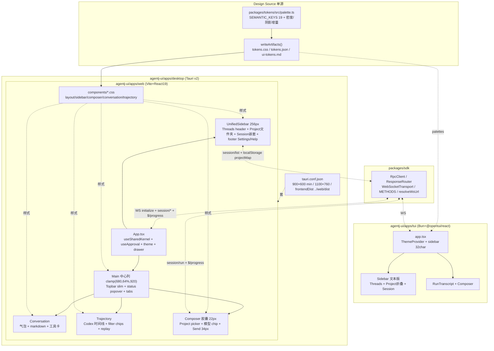
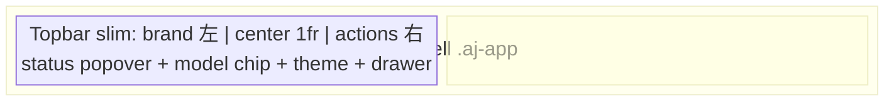
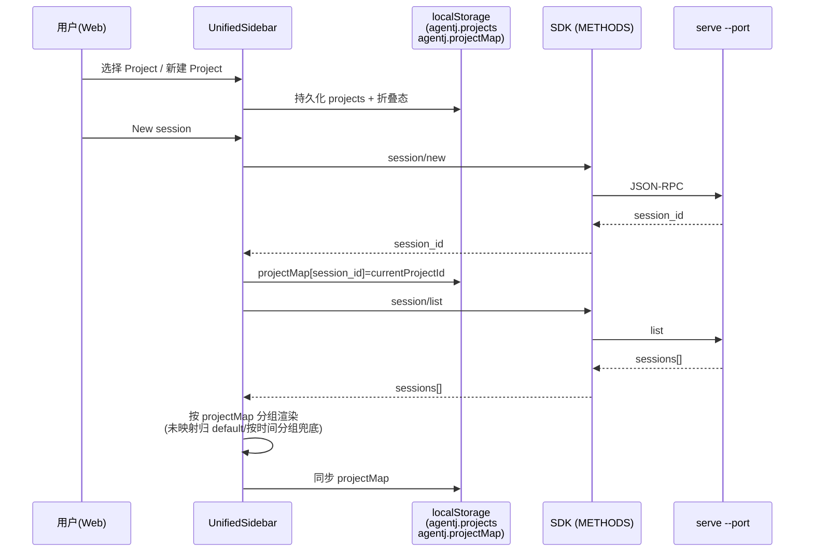

# 设计文档：agentj-ui 对标 Opencode 桌面端全量重设计（Visual 2.2, 0.13.0）

> 基于 Opencode 桌面端 Codex-style 统一侧栏调研 + `agentj-ui` 现状差距诊断，对 `agentj-ui` 三端做全量视觉与布局重设计。后端零改造，`PROTOCOL_VERSION 0.12.1` 冻结。

## 概述

`v0.12.3 Visual 2.1` 已完成 Web 精细化（`tokens 19 keys` + 悬浮胶囊 composer + 卡片化会话/连接 + trajectory timeline + DeepSeek-blue `#4176E6/#679EFE` 单源），但与 Opencode 桌面端预期仍有显著差距：

- **侧栏**：当前 `280px` 双段式（`favorites` 置顶 + `recent` 列表扁平），Opencode 已演进为 **Codex-style 统一侧栏 256px**（`Threads` header + 可折叠 Project/Workspace 文件夹行 + Session 嵌套 + 底栏 Settings/Help）。
- **密度与质感**：现有 `shadowSoft/hairline/16px gap` 仍偏“线框”，Opencode 为更克制的 **灰阶分层 + 0.5px hairline + 8/12/16 紧凑密度 + 更克制阴影**。
- **Composer**：现有为单 `textarea + Plan chip + Send`，Opencode 含 **Project picker / branch 指示 / MCP connecting 状态 / status popover**，与侧栏联动。
- **三端一致性**：TUI 侧栏仍为简单列表、Desktop 壳仅套 `web/dist` 无窗口质感联动。

本次 **Visual 2.2（0.13.0）** 以 **混合保留（方案 B）** 为基线：**布局与交互完全对标 Opencode 桌面**（统一侧栏、Threads、分级收纳、底栏），**色板保留 DeepSeek-blue 主色**仅将阴影/密度/边框语言向 Opencode 靠拢（不全切近黑/蜜桃橙），`tokens` 增量而非重写，三端一次对齐。

本设计只定 WHAT 与 WHY；任务级 TDD 拆分归实现计划（`/jskill-feature-plan`）阶段。

## 调研摘要（一手事实）

### Opencode 桌面参照（源码/PR 级事实）

| 维度 | Opencode 桌面（Codex-style, 2026-03-31 PR #20242 基准） |
|---|---|
| 侧栏宽度 | 从 `64px rail + 右 panel` 重构为 **统一 256px** 侧栏（`sidebar-shell.tsx` + `sidebar-project.tsx`） |
| 结构 | `Threads` header（Filter / Sort / View / Add Project） + **可折叠 Project 文件夹行**（chevron + folder icon + name + count）→ Workspace 子文件夹 → Session 列表嵌套；底栏 `Settings / Help` 带文本标签 |
| 布局 | 移除右 panel/peek/resize handle，`layout.tsx` 重算桌面侧栏尺寸与偏移；拖拽项目重排保留 |
| Composer | `project picker + add-project + branch 指示 + custom-agent picker`（`prompt-input.tsx` + `submit.ts`），`status popover`（`status-popover.tsx`）分 server/directory 双态，MCP `connecting` 非阻塞 |
| 视觉 | 近黑 `#0a0a0a` 12 级灰阶、无边框、蜜桃橙 `#fab283` 主强调、紫 `#9d7cd8` 次强调（与 DeepSeek 蓝系差异显著） |
| 交互 | 家庭页空状态/搜索态、选中状态高亮、启动期减少 fanout、MCP 非阻塞串行启动 |

### agentj 现状差距

1. **Web**（`apps/web`）：`aj-session-rail 280px` + `aj-main clamp(680,64%,920)` 居中列 + 顶栏 `grid [brand 1fr actions]` + `aj-composer-card 22px + shadowRaised + sticky bottom:16px` + `lucide 16px` 体系已具备，但侧栏仍为扁平列表（`favorites → recent`）、无 Threads header、无可折叠 Project、工作空间概念缺失、底栏无 Settings/Help、`modules` 仍在 popover。
2. **TUI**（`apps/tui`）：`ThemeProvider` 消费 `@agentj/tokens` 19 keys 但仅用于状态色与行色；`SessionList` 为单列 `▶ active` 列表，无 Project 分组；`ConnectionManager` 已有 403 停重连与指数退避 30s 上限。
3. **Desktop**（`apps/desktop`）：`tauri.conf.json` `minWidth 900 / minHeight 600 / 1100×760` + `frontendDist ../../web/dist` 壳约束；`src-tauri/Cargo.toml` 版本需与 `sdk/config.ts 0.12.3` 同步；视觉 = web，无额外窗口质感。
4. **协议**：`PROTOCOL_VERSION 0.12.1` 冻结，`METHODS 18 个`（`session/list/history` 已齐），后端零改造约束下 Project 只能前端本地映射。

## 目标与非目标

### 目标

- **G1 统一侧栏（P0）**：Web 侧栏从 `280px 扁平` 重构为 **Opencode Codex-style 统一 256px**：`Threads` header（搜索 + Filter/Sort/View + Add Project）+ **可折叠 Project 文件夹行**（chevron + folder + name + session count）+ Workspace 次级折叠 + Session 嵌套 + 底栏 `Settings / Help`（文本标签 + lucide 图标），与现有 `favorites/stale` 语义融合（Favorites 置顶区保留但收进文件夹视图）。
- **G2 本地 Project 映射（P0）**：不改后端/协议，前端 `localStorage` 新增 `agentj.projects`（`{id, name, sessionIds[]}`）与 `agentj.projectMap`（`session_id → project_id`），`session/new` 时归入当前选中 Project（或 `default`），`session/list` 拉取后按映射分组；支持新建/重命名/折叠状态持久化。
- **G3 视觉密度向 Opencode 靠拢（P1）**：保留 `DeepSeek-blue #4176E6/#679EFE` 主强调色，`tokens` 在 19 keys 上增量 **密度/阴影/边框** 细化：侧栏灰阶更克制（`sidebar` 微调）、`hairline 0.5px` 统一、`gap 8/12/16` 紧凑化、`shadowSoft` 更克制（`0 4px 16px rgba(0,0,0,.06)` 档位新增）、`radius` 保持 `22px` 胶囊；`light` 仍默认，`dark` 质感拉齐（不切近黑）。
- **G4 Composer 增强（P1）**：胶囊形态保留 `22px + shadow + sticky`，新增 **Project 选择器**（下拉显示当前 Project + 新建入口）+ **模型只读 chip**（`kernel/status.default_model`）+ **状态入口**（连接态/MCP connecting 复用 `status popover` 简化版）；`@补全 / /palette` 能力向 TUI 看齐（前端本地）。
- **G5 三端对齐（P2）**：TUI 侧栏同步为 **文本版统一侧栏**（`32 字符 ≈256px/8`，`box border` + `▶/▼` 折叠 + `Threads` header + 底栏 `Settings/Help`），复用 `palettes` 19 keys；Desktop 壳窗口参数不变（`900×600 min`），图标/标题随 DeepSeek-blue 保持，仅随 Web 产物更新。
- **G6 可访问性与性能（P2）**：侧栏折叠/搜索/筛选全键盘可达（`Tab` 顺序与视觉一致、`aria-expanded`、`aria-label`），`prefers-reduced-motion` 关闭动效，`CLS <0.1`（`composer` 高度预留），列表 `virtualize` 阈值 50+。

### 非目标

- ❌ 不改 Rust 后端（`agentj-protocol/core/session/ipc`）与 `PROTOCOL_VERSION`，不新增 protocol 方法（Project 仅前端本地）。
- ❌ 不引入 Tailwind / shadcn / antd 等重组件库（继续纯 CSS + `components/*.css` 模块化，`lucide-react` 唯一图标库）。
- ❌ 不做后端 Project 存储/多项目文件树/分支选择（Opencode 的 branch/worktree 能力另起 feature）。
- ❌ 不做 WSS/TLS、HTTP REST、CORS、速率限流、移动端安装包。
- ❌ 不全切 Opencode 近黑/蜜桃橙色板（本次为混合保留，DeepSeek-blue 仍为品牌主色）。

## 设计方案（选定的整体路线：方案 B 混合保留）

**布局完全对标 Opencode，色板混合保留**：侧栏、Threads、文件夹收纳、底栏、Composer 增强均按 Opencode Codex-style 实现；色板保留 `DeepSeek-blue #4176E6/#679EFE` 与 `19 keys` 单源，仅将 **密度/阴影/边框/灰阶** 向 Opencode 克制质感靠拢（增量 tokens，不重写）。

### 备选方案

| 方案 | 优点 | 缺点 | 为何未选用 |
|------|------|------|-----------|
| A 完全复刻（废弃蓝切近黑/橙） | 视觉 100% 贴近 Opencode，满足“差距很大”直觉 | 需全量替换 `palette.ts` 19 keys + `favicon/icon` + `docs/ui-tokens.md` + 主题快照，破坏已沉淀的 DeepSeek-blue 品牌与 light 默认，工作量与回归风险最大 | 用户终选 B，A 作为备选保留 |
| **B 混合保留（选用）** | 布局 100% 对齐 Opencode，色板保留蓝仅优化质感，tokens 增量向后兼容，风险与工作量可控，质感提升显著 | 无法 100% 复刻 Opencode OLED 深黑质感（有意为之） | **选中** |
| C 渐进精修（仅改侧栏宽度） | 改动最小、低风险 | 仅 `280→256` 与分组，无 Threads/底栏/Composer 增强，无法弥补质感鸿沟 | 投入产出比差 |

## 架构

### 总体架构

### 布局（Web）

关键参数：侧栏 **256px**（`--aj-sidebar-width:256px`，原 280px -24px），`gap 12px`（原 16px 向紧凑靠拢），`Main` 仍 `clamp(680,64%,920) + max 960` 居中；Composer `max 760 + radiusXl 22px + shadowSoft(克制档) + sticky bottom:16px` 形态保留，仅内部增加 Project picker；断点 `768/1024`（`≥1024` 侧栏常驻，`<1024` 抽屉 + `scrim .24`），`z-drawer 40 / z-dialog 100` 不变。

### 数据流（Project 本地映射）

## 关键设计决策

**D1 侧栏 256px 统一化（P0）**
- 宽度从 `280px → 256px`（`--aj-sidebar-width:256px`），与 Opencode `sidebar-shell.tsx 256px` 对齐；`aj-session-rail` 重命名为 `aj-sidebar`（保留兼容类名重定向），`layout.css` 改 `width:var(--aj-sidebar-width)`。
- Threads header：`Threads` 标题 `14px/600` + 右侧工具组 `Filter / Sort / View (icon 16px)` + `+ Add Project`（`lucide Plus` 16px，`32×32` 触点）；搜索框沿用 `aj-session-search` 但上移至 header 内（`Search 16px`）。
- Project 文件夹行：`button aj-project-row`（`height 36px + gap 8px + padding 8px 10px + hover var(--aj-raised)`），含 `ChevronRight/ChevronDown 16px`（`aria-expanded`）+ `Folder/FolderOpen 16px` + `name 13px/600` + `count 12px textCaption`；点击折叠（`localStorage agentj.projectCollapsed`）。
- Workspace 层级：本次为次级缩进文件夹（`padding-left 20px`），数据仍扁平，仅 UI 缩进（为后续后端 Workspace 预留）。
- Session 嵌套：`aj-session-row 10px/12px` 保留 `dot + id + preview + time`，但缩进至 Project 内（`padding-left 28px`），`active` 态 `left 2px accent` 改为 `background var(--aj-raised) + border-left 2px accent`（与文件夹层级视觉一致）。
- 底栏：`footer aj-sidebar-footer`（`border-top 0.5px hairline + padding 10px + gap 8px`），`Settings (Settings 16px) / Help (HelpCircle 16px)` 文本按钮（`12px/600 textMuted → hover text`）。

**D2 本地 Project 模型（P0）**
- 存储键：`agentj.projects = [{id, name, createdAt}]`（`id = slug(name)+timestamp`），`agentj.projectMap = {session_id: project_id}`，`agentj.projectCollapsed = {project_id: boolean}`。
- 默认 Project：`default`（`name: Inbox`）；未映射 session 归 `default`，并在 `default` 内按时间分组（Today / Previous 7 days / Older，复用 `formatRelative`）。
- 新建：`Add Project` → `prompt(name)` → 创建 Project 并设为 `currentProjectId`（`localStorage agentj.currentProject`）；`New session` 时自动归入 `currentProjectId`。
- 兼容：`favorites` 仍支持（`Star`），在统一侧栏中 Favorites 作为顶部分组（`Star 16px` header）保留，与 Project 分组并列（不移除现有键）。
- 后端零改造：`session/list` 仍扁平拉取，分组纯前端；`session/history` 等不变。

**D3 视觉密度与 tokens 增量（P1）**
- 保留 `DeepSeek-blue #4176E6/#679EFE` 与 19 keys（`bg/sidebar/panel/raised/text/textMuted/accent/accentOnAccent/userBubble/border/codeBg/inlineCodeBg/success/error/warning/shadowSoft/shadowRaised/radiusXl/textCaption`）。
- 增量变量（`index.css`）：`--aj-sidebar-width:256px`、`--aj-gap:12px`（原 16px，侧栏与主区 gap 收紧）、`--aj-shadow-soft-sm: 0 4px 16px rgba(0,0,0,.06)`（更克制档，侧栏/卡片用，小于现有 `shadowSoft 0 8px 24px .08`）、`--aj-sidebar-bg-diff: color-mix(in srgb, var(--aj-sidebar) 98%, transparent)`（灰阶更克制）。
- 颜色：不切近黑，`sidebar #F9FAFB / #1B1B1C` 保持，仅 `border #E4E7EA/#2E2E31` 与 `hairline` 更强调（`box-shadow 0 0 0 0.5px var(--aj-border)` 全量应用）。
- 密度：侧栏行高 `36px`（原 40px），搜索框 `36px`，`gap 8/12/16` 紧凑；主区 `Main gap 10px` 保持。
- `palette.ts` 不新增语义 key（避免 `SEMANTIC_KEYS` 漂移），仅 `index.css` 增量 vars + `layout/sidebar.css` 消费。

**D4 Composer 增强（P1）**
- 形态：`aj-composer-card` 保留 `radiusXl 22px + shadowRaised + hairline + sticky bottom:16px + max 760px`，`textarea#aj-prompt min-height 44px` 与 `Send 34px` 不变。
- 新增：`aj-composer__header`（`Project picker` 下拉：`Folder 16px + currentProjectName 13px/600 + ChevronDown 16px`，点击弹出 `Project list + New Project`）；模型 chip 移入 composer 头部（`modelName 12px` 复用 `aj-chip--model`）；`Plan` chip 保留。
- 状态入口：`status popover` 简化版（`MoreHorizontal 16px` 触发，复用现有 `aj-popover`，内容为 `modules[]` + `connectionLight` + `MCP connecting` 文案，Opencode `status-popover` 的 server/directory 双态简化为单态）。
- 交互：Project 切换仅改 `currentProjectId`（不触发重连），`New session` 归入当前 Project；`@`/`/` 能力前端本地（与 TUI `@补全 //palette` 一致，不新增后端）。

**D5 TUI 文本版统一侧栏（P2）**
- 宽度 `32 字符`（`256px / 8 ≈ 32`），`box` 布局：`header Threads + filter/search` → `project 折叠列表（▶/▼ + folder 名 + count）` → `session 嵌套（缩进 2 字符 + ● active）` → `footer Settings/Help`。
- 复用 `palettes` 19 keys（`palette.sidebar/accent/textMuted` 等），`rowColor` 与 `statusColor` 语义不变；折叠态持久化复用 `~/.config/agentj/projects.json`（新增，与 `theme.json` 同目录）。
- 快捷键：`j/k` 上下，`h/l` 折叠/展开，`enter` 选中 session，`n` 新建 session 归入当前 Project。

**D6 Desktop 壳（P2）**
- `tauri.conf.json` 窗口 `minWidth 900 / minHeight 600 / 1100×760` 不变，`frontendDist ../../web/dist` 不变，`security.csp null` 不变；仅随 Web 产物更新与 `version 0.13.0` 同步（`src-tauri/Cargo.toml` 需同步 bump）。
- 图标 `assets/app-icon.png 1024×1024` 保持 DeepSeek-blue 系（不切近黑/橙），`check-desktop-ui.mjs` 门禁（PNG magic / 尺寸）不变。

**D7 风格锚点**
- 对标 `Minimalism & Swiss Style (variance 3-4, density 5-6 紧凑)`，`dark-mode` 克制阴影与 `0.5px hairline` 体系，与 `v0.12.1` 锚点一致，仅密度向 Opencode 紧凑化（`4-5 → 5-6`）。

## 组件设计

**UnifiedSidebar（Web）**
- Props：`wsUrl, client, activeSessionId, onActiveChange, currentProjectId, onProjectChange`；内部 `projects / projectMap / collapsed / query` 状态（`localStorage` 持久化）。
- 渲染：`Threads header` → `Project 文件夹列表（可折叠）` → `Session 嵌套（indent）` → `footer Settings/Help`；搜索 `query` 过滤 `id + preview`（复用 `filteredRows` 逻辑但按 Project 分组）。
- 交互：`Chevron` 切换 `collapsed`，`Project row` 点击展开/收起；`Session row` 点击 `continueSession(id)` 并 `setProjectMap`；`Add Project` 新建并选中；`Clear` 清空 `favorites/stale` 与 `projectMap`。

**App Shell**
- `Topbar slim`：`brand h1 16px/700 + status-light 8px` 左，`center 1fr` 保留，`actions` 精简为 `model chip + status popover trigger + theme + drawer toggle`（`modules` 从 `MoreHorizontal` popover 移至 `status popover` 内，顶栏更瘦）。
- `Layout`：`gap 12px`，`sidebar 256px`，`main clamp(680,64%,920) + max 960 居中`，`drawer <1024` 逻辑保留（`translateX -100% + scrim .24`）。

**Composer / Conversation / Trajectory**
- Composer：`aj-composer-card` 内部新增 `aj-composer__header`（Project picker + model chip），其余 `textarea + toolbar + Send` 保留。
- Conversation：`aj-conv gap 10 → 8px`（密度收紧），`bubble-user 78% + radiusXl` 与 `ai border-left 2px accent` 保留，`ToolCard` 密度微调（`padding 8→6px`）。
- Trajectory：`filter chips` 复用，但增加 `Project` 维度筛选（前端本地按 `projectMap` 过滤）。

## 错误处理

| 场景 | 行为 |
|------|------|
| `localStorage` 异常（`projects/projectMap` 解析失败） | 回退 `default` Project，扁平列表仍可用，不阻塞 `session/list` |
| `session/list` 失败 | 侧栏显示 `No sessions yet` + `New session`，`projectMap` 不更新，不 crash |
| `currentProjectId` 指向不存在 Project | 自动回退 `default` 并清理 `agentj.currentProject` |
| `project name` 为空/重复 | `Add Project` 校验非空，去重（`name` 已存在则追加后缀） |
| 断线/403（`unreachable`） | `status popover` 红态 + `status-light warning`，侧栏置灰但仍可浏览本地缓存列表 |
| `prefers-reduced-motion` | 关闭所有 `transform/transition`（`layout/sidebar` 抽屉动效禁用） |
| 未知 `projectMap` 条目 | 忽略，回退 `default` 分组 |

## 测试策略

- **存量门禁**：`cargo test/clippy/fmt + drift + check-version.sh + sdk 29 + web 71 + tui 63 + desktop-ui-ok`，`npm --prefix agentj-ui test --workspace=@agentj/web` 与 `run build --workspace=@agentj/web` 必须通过；`vitest` 新增 `UnifiedSidebar` 单测不破坏现有 `session/list` 契约（`role/label` 保留）。
- **新增单测**：
  - `UnifiedSidebar.test.tsx`：Threads header 渲染、256px 宽度断言、Project 折叠/展开、`Add Project` 持久化、搜索过滤、Session 嵌套缩进、`active` 高亮、`footer Settings/Help` 存在。
  - `projectMap.test.ts`：`localStorage` 读写、回退 `default`、`clear` 行为。
  - `composer.test.tsx`：Project picker 下拉、模型 chip 只读展示、`status popover` 触发。
  - `palette.test.ts`：`SEMANTIC_KEYS` 仍 19 keys，无裸 hex（`var(--aj-*)` 约束）。
  - `layout.test.ts`：`--aj-sidebar-width 256px` 与 `gap 12px` 变量断言。
- **TUI**：`sidebar.test.tsx`（`testRender` + `pressKey` 折叠/选择）、`theme` 持久化新增 `projects.json`。
- **Desktop**：`check-desktop-ui.mjs` 窗口 `900/600/1100/760` 断言不变，`tauri.conf` 版本同步 `0.13.0`。
- **手动**：`vite preview` 截图对比 `light/dark @ 375/768/1024` + `keyboard Tab` 全链路 + `contrast 4.5:1` 抽检 + `prefers-reduced-motion`。

## 依赖

- **前置**：`v0.12.3`（`tokens 19 keys + lucide 0.462.0 + react-markdown` 已齐，`sdk 0.12.3 / PROTOCOL_VERSION 0.12.1`）。
- **外部**：无新增依赖（`lucide-react` 已有 `Folder/FolderOpen/ChevronRight/ChevronDown/Plus/Settings/HelpCircle/Search` 等图标全覆盖，不新增）。
- **阻塞**：无后端阻塞，纯 `agentj-ui` 增量；`@agentj/tokens` 生成链为第一门（但本次不改 `palette.ts` 语义 key，仅 `index.css` vars）。
- **版本**：`0.12.3 → 0.13.0`（feature minor；`Cargo + sdk/config + desktop/tauri.conf/src-tauri/Cargo` 四处同源，`PROTOCOL_VERSION` 保持 `0.12.1`）。

## 产出与验收

- 交付物：`UnifiedSidebar 256px` + `Threads header` + `Project 文件夹体系（前端本地）` + `底栏 Settings/Help` + `Composer Project picker + status popover` + `TUI 文本版侧栏` + `Desktop 随产物更新` + `tokens 密度/阴影 vars` 增量。
- 验收：`theme/ui-tokens` 门禁 + `vite build 278 modules` + 手动三主题三断点截图，`ui-ux-pro-max P1-P5` checklist 全绿（统一侧栏 256px、Threads、分级收纳、底栏、Project picker）。

## TODO 清单（plan 阶段逐期勾选）

- [x] T0 tokens 增量（`--aj-sidebar-width 256px + --aj-gap 12px + --aj-shadow-soft-sm + sidebar bg diff`，`SEMANTIC_KEYS` 保持 19）
- [x] T1 UnifiedSidebar 壳（`256px + Threads header + 搜索 + Filter/Sort/View + Add Project + footer Settings/Help`，`layout.css → sidebar.css` 拆分）
- [x] T2 Project 本地模型（`agentj.projects / projectMap / collapsed / currentProject`，`session/new` 归属，`session/list` 分组渲染）
- [x] T3 App Shell 瘦身（`Topbar` 精简 + `status popover` 简化版 + `Main gap 12 + centered clamp`）
- [x] T4 Composer 增强（`Project picker + 模型 chip + 状态入口`，`composer.css` 头部增量）
- [x] T5 Conversation/Trajectory 密度收紧（`gap 8 + padding 6`，Trajectory 按 Project 筛选）
- [x] T6 TUI 文本版统一侧栏（`32char + Threads + 折叠 + 底栏`，`projects.json` 持久化）
- [x] T7 Desktop 版本同步（`0.13.0 tauri.conf/src-tauri/Cargo + check-desktop-ui`）
- [x] T8 全量门禁与文档同步（`cargo test/clippy/drift + web/tui build + version.sh + AGENTS.md/README.md/summary`）

