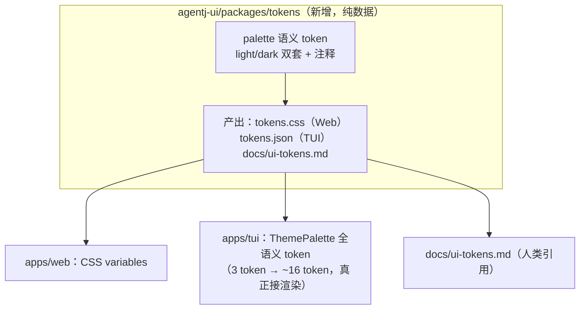
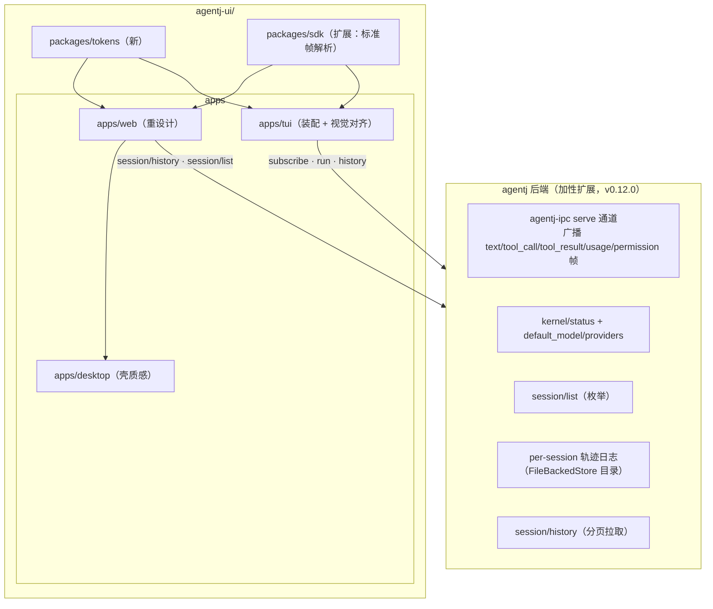
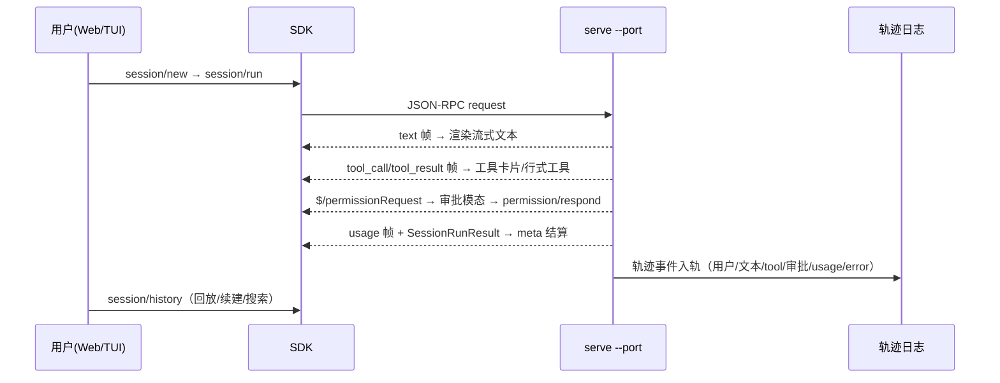
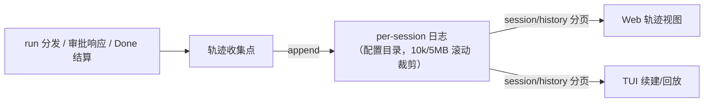

# 设计文档：agentj 三端统一 UI 视觉设计（AgentJ UI 2.0）

> **状态**：设计中（待用户终审）。前置决策（brainstorming 逐项确认）：
> 范围=三端一次做完；方案 A（同源 token 架构、分端裁切组件语言）；
> 强调色=DeepSeek 蓝（`#4176E6`/`#679EFE`），Web 参照 DeepSeek harness、
> TUI 参照 OpenCode；后端一并加性补齐（工具/usage/审批帧广播、
> `kernel/status` 模型字段、`session/list`、完整可回放轨迹）；
> Web 布局=双栏+对话/轨迹双视图；消息=用户气泡+工具卡片（B）、
> 审批=语义化行（A）；TUI=OpenCode 移植（竖条+行式工具+meta 行）；
> 轨迹=分步时间线+搜索/筛选/回放（A）；色板=deepsuite 官方值 + P2 蓝主按钮。

## 概述

agentj v0.11.1 已交付三端（Web / TUI / Desktop）的**功能面**——上一版设计
（`2026-09-05-agentj-ui-design.md`）明确将「Web 视觉重设计」列为非目标，TUI
主题系统未接渲染、主入口未装配 transcript/composer/usage，Desktop 为零定制壳。
本次为**视觉与交互体验设计阶段**：以 OpenCode 的 TUI/客户端风格为基准补齐
agentj 的 TUI 与客户端，以 DeepSeek harness（官方开源 agent 框架 "dsh"，其
Web UI 与 chat.deepseek.com 同源 deepsuite 设计体系）为参照设计 Web UI；
并一次性补齐三端视觉所依赖的**后端加性数据面**（工具/usage/审批事件帧、
`session/list`、`kernel/status` 模型字段、per-session 轨迹日志与 `session/history`），
使 UI 消费真实数据、轨迹可完整回放。

本设计只定 WHAT 与 WHY；任务级 TDD 拆分归实现计划（`/jskill-feature-plan`）阶段。

## 调研摘要（一手事实）

### 参照风格（源码级色值，来自外部调研）

| 维度 | OpenCode（TUI 与 Web/Desktop 客户端） | DeepSeek Harness Web（deepsuite 体系） |
|---|---|---|
| 底色 | 近黑 `#0a0a0a`，12 级灰阶分层、几乎无边框 | 白 `#FFFFFF` / 深 `#151517`，hairline 0.5px |
| 强调色 | 蜜桃橙 `#fab283`（primary），紫 `#9d7cd8` 次强调 | 品牌蓝 `#4176E6`（dark `#679EFE`），浅色主按钮反色近黑 |
| 布局 | TUI 无侧栏：消息流贴底 + footer composer；会话切换弹 dialog；Web/桌面才用左会话栏 + 右 Review/文件面板 | 左会话栏 + 中央对话 + **工具调用时间线摊开** + Trajectory 回放/搜索 |
| 消息区分 | 用户消息=左侧竖条（agent 色）+ 面板底；AI 无容器裸排；meta 行 `▣ 模式 · model · 耗时` | 用户消息=浅蓝气泡（light `#EDF3FE`/dark `#2C2C2E`）；AI 无气泡 |
| 工具呈现 | 行式：`✓/│/✗` 状态字 + 友好名；输出折叠 ≤3 行；审批=warning 橙 | 卡片/条目摊开在时间线，输出内嵌 |
| 细节 | 自动贴底滚动、键位提示单行、reduced-motion | superellipse(1.5) 圆角、0.2s `cubic-bezier(0.4,0,0.2,1)`、状态色 1px 实边 |

### agentj 现状差距（内部调研）

1. **Web**（`apps/web`）：零样式落地（控件走 UA 默认、无 spacing/radius 体系）、
   布局无响应式（`#root` 定宽 1126px + `text-align:center`、flex 不换行）、
   审批弹窗非模态（无 overlay/fixed）、feed 纯文本逐 token 成行；
   无 markdown/工具层级/气泡。现有 `index.css` token 骨架为品牌紫
   `#aa3bff`/favicon `#863bff`+青 `#47bfff`（本次决策改蓝，见 D2）。
2. **TUI**（`apps/tui`）：组件齐备但**主入口未装配**（app.tsx 仅到会话列表+3 行状态）；
   主题系统仅 3 token（dark `#1a1b26/#c0caf5/#7aa2f7`，Tokyo Night 系）且**不被渲染消费**；
   progress 消费与真实 wire 形态错位（runview 不解析 `{token,value:{kind,delta}}`，
   mock 用平铺 `{session_id,text}`，与后端及 schema 三方不一致）。
3. **Desktop**（`apps/desktop`）：最小 Tauri 壳——无 minSize/无标题栏定制/无主题联动，
   视觉完全 = web 产物。
4. **协议面**：`$/progress` 的 `tool_call/tool_result` 帧类型 schema 早已定义
   （33 schemas），但 serve 通道运行时只广播 text 帧（ToolCall/ToolResult 事件被吞），
   usage 仅在 run 响应出现；`kernel/status` 不返回 `default_model/providers`
   （TUI 模型选择器恒走硬编码兜底）；无 `session/list`（Web localStorage/TUI 文件补丁）。

## 目标与非目标

### 目标

- **G1**：`packages/tokens` 三端设计 token 单一来源（CSS 变量 + JSON + 文档），
  dark/light 双套；品牌强调色切换为 DeepSeek 蓝系（favicon/图标/标题同步）。
- **G2**：Web 视觉重设计——双栏布局（左会话栏 + 中央对话/轨迹双 Tab）、
  用户浅蓝气泡 + AI markdown 裸排、工具卡片（✓/│/✗/△ 四态、输出/错误内嵌）、
  meta 结算行、语义化审批模态（可完整审查参数）、状态灯与横幅语义化、
  响应式（≥900 双栏 / <900 抽屉 / <480 降级）、主题跟随系统 + 手动切换。
- **G3**：TUI 对齐 OpenCode 终端语言并**完成装配**——app.tsx 接
  transcript/composer/usage；progress 按标准 kind 帧解析；用户消息蓝竖条、
  AI 裸排、行式工具、meta 行、语义色状态行；主题系统扩展为全语义 token
  并真正接入渲染。
- **G4**：Desktop 壳质感——minSize、窗口主题联动、蓝系图标；视觉随 web。
- **G5**：后端加性补齐（见「后端加性接口」节）——serve 通道广播
  `tool_call/tool_result/usage/permission` 帧；`kernel/status` 增
  `default_model/providers`；新增 `session/list`；per-session 轨迹事件日志 +
  `session/history` 分页拉取（完整可回放）。
- **G6**：Web 轨迹视图（分步时间线 + 搜索/筛选/▶回放）；继续会话时从
  `session/history` 重建对话与轨迹（消除「凭 id 继续后无历史」空白）。

### 非目标

- ❌ 右侧文件浏览/上下文面板（OpenCode Web 三栏的右栏；需后端 FS 浏览方法，另起 feature）。
- ❌ 交互式模型下发（`session/run.model` 覆盖，NEXT-VERSION 已记录）；本期只读展示。
- ❌ WSS/TLS、HTTP REST、CORS、速率限流、移动端安装包、cargo-dist。
- ❌ Electron/换壳（Tauri v2 已覆盖）。
- ❌ 后端协议破坏性变更（16 方法面冻结，仅加性扩展）。
- ❌ 引入 Tailwind/组件库（Web 继续纯 CSS + CSS 嵌套；TUI 不换渲染库）。

## 设计方案（选定的整体路线：方案 A）

**同源 token 架构 + 分端裁切组件语言**：一份 token 体系贯通三端，每端按媒介
特性采用参照系的组件语法——Web 用 DeepSeek harness 的会话栏/气泡/工具时间线，
TUI 用 OpenCode 的贴底消息流/行式工具/footer composer，Desktop 视觉 = Web。

### 备选方案

| 方案 | 优点 | 缺点 | 为何未选用 |
|------|------|------|-----------|
| B. 全盘 dsh 化（TUI 也用气泡/卡片/圆角） | 三端观感完全一致 | 与点名参照「TUI 按 OpenCode」矛盾；终端气泡/圆角低密度、OpenTUI 渲染成本高 | 用户选 A |
| C. 双轨独立（Web 一套 / TUI+Desktop 另一套，不共享 token） | 两套可各自极致 | 观感割裂、双份维护，违「三端统一」叙事；Desktop 视觉=web 天然无法独立 | 用户选 A |

### 关键设计决策（brainstorming 逐项确认）

- **D1 — 范围**：三端统一视觉设计一次做完（实施在 plan 阶段分期 P0-P4）。
- **D2 — 品牌强调色 = DeepSeek 蓝**：全三端 accent/primary 改 `#4176E6`
  （dark `#679EFE`）；favicon/图标/窗口图标同步蓝系，清除品牌紫残留。
- **D3 — Web 布局 = 双栏 + 对话/轨迹双 Tab**：左会话栏（`session/list` 真实
  列表，localStorage 收藏降级为「置顶」UI 层，存储键契约不动）+ 中央列
  「对话 | 轨迹」切换；不设右栏（非目标）。
- **D4 — 对话区消息语言 = dsh 气泡 + 工具卡片（B 方案）**：用户消息浅蓝气泡
  （light `#EAF1FE`/dark `#2C2C2E`，AI 无气泡 markdown 裸排；工具调用为
  卡片（✓/│/✗/△ 状态字 + 工具名 + 输出/错误/审批入口内嵌，默认展开
  输出 ≤3 行可点击全文）。卡片语言同时作为轨迹视图的回放条目，两层复用。
- **D5 — 审批弹窗 = 语义化行（A 方案）**：工具字段映射可读行（write→文件/
  内容、bash→命令/超时…），长内容默认折叠可展开全文（修复 200 字符截断
  不可完整审查的硬伤）；未知字段回退原始 JSON 行；allow_always 为底部复选
  防误触；Allow=主蓝按钮 / Deny=次级 / 错误态红。
- **D6 — TUI = OpenCode 移植（A 方案）**：顶状态行（连接态/会话/模型/主题）
  → transcript（用户蓝竖条+面板底、AI 裸排、工具行式、meta 结算行）→
  footer composer（@ 补全、/ palette、Esc 清空）→ 最底键位提示行；
  审批/模型/palette 为居中模态。主入口完成装配。
- **D7 — 轨迹 = 分步时间线（A 方案）**：事件节点（用户/思考/工具/审批/usage
  为主干，会话级 error 附加，完整映射见 Web 端页面设计节）保留 run 叙事节奏，
  点节点展开完整 args/输出/决策；顶部搜索（节点全文含 args/输出）+ 类型筛选
  chips + ▶ 回放（自动步进高亮滚动）。文本帧入轨方式：增量文本合并为「思考」
  节点，工具帧全量入轨。
- **D8 — 色板与主按钮（P2）**：色值以 deepsuite 官方 token 为准（见下表），
  但主按钮语义取 P2——Allow/发送/连接一律主蓝 `#4176E6`（dark `#679EFE`），
  不采用 dsh「浅色主按钮近黑反色」的 P1 正典（保留灰阶/侧栏/圆角/气泡规则）。
- **D9 — 后端一并补齐**：见「后端加性接口」节（G5）。原则：加性纪律、
  TS/旧客户端容忍未知字段与 kind、33 schemas 重生成 + drift 门禁前置。

## 视觉语言与设计 token 体系

### 色板（deepsuite 官方值为准 + P2 按钮语义）

| token 语义 | Light | Dark | 说明 |
|---|---|---|---|
| bg（页面底） | `#FFFFFF` | `#151517` | |
| sidebar-fill | `#F9FAFB` | `#1B1B1C` | 左会话栏底 |
| layer（抬升层） | `#FFFFFF`/`#E9EDF1` | `#232324`/`#2C2C2E` | 卡片/浮层底（浮层加 shadow，不再深一档色） |
| text（主文字） | `#0F1115` | `#F9FAFB` | |
| text-muted | `#61666B` | `#CFD3D6` | 次级/时间/元信息 |
| accent（主蓝，链接/焦点/选中） | `#4176E6` | `#679EFE` | D2/D8 |
| 主按钮填充（CTA） | `#4176E6` | `#679EFE` | P2 决策（非 P1 反色） |
| 用户气泡底 | `#EAF1FE` | `#2C2C2E` | dsh `#EDF3FE` 的蓝 tint 调整 |
| 边框（hairline 0.5px） | `#CBD2DB` | `#2E2E31` | 状态色边框才 1px 实线 |
| 成功 / 错误 / 警告 | `#22C55E` / `#EC1313` / `#F59E0B` | 同（错误 `#F25A5A`） | |
| 代码块底 / 行内代码底 | `#F9FAFB` / `#FAFAFA`\* | `#1B1B1C` / `#292929`\* | |

\* 行内代码底色为代码块底的微调细分值（light `#FAFAFA` / dark `#292929`），按
dsh 分层规则推导；色板屏未单列此项，实现期如需可复核（其余行内代码底/代码
块底值均来自色板屏逐项确认）。

### 排版 / 形状 / 动效

- 字体：Web `system-ui` 栈 + `PingFang SC`/`Segoe UI`/`Microsoft YaHei`
  （中文语境）；代码 `ui-monospace`/`SF Mono`/`JetBrains Mono`/`Consolas`。
- 圆角：superellipse(1.5) 语义（≈ 卡片 10px、控件 6px、chip/胶囊完全圆角）。
- 边框：中性一律 0.5px hairline（画在 box-shadow，随 elevation 柔光），
  状态/焦点色 1px 实线。
- 动效：`cubic-bezier(0.4,0,0.2,1)`，常规 0.2s / 快 0.1s / 慢 0.3s；
  尊重 `prefers-reduced-motion`；键盘焦点可见性为必检。
- 主题：Web `color-scheme` + 手动切换（顶栏入口，localStorage 覆盖系统偏好）；
  TUI 沿用 `theme.json` 机制扩展。

### token 单一来源与三端映射



TUI 主题重构：`ThemePalette` 由 `{background,foreground,accent}` 扩展为全语义键
（bg/sidebar/panel/raised/text/textMuted/border/accent/success/error/warning/
codeBg/…），dark/light 两套，`theme.json` 序列化校验同步升级（旧值仅 "dark"/
"light" 模式串不变，向后兼容）。Web 删除 Vite 模板残留（App.css、.counter 等）。

## 架构



一次 run 的数据流（三端一致，轨迹双写）：



## Web 端页面设计

### 布局与组件树

```
App（useKernel / useApproval 保留，连接状态机语义不变）
├─ TopBar：品牌标 AgentJ · 连接态灯（绿/橙重连/红 403）· 会话范围 · 模型 chip（kernel/status）· 主题切换
├─ SessionRail（≥900px 常驻；<900px 折叠为抽屉按钮）
│   ├─ ＋新建会话 · 凭 id 继续（输入框）
│   ├─ 会话列表（session/list：置顶收藏 + 最近）+ 状态/归档标记
│   └─ 底部：连接设置（地址/端口/token，未连接引导命令 agentj dashboard --port …）
├─ Main（双 Tab：对话 | 轨迹）
│   ├─ Conversation：Timeline（用户气泡 / AI markdown / ToolCard / meta 结算行）+ Composer
│   └─ Trajectory：搜索框 + 类型筛选 chips + ▶ 回放控制 + 节点时间线
└─ ApprovalModal（模态遮罩，语义化行 + 折叠 + allow_always 复选）
```

- **Timeline 视觉规则**：用户消息一律**左对齐**浅蓝气泡（与 dsh 会话体一致，
  非聊天室右侧气泡）；AI 无气泡裸排；同一 run 尾部追加
  `meta 结算行`（模型 · 耗时 · in/out tokens）；自动贴底滚动，向上翻阅可暂停。
- **ToolCard 状态机**：`│` 运行中（骨架脉冲）→ `✓` 成功（输出折叠 ≤3 行）/
  `✗` 失败（错误红、可展开全文）/ `△` 等待审批（模态期间卡片示审批中）。
- **Trajectory 节点**（日志 kind → 展示节点映射）：`user`→用户；`thinking`
  （增量文本按帧合并）→思考；`tool_call`+`tool_result`→**工具节点**（状态由
  result 决定 ✓/│/✗/△，工具卡同款语言）；`permission`→审批节点（工具+决策）；
  `usage`→usage 节点；会话级 `error`→错误节点（红点）。点节点展开细节；
  搜索覆盖 args/输出全文。
- **响应式**：≥900px 双栏；<900px 左栏转抽屉（会话栏按钮）；<480px 工具卡
  降级单行（图标+名+状态）。
- **状态机**（沿用现语义）：未连接 → 已连无会话 → 会话空闲 → 运行中 →
  待审批（模态阻塞）→ 结算；新增「续会话加载中」（session/history 重建）。

## TUI 装配与视觉对齐

- 主入口 `app.tsx` 装配：RunView(transcript) + Composer + RunViewWithUsage
  （组件已存在，测试已覆盖其独立行为）；状态行语义色：connected 绿 / 
  reconnecting 橙 / auth error 红（403 停重试）。
- progress 消费修正：按 `{token,value:{kind,...}}` 标准帧解析（text→追加、
  tool_call/tool_result→行式工具、usage→结算），mock kernel 同步改造为
  标准帧（消除三方格式错位）。
- 视觉（dark/light 全语义 token 接入渲染）：用户消息 `border-left` 蓝竖条 +
  面板底；AI 裸排；工具行 `✓/│/✗/△` + 友好名 + 折叠输出 ≤3 行；meta 结算行
  承接 usage；会话列表/palette/模型列表/审批模态换 token 与蓝 accent。
- 优雅退出 / 断线重连 / 403 停重试语义全部保留；`/palette themes` 真生效。

## Desktop（Tauri 壳）

- `tauri.conf.json`：`minWidth/minHeight`（≥900×600）；窗口 title/图标换蓝系；
  `decorations` 保留系统默认，深浅色由壳内 web 内容 `color-scheme` 决定
  （不引入额外原生联动，保持最小壳原则）；四件套打包与 check-artifacts 不动。
- 壳内无新增 UI（引导页与连接设置全部在 web 内已有）。

## 后端加性接口设计

> 加性纪律：方法面 16 个冻结方法不破坏；新增方法、扩展 result 可选字段、
> 新增通知帧 kind 均向后兼容；TS/SDK 对未知字段与 kind 容忍（忽略不 crash）；
> Rust schemars 重生成 33 schemas → TS 类型 → 现有 schema 漂移门禁测试作为 CI 第一门。

### 1) 通知帧补齐（agentj-ipc dispatch_session_run）

- `AgentEvent::ToolCall/ToolResult` 由 `_ => {}` 吞掉改为广播
  `$/progress {token, value:{kind:"tool_call", tool_call}}` 与
  `{kind:"tool_result", tool_call_id, content}`（schema 类型已备）。
- `ProgressValue` 加性新增 `usage`（随 Done 结算广播，payload=UsageInfo）与
  `permission`（审批决策结果入轨）两个 kind；schema 同步重生成。
- TUI/Web 未知 kind 忽略（与现状 BUG-005 分叉语义一致，不 crash）。

### 2) `kernel/status` 加性字段

- result 增 `default_model: string` 与 `providers: [{id, models:[]}]`
  （可选字段，`skip_serializing_if` 保持兼容）；config 单一来源。
- 消费：Web 顶栏模型 chip、TUI ModelSelector 与状态行 model 段
  （替换硬编码 MODEL_CONFIG 兜底；拉取失败仍回退硬编码）。

### 3) `session/list`（新方法）

- 语义：枚举内核已知会话（FileBackedStore 持久化 + InMemory），
  result 最小集：`[{session_id, updated_at?, state, preview?}]`；
  分页/排序实现细节归 plan 阶段。
- 消费：Web SessionRail 真实列表（localStorage `agentj.favorites` 存储键及其
  stale 失效标记语义保留，降级为「置顶收藏 + 失效置灰」UI 层）；TUI 会话列表同源。

### 4) per-session 轨迹日志 + `session/history`

- 事件模型 `TrajectoryEvent { session_id, seq, ts, kind }`，
  kind ∈ {user, thinking(增量文本合并), tool_call, tool_result, permission,
  usage, error}；在 run 分发路径 + permission respond 路径 + done 结算路径
  收集，追加写入 `FileBackedStore` 同配置目录的 per-session append-only 日志。
- 容量：每会话上限（初值：10k 事件 / 5MB），超出滚动裁剪最旧事件
  （config `[session]` 可配；默认值实现期复核）。
- `session/history { session_id, cursor?, limit? }` → 分页事件序列
  （cursor=seq，向前翻页）；live 追加走既有 `session/subscribe`。
- 消费：轨迹视图（回放/搜索/筛选）、继续会话后的对话重建。
- 失败降级：日志写失败 → live-only + console.warn，不阻断 run（与
  EventGuard/FileBackedStore 现有容错语义一致）。



## 状态机与错误处理

| 场景 | 行为 |
|------|------|
| 内核不可达 | 状态灯橙 + 指数退避重连（沿用），不阻断 UI |
| token 错误（403/-32806） | 状态灯红，停重连，提示检查 token 手动重连 |
| 版本不匹配（initialize） | TopBar 横幅（期望 vs 实际），降级可用 |
| 断线时在途请求 | rejectAll 标记过期；会话区/轨迹置离线态 |
| 断线恢复 | 重连后 `session/history` 续建对话与轨迹（新增收益） |
| 未知 kind/坏帧 | 忽略 + console.debug，不 crash |
| 轨迹日志写失败/容量超限 | live-only + warn；裁剪不阻断 run |
| 审批响应过期/非本端 | 模态内联报错可关闭，不阻塞 run 视图 |
| 凭 id 继续失败（已归档） | 会话栏报错 + 新建按钮，收藏条目标记失效 |
| reduced-motion 偏好 | 关闭动效；键盘焦点可见性必检 |

## 测试策略

- **协议/后端**：schema drift 门禁（重生成 33 schemas 无漂移）；serve 通道
  新帧 e2e（tool_call/tool_result/usage/permission 帧可达、未知 kind 旧端
  容忍）；`session/history` 分页/裁剪单测；`session/list`、kernel/status
  扩展字段单测（skip_serializing_if 缺省兼容）。
- **tokens**：双形态产出一致性（css/json 同值）测试。
- **Web**：现有 role/label/文本契约红线全部保留（调研已列：aj-* id、label
  文案、单文本节点聚合、banner 端口提示等）；新增 Timeline/ToolCard/
  Trajectory/ApprovalModal/主题切换组件测试（mock WS 标准帧驱动）。
- **TUI**：runview 标准帧解析测试（mock 同步标准帧）；主题 token 生效
  断言（此前「切主题不改变像素」用例补齐）；装配后 app 集成测试更新。
- **Desktop**：tauri.conf 断言（minSize/标题）+ 四件套产物校验照旧。
- **验收标准**：Rust 全绿（test/clippy/drift/fmt）+ `npm -ws build/test` +
  `bun test` 全绿 + Web/TUI 手工跑完：一次 run（含工具卡/审批/usage）、
  断线重连、继续会话历史重建、轨迹回放/搜索。

## 依赖与版本分期

- **前置**：Node 24+、Bun ≥1.2、Rust 工具链（Desktop）、可联调 `serve --port`。
- **外部依赖**：Web 新增 `react-markdown` + `remark-gfm`（渲染 AI 消息与工具
  输出；代码块仅样式化、不做语法高亮以免引重型依赖——语法高亮留待后续如有需
  要单独立项）；图标一律内联 SVG（不新增图标库）；无 UI 框架/Tailwind。
- **版本**：`0.11.1 → 0.12.0`（feature minor；Cargo + sdk/config + desktop
  三处同源）。
- **分期建议**（plan 阶段细化 TDD 任务）：
  P0 `packages/tokens` + 品牌蓝切换 → P1 后端加性（帧广播/status/list/
  轨迹日志/history）→ P2 Web 重设计 → P3 TUI 装配对齐 → P4 Desktop + 全量验收。

## NEXT-VERSION 目标（不在本设计实现）

- [ ] 交互式模型下发（`session/run.model` 加性 wire 字段覆盖 default_model）。
- [ ] 右侧文件浏览/上下文面板（后端 FS 浏览方法 + Web 三栏）。
- [ ] 轨迹跨会话聚合视图 / 事件追溯全局日志。

## TODO 清单（plan 阶段逐期勾选）

- [ ] P0 tokens 包 + 品牌蓝
- [ ] P1 后端加性（广播/status/list/轨迹日志/history）
- [ ] P2 Web 重设计
- [ ] P3 TUI 装配对齐
- [ ] P4 Desktop + 验收
