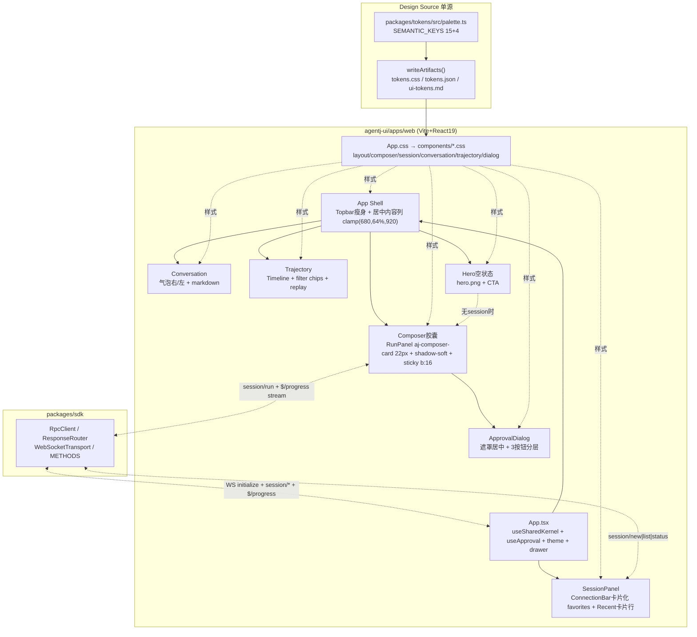
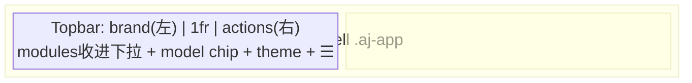

# 设计文档：agentj-ui Web 精细化（Visual 2.1, 0.12.2）

> 基于 DeepSeek Harness 调研 + ui-ux-pro-max 诊断，对 `agentj-ui/apps/web` 做 Web-only 增量精细化。后端零改造。

## 概述

`v0.12.1 Visual 2.0` 已完成 `agentj-ui` 三端功能闭环与 `DeepSeek-blue #4176E6/#679EFE` 的 tokens 单源化，但 Web 仍是“线框原型”：`App.css` 单文件 80 行仅 `0 0 0 0.5px border` 无阴影体系、无间距/字阶/阴影 token，`ConnectionBar` 裸表单，`SessionPanel` 内联样式，`Composer` 无容器感，空状态仅 `aj-empty` 文字。DeepSeek Harness 实证为 `22px 胶囊 composer + soft shadow + 悬浮居中内容列 + Hero 空状态`。本次 **Visual 2.1（0.12.2）** 在保持 `packages/tokens` 单源 + 纯 CSS 体系的前提下，对 Web 做增量精细化，风格锚定 `Minimalism & Swiss Style (variance 3-4, density 4-5)`。

## 目标与非目标

- **目标**：
  - 扩展 `packages/tokens` 为间距/阴影/圆角/字阶的单一源，`tokens.css/json/md` 自动生成，三端约束不变（TUI 仅消费 palette，不受 CSS 变量影响）
  - 将 `App Shell` 瘦身为“品牌左 + 操作右 + 居中内容列 `clamp(680,64%,920)`”的现代布局，`modules` 收进下拉，避免顶栏拥挤；断点 `640/768/1024`，`≥1024` 侧栏常驻
  - 将 `Composer` 重做为悬浮胶囊卡（22px 圆角 + `shadow-soft` + `sticky bottom:16px` + 34px 圆形 Send），对齐 DSH `InputBar.module.css`
  - 将 `SessionPanel/ConnectionBar` 卡片化、表单样式化，`Conversation/Trajectory` 改 timeline/气泡层级，启用 `hero.png` 的 Hero 空状态
  - 引入 `lucide-react` 替换 emoji 符号（`✓✗△│☰☾☀`），`App.css` 拆 `components/*.css` 模块化，保持 `theme.test.ts / ui-tokens.test.ts` 门禁通过
- **非目标**：
  - 不改 Rust 后端（`agentj-protocol/core/session`）与 `protocol_version`，不改 `PROTOCOL_VERSION`
  - 不引入 Tailwind / shadcn / antd 等重组件库，不改 `TUI/Desktop` 交互（仅 token 同源受益）
  - 不做“一切皆插件”式 slot 架构，仅吸收其视觉语言
  - 不做代码高亮/行号/复制以外富交互（`@opentui/react` 约束不变）

## 设计方案

选定 **A 精细打磨（推荐）**：在现有 `packages/tokens` 单源 + 纯 CSS 体系上做增量——扩展 `spacing/shadow/radius-xl/font-scale`，`App.css` 拆 `components/*.css`，composer 改 22px 悬浮胶囊居中，内容列居中，`SessionPanel` 卡片化，`Trajectory` timeline 化，Hero 空状态启用 `hero.png`。仅新增 `lucide-react + react-markdown` 已有，**不引 Tailwind**，与 `v0.12.1` 设计契约一致，风险最低、质感提升最大。

### 备选方案

| 方案 | 优点 | 缺点 | 为何未选用 |
|------|------|------|-----------|
| A 精细打磨（选用） | 单源保留、纯 CSS、与 v0.12.1 契约一致；复用 DSH 胶囊/居中列/柔和阴影，改动聚焦 | 需手写 CSS 模块化 | 最小风险，最大质感提升 |
| B 重构式 Tailwind+shadcn | 组件现成、开发快 | 废弃 tokens 单源、增加构建复杂度、与 `index.css` 三层主题覆盖冲突 | 推翻已有设计系统 |
| C 最小补丁 | 改动最小 | 仅修裸表单与间距，无容器感/无层级/无阴影，治标不治本 | 投入产出比差 |

## 架构

### 总体架构



### 布局



关键参数：内容列 `--aj-content-max:960px` 居中，`Main: clamp(680px,64vw,920px)`，窄屏 `padding 0 16px`；Composer `max-width:760px` 居中，`radiusXl 22px` + `shadowSoft` + `hairline`，`sticky bottom 16px`；侧栏 `280px`，`gap 16px`，`≥1024` 常驻，`<1024` 抽屉 + `scrim rgba(0,0,0,.24)`；断点 `640/768/1024`，`z-drawer 40 / z-dialog 100`。

数据流复用 `v0.12.1`：`WsUrl → useSharedKernel(initialize→kernel/status) → SessionPanel(session/list|new|status) → RunPanel(session/run + $/progress → reduceRunFeed → ConversationFeed) → Trajectory(historyToEntries)`，仅改呈现层。

## 关键设计决策

**D1 Token 单源扩展（P0）**
- 新增语义 4 key：`shadowSoft / shadowRaised / radiusXl / textCaption`（`SEMANTIC_KEYS` 扩展，`light/dark` 同值，生成链不变，TUI 仅消费 palette 不受影响）
- 间距 4pt scale：`--aj-space-1:4px / 2:8px / 3:12px / 4:16px / 5:24px / 6:32px`
- 字阶：`--aj-font-sm:13px / --aj-font-md:15px / --aj-font-lg:18px`，`line-height 1.6`
- 布局：`--aj-content-max:960px / --aj-composer-max:760px / --aj-z-drawer:40 / --aj-z-dialog:100 / --aj-motion-fast:150ms / --aj-motion-base:220ms`
- Token 增量（`palette.ts`）：

```ts
shadowSoft: "0 8px 24px rgba(0,0,0,.08)" // CSS 叠加 hairline 1px border
shadowRaised: "0 12px 32px rgba(0,0,0,.12)"
radiusXl: "22px"
textCaption: "#8A8F98" // light, dark "#8B8F98"
```

**D2 样式架构**：`App.css` 拆 `src/components/{layout,composer,session,conversation,trajectory,dialog}.css`，`App.css` 仅留 shell，不引 Tailwind，保持 `index.css @import @agentj/tokens/tokens.css` 首行 + `focus-visible` 三层覆盖。

**D3 Composer 形态**：`sticky bottom:16px` 而非 `fixed`，随内容滚动自然，不遮 `scrollHeight`，与 `ConversationFeed` 吸底（`pinned + scrollIntoView 40px`）兼容；DSH `composerSeat` 同理用 `ResizeObserver` 发布高度，agentj 复用现有吸底即可。

**D4 图标**：`lucide-react`（`stroke 1.5-2px` 统一，`icon-sm 16 / md 20 / lg 24` token），`Phosphor` 为 RN 备选，Web 用 `lucide` 体积更小；替换 `✓→Check / ✗→X / △→Clock / │→Minus / ☰→Menu / ☾→Moon / ☀→Sun / ◐→Monitor`。

**D5 风格锚点**：`Minimalism & Swiss Style (variance 3-4)` 克制美学，`density 4-5 Standard`，保留 `system-ui + JetBrains Mono` 不引 `Inter/IBM Plex` 以免 FOUT，颜色保留 `DeepSeek-blue` 主色，仅把数据集的 `green #22C55E` 映射为 `success` 语义。

## 组件设计

**App Shell**：`Topbar: grid [brand 1fr actions]`，`brand: h1 16px/700 + 8px 状态灯`，`actions: model chip + 主题 + 抽屉`，`modules` 收进 `Popover（lucide MoreHorizontal）`；`Layout: gap 16px`，`Rail 280px`，`Main max-width 960 居中`；`Drawer: translateX + scrim 0.24`，`backdrop-blur 8px + border-bottom`。

**Composer**：外壳 `.aj-composer-card`（`radiusXl + shadowSoft + hairline + bg: var(--aj-panel)`），内 `textarea#aj-prompt` 无边框 `min-height 52px(hero)/44px(docked)`，`Toolbar: 左 attach 28px圆 + Plan chip + 右 model select + Send 34px圆 #4176E6/#679EFE + transform translateY(-2px)`，`disabled opacity .4`，`pending 8px dot pulse 1s alternate`。

**SessionPanel / ConnectionBar**：`ConnectionBar` 改卡片 `ConnectionCard`（`raised + radius 12 + padding 12`），`label 12px textMuted + input 40px高 + helper`，`SessionPanel: Favorites 置顶（★ chip 组）+ Recent 列表（`aj-session-row 10px/12px + hover raised + active left 2px accent + 相对时间 12px textCaption`）+ 搜索框`；内联 `style` 清除，统一 `aj-*`。

**Conversation**：用户 `align-self:flex-end max-width 78% radiusXl 右尖角 + userBubble`，AI `left 2px accent bar + markdown`；`ToolCard → Timeline`：`border-left 2px + dot 8px`（`ok success / running accent pulse / denied error`），`折叠 3行 + expand`，`pre codeBg + radius 6`。

**Trajectory**：`Toolbar: 搜索 + chips(wrap, +n overflow)`，`List: ol + 竖线`，`Step: dot + seq 12px mono + title 13px + details pre`，`play 700ms step + current 高亮 shadowSoft`，`filter aj-chip--on accent`。

**Hero / Dialog**：`Hero: 居中 + hero.png 120px + h2 18px/600 + p 14px textMuted + 主按钮 New session + 虚线 workspaceTrigger（reuse DSH SVG mask dash 4 4）`；`Dialog: fixed inset 0 + scrim rgba(0,0,0,.32) + card 560px + shadowRaised + radius 16 + 按钮分层（primary accent / ghost / danger） + focus trap + Escape 关闭`。

## 错误处理

- `theme`：`localStorage` 异常回退 `system`，`dataset.theme` 容错
- `history 分页`：`next_cursor` 非 number 或 `≤cursor` 即停，异常 `setHistoryEvents([])` 不阻断 tab
- `session/run`：`busy.current` 锁 + `try/catch → failRun`，`usage` 缺失不追加
- `Dialog`：无遮罩改为 `fixed + focus trap`，`Escape` 关闭，`allow_always` 仅会话级
- `WS`：`status unreachable` 提示 `agentj dashboard --port`，`token 403` 双通道不变，`ConnectionBar` 内联校验 `host/port` 非空

## 测试策略

- 存量门禁不变：`cargo test/clippy/fmt + drift + check-version.sh + sdk 29 + web 71 + tui 63 + desktop-ui-ok`，`npm --prefix agentj-ui test --workspace=@agentj/web` 与 `run build --workspace=@agentj/web` 必须通过
- 新增单测：`palette.test.ts` 校验 4 新增 key 无裸 hex；`theme.test.ts` 校验 `tokens.css` 含 `shadow/radiusXl`；`App.test.tsx` 校验 Hero 空状态与抽屉；`SessionPanel.test.tsx` 校验卡片行与搜索；`RunPanel.test.tsx` 校验胶囊与 timeline 状态；`components` 样式快照
- 手动：`vite preview` 截图对比 `light/dark/375/768/1024` + `prefers-reduced-motion` + `keyboard Tab` 轨迹 + `contrast 4.5:1` 抽检

## 依赖

- 前置：`v0.12.1`（`packages/tokens` 单源 + `sdk 0.12.1 + protocol 33 schemas`）
- 外部：`lucide-react ^0.44` 唯一新增（`npm --prefix agentj-ui add`），`react-markdown/remark-gfm` 已有；不引 Tailwind/shadcn
- 阻塞：无后端阻塞，纯 `agentj-ui` 增量；`@agentj/tokens` 生成链为第一门
- 版本：`0.12.2` patch 级视觉迭代（`AGENTS.md bump version on every feature 0.x → 0.12.2`）

## 产出与验收

- 交付物：`packages/tokens` 扩展 + `apps/web` 组件 CSS 拆分 + `lucide` 替换 + Hero/Composer/SessionPanel 视觉重做
- 验收：`theme/ui-tokens` 门禁 + `vite build 278 modules` + 手动三主题三断点截图，`ui-ux-pro-max P1-P5` checklist 全绿

## TODO 清单（0.12.2 完成）

- [x] T0 tokens 19 keys + CSS vars（shadowSoft/shadowRaised/radiusXl/textCaption + spacing/font/z/motion/icon）
- [x] T1 lucide-react + App.css 拆 components/* scaffold
- [x] T2 App Shell 居中列 + 抽屉 scrim
- [x] T3 ConnectionBar 卡片化 + 表单校验
- [x] T4 SessionPanel 卡片化 + 搜索
- [x] T5 悬浮胶囊 Composer（22px + shadow + sticky + Send 34px）
- [x] T6 Conversation 气泡 + timeline 工具卡
- [x] T7 Trajectory timeline + filter chips
- [x] T8 Hero 空状态 + dashed workspaceTrigger
- [x] T9 ApprovalDialog 固定遮罩 + shadowRaised + focus trap
- [x] T10 版本 0.12.2 + 文档同步 + 全量门禁
