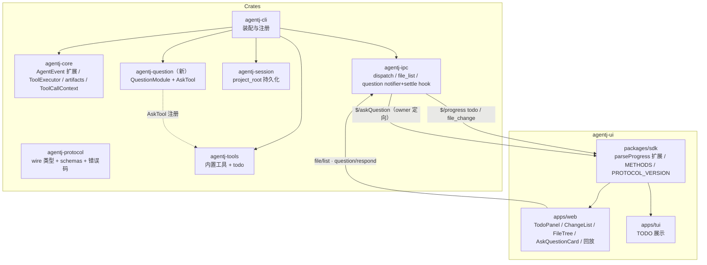
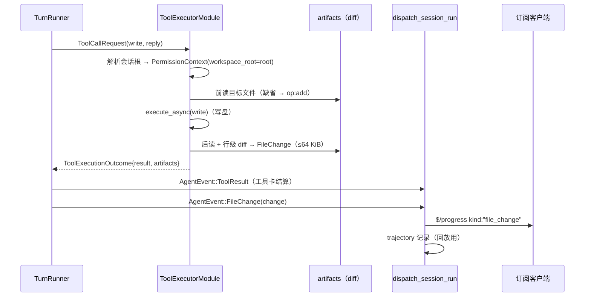
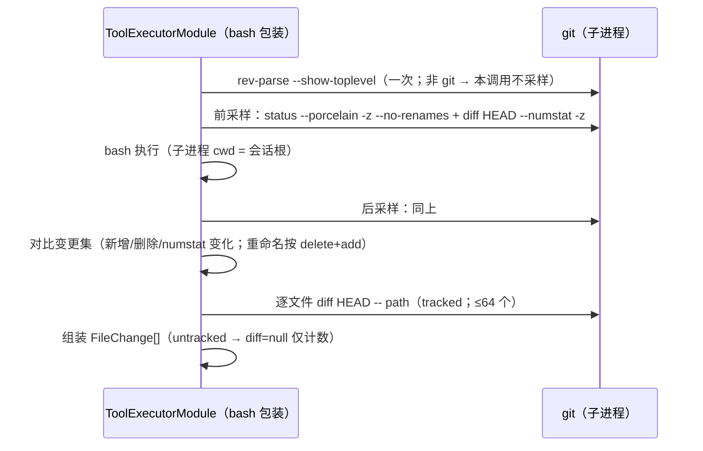
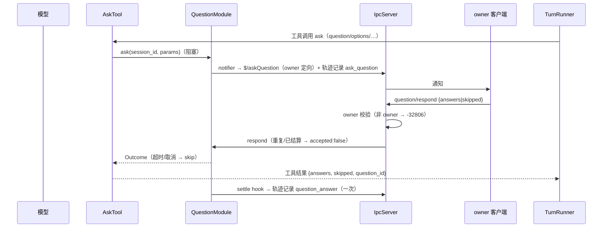
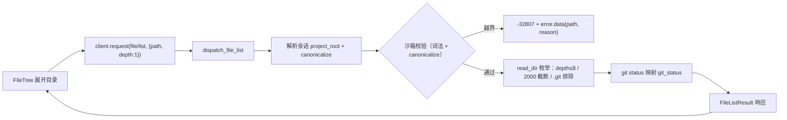
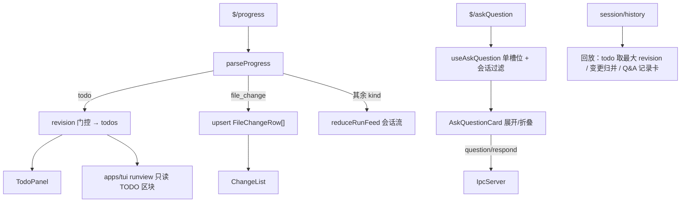

# 设计文档：AgentJ 协议扩展 —— file/list + `$/progress` todo/file_change + `$/askQuestion` / `question/respond`（三栏工作台真实数据源）

> 状态：**已实现（v0.15.0，协议 0.13.0）** ｜ 日期：2026-09-13 ｜ 上游输入：`docs/design/three-column/protocol-extension-prompt.md`（草案契约）、`docs/design/three-column/design.md`（界面规格）、`docs/superpowers/specs/2026-09-13-agentj-three-column-workbench-design.md`（阶段一占位数据交付）
>
> 本文档定义**数据契约与架构**（WHAT / WHY）；任务级 TDD 拆解属下一阶段（`/jskill-feature-plan`）。落地后阶段一的三处 demo/占位数据源（右栏 TODO、左栏文件树、提问卡片）与半推导变更列表（`deriveChanges`）全部切换为真实数据。

## 概述

AgentJ 三栏工作台（v0.14.6）已用占位数据交付：右栏 `TodoPanel`/`ChangeList`、左栏 `FileTree`、composer `AskQuestionCard` 均标注「待协议支持」，文件变更由 `write` 的 `tool_call` 半推导。本特性落地协议扩展，让这些 UI 拿到真实数据：

1. **`file/list`**（请求）：目录懒加载 + git 状态点。
2. **`$/progress` 新增 `kind:"todo"`**（通知）：模型通过新增内置 `todo` 工具提交全量清单，内核广播。
3. **`$/progress` 新增 `kind:"file_change"`**（通知）：`write`（写前/写后 diff）与 `bash`（git 前后采样对比）发出变更事件，含行数与 unified diff。
4. **`$/askQuestion`（通知）+ `question/respond`（请求）**：模型通过新增内置 `ask` 工具发起结构化提问（2–8 个选项），owner 客户端作答后作为工具结果回流模型。

同时完成：会话级 `project_root`（`session/new` 加性参数）、新错误码 `-32807 PathNotAllowed`、`session/history` 回放对新事件的记录与重建、TUI 的 TODO 展示。

**与阶段一的关系**：阶段一交付的布局/交互规格（`design.md`）不变；本特性只替换数据源，保留 demo 模式（`?demo=1` / `agentj.demo`）作为可切换的预览通道。

## 目标与非目标

- **目标**：
  1. 一次真实 `session/run` 内，TODO 变化与文件变更分别经 `$/progress` 到达订阅客户端（`revision` 单调、变更可展开 unified diff）。
  2. `file/list` 支持项目根与子目录懒加载列举，越界路径被拒且错误码/`error.data` 符合规范；git 状态点（M/A/U/D）可用。
  3. `$/askQuestion` → `question/respond` 端到端可用（选项/多选/其他/跳过/超时）；非 owner 被拒 `-32806`；重复响应幂等 `accepted:false`；取消后按 skip 结算。
  4. `session/history` 回放能重建 TODO 快照、变更列表与问答记录（含 Q&A 记录卡）。
  5. 协议纪律全绿：schema 漂移门禁、注册表一致性、TS 生成 + tsc、`check-version.sh`、clippy 零告警；规范文档与 schema/methods.json 一致。
  6. 前端三处 demo/半推导数据源退役：`TodoPanel`/`ChangeList`/`FileTree`/`AskQuestionCard` 由真实协议驱动；TUI 展示 TODO。
- **非目标**：
  - **bash 非 git 盲区**：非 git 仓库 / 项目根之外的 bash 副作用不检测（明示限制，见「错误处理」）。
  - **不新增 `edit` 工具**：现存工具仅 bash/glob/grep/read/write；`write` 是唯一显式写文件工具。
  - **不做 EventBus 桥接**：维持 EventBus 仅生命周期用途（见「关键设计决策 #1」对草案 §5 的偏离说明）。
  - **不做 file/list 分页**：`depth` + 2000 条目上限 + `truncated` 已满足懒加载场景。
  - **不做多提问并发队列**：`ask` 工具阻塞式调用保证单会话至多一个待答提问。
  - **TUI 只接 TODO**：仅在 runview 增加只读 TODO 区块（全量快照 + revision 丢弃旧帧）；file_change 与提问卡不进 TUI（后续可独立加性扩展）。
  - **不新增第三方依赖**：diff 自研、git 走子进程；`agentj-question` 用工作区已有 uuid/tokio。
  - **不改既有 18 方法的字段含义**；不改 `design.md` 布局与交互规格。

## 设计方案

### 选定方案总览

沿用 `protocol-extension-prompt.md` 的加性纪律（`$` 前缀通知未知 `kind` 可忽略、snake_case、判别联合、一请求一响应），并按其「先 UI、后数据源」的两段式落地第二段：

- **发射架构**：新事件沿既有 `AgentEvent` 流（TurnRunner → `dispatch_session_run` → `broadcast_to_session`）扩展，不新建 EventBus 桥（决策 #1）。
- **提问通道**：新 crate `agentj-question`（`QuestionModule` + `AskTool`），完全镜像 `agentj-permission` 的 pending/watch/notifier/owner 归属机制，但语义独立：`timeout_s` 可空（缺省不超时）、重复响应幂等 `accepted:false`、结算统一走 settle hook。
- **项目根**：会话级 `project_root`（`session/new` 可选、canonicalize 后持久化），并把「五处路径基准」统一到该根（决策 #3）。
- **契约修正**：修正草案中与代码现状不符的计数（16 方法 → 实际 18 → 新 21；33 schemas → 实际 38 → 新约 51），并补齐规范文档缺口。

### 备选方案

| 方案 | 优点 | 缺点 | 为何未选用 |
|------|------|------|-----------|
| **A. AgentEvent 流扩展**（选定） | 单一有序管线；帧转换/广播/轨迹记录集中在 `dispatch_session_run` 一处；与现有 progress 测试同构；无重入压力 | 需改 `agentj-core` 的 `AgentEvent` 与 `ToolCallReply` 载荷（机械替换全部 send 点） | — |
| B. EventBus 桥（草案 §5 字面） | 与提示词字面一致；模块解耦 | EventBus 现仅承载生命周期，`KernelContext` 无 bus、bus 无 registry 访问；需新建桥接层与 ctx 扩展；重入语义需重新论证；零先例 | 纯增复杂度，收益不明（决策 #1） |
| C. 直连 sink（依赖倒置） | 不动 `TurnRunner` | 产生第二条 progress 发射路径：顺序、revision 计数、轨迹记录要在 sink 重复实现；测试需搭 IPC 环境 | 与「单一转换点」原则冲突（决策 #1） |
| D. file_change 仅 write | 零误报、实现最小 | bash（sed -i、重定向等）副作用不可见 | 用户选定 write + bash（决策 #2） |
| E. 解析计划文本得 TODO | 不新增工具 | 脆弱、无显式状态流转、误报 | 用户选定内置 `todo` 工具（决策 #2） |

### 协议契约（wire 层）

> 字段一律 snake_case；新增类型/字段标注 `@since 0.13.0`；「未知值容忍」仅施加于**值枚举**（`#[serde(other)]` + `#[schemars(skip)]`），判别联合 `ProgressValue` 的未知 `kind` 依赖消费者按 `$` 前缀约定忽略（与现状一致）。

#### 1. `file/list`（请求，client → server）

Params `FileListParams`：

| 字段 | 类型 | 必填 | 说明 |
|---|---|---|---|
| `session_id` | string | 是 | 解析会话 `project_root` 与归属 |
| `path` | string \| null | 否 | 相对项目根的目录路径；缺省/`""` = 根 |
| `depth` | integer \| null | 否 | 列举深度 1..=8，缺省 1；越界 → `-32602` |

Result `FileListResult`：`entries: FileEntry[]`、`truncated: boolean`（上限 2000，超出截断并置 `true`）。

`FileEntry`：`name`（不含分隔符）、`path`（相对根、无 `./` 前缀）、`kind: "file" | "dir"`、`size: int|null`（dir 为 null）、`mtime_ms: int|null`（epoch 毫秒）、`git_status: "M"|"A"|"U"|"D"|null`。

规则：

- **排序**：目录在前，同类按名称升序（稳定输出，可测试）。
- **排除**：`.git` 目录本身不返回、不下钻；其余隐藏文件正常返回。
- **git 映射**（porcelain XY）：`??`→`A`；`A `（staged add）→`A`；` D`/`D `→`D`；冲突（`UU/AA/DD/AU/UA/DU/UD`）→`U`；其余非 clean 状态（含 `M`/`C` 等）→`M` 兜底；clean→`null`；目录→`null`；非 git 仓库或 git 不可用→全 `null`（降级，不报错）。
- **路径形态**：`path` 不存在 → `-32602`（`data{path, reason:"not_found"}`）；指向文件而非目录 → `-32602`（`data{path, reason:"not_a_directory"}`）。
- **沙箱**：root = 会话 `project_root`（canonicalize；缺省 = 进程 CWD）；请求 `path` 先词法规范化再 `canonicalize`，结果必须 `starts_with(root)`，否则 `-32807 PathNotAllowed`（`error.data = { path, reason: "outside_project_root" }`）；目录内**指向根外的符号链接条目跳过**（条目不返回，不报错）。
- **权限**：只读列举默认 allow，不经 60s 审批通道；沙箱即安全边界。
- 会话不存在 → `-32802 SessionNotFound`；根/目标目录不可读 → `-32603 InternalError`（`error.data = { path, reason }`）；单条目元数据失败 → 跳过该条目。

#### 2. `$/progress` 新增 `kind:"todo"`（通知，server → client）

`{ kind:"todo", session_id, revision: integer, items: TodoItem[] }`——**全量快照**；`revision` 按会话单调递增（内核分配），客户端丢弃比已见更旧的快照（幂等覆盖）。

`TodoItem`：`{ id: string（内核按内容计算稳定哈希；重复内容追加出现序号消歧）, content: string, status: TodoStatus }`；`TodoStatus = "pending" | "in_progress" | "completed" | "cancelled"` + `Unknown(serde other)`；未知 status 客户端按 `pending` 渲染。

#### 3. `$/progress` 新增 `kind:"file_change"`（通知，server → client）

`{ kind:"file_change", session_id, change: FileChange }`。

`FileChange`：`path`（相对项目根）、`op: "add"|"modify"|"delete"`（`FileChangeKind` 带 `Unknown`）、`additions: int`、`deletions: int`、`tool_call_id: string|null`（关联工具卡）、`diff: string|null`（unified diff 文本；快照 diff ≤ 64 KiB，超出置 `null`）、`diff_truncated: bool|null`（仅截断时置 `true`）。

#### 4. `$/askQuestion`（通知，server → client，owner 定向）

Params `AskQuestionParams`：`question_id`、`session_id`、`question`、`header?: string|null`、`options: AskOption[]`（2–8 项）、`allow_multiple?: bool`（缺省 false）、`allow_other?: bool`（缺省 true）、`timeout_s?: int|null`（缺省 null = 不超时；超时按 skip 结算）。

`AskOption`：`{ id, label, hint?: string|null }`。

#### 5. `question/respond`（请求，client → server）

Params `QuestionRespondParams`：`question_id`、`answers: string[]`（option.id 或 `other:` 前缀自由文本）、`skipped?: bool`（缺省 false）。

Result `QuestionRespondResult`：`{ accepted: boolean }`。

规则：

- **归属**：仅 owner 连接可响应（复用 `session_owner` 语义）；非 owner → `-32806 NotAuthorized`。
- **幂等**：同一 `question_id` 仅首次有效响应接受；重复/已结算/未知 → `accepted:false`（不报错）。
- **校验**：畸形参数、未知 option id（非 `other:` 前缀）、单选传多答 → `-32602`（`error.data` 附 `{ unknown_options? }`）。
- **归属与校验顺序**：先解析 `question_id`——未知（从未存在/已过期清理）→ 直接 `accepted:false`，不做归属校验、不泄露会话信息；可解析时先做 owner 校验（非 owner → `-32806`），再做参数校验（畸形/未知 option id/单选多答 → `-32602`），最后做结算尝试（已结算 → `accepted:false`；首次有效 → `accepted:true` 并按 respond/超时/取消统一结算一次）。
- **结算**：respond / 超时 / run 取消 / 会话归档删除 / owner 连接断开 → 统一按一次结算（skip 或 answers），settle hook 保证轨迹只记录一次。

#### 6. `session/new` 加性变更

Params 从「无」到 `SessionNewParams`：`{ project_root?: string|null }`。缺省 = 进程 CWD；必须是存在的绝对目录（否则 `-32602`），canonicalize 后随会话持久化（`SessionSnapshot` 加 `#[serde(default)]` 字段）。旧客户端不传 params 行为不变。

#### 7. 错误码与 error.data

新增 `-32807 PathNotAllowed`（`agentj-protocol` 的 `error_codes`，测试锁定值）。IPC 的 `JsonRpcError` / `DispatchError` 增加可选 `data: Option<serde_json::Value>` 字段（现状缺失，属实现前置项）。

#### 8. 版本与文档门禁

| 项 | 现状 | 目标 |
|---|---|---|
| `PROTOCOL_VERSION`（sdk/config.ts，单一来源） | 0.12.1 | **0.13.0**（加性 → minor） |
| 工作区版本（Cargo + sdk VERSION + desktop） | 0.14.6 | **0.15.0**（feature → minor） |
| `protocol/methods.json` | 18 方法，`protocol_version: "0.3.0"`（过时） | **21 方法**；`protocol_version` 同步 `0.13.0` 并纳入 `check-version.sh` 门禁 |
| `schemas/*.json` | 38 | **约 51**（13 个新类型；以 gen 输出为准） |
| `docs/specs/ipc-protocol.md` | 16 方法 / 33 schemas / 3 progress kind 声明均已过时；缺 session/list、session/history 小节 | 新增 §8.18–8.22（先补 session/list、session/history，再 file/list、`$/askQuestion`、`question/respond`）；§8.1 表补 21 行；§7.3 判别表补 todo/file_change 并修复缺失的 usage/permission 行；§3.4 登记 -32807；§9.4 @since；§11.3 变更日志 0.13.0；§10 计数校正 |

新增注册 schema（13）：`FileListParams`、`FileListResult`、`FileEntry`、`FileKind`、`AskQuestionParams`、`AskOption`、`QuestionRespondParams`、`QuestionRespondResult`、`TodoItem`、`TodoStatus`、`FileChange`、`FileChangeKind`、`SessionNewParams`；`ProgressValue` / `TrajectoryValue` / `SessionHistoryResult` / `ErrorObject` 经 gen 更新。

## 架构

### 组件图

### 数据流 A：write → file_change

### 数据流 B：bash → git 前后采样

### 数据流 C：提问往返

### 数据流 D：file/list

### 数据流 E：前端

## 关键设计决策

### #1 发射架构：AgentEvent 流扩展（对草案 §5「EventBus」字面的偏离）

- **上下文**：草案 §5 要求「TODO 与 file_change 由编排层经 `EventBus` 发布」，但实测 `$/progress` 全链路**不经过 EventBus**：`TurnRunner` 经 mpsc `AgentEvent` → `dispatch_session_run` → `broadcast_to_session`；EventBus 仅承载生命周期/会话过期/MCP 事件，且 `KernelContext` 不持有 bus、bus 不能访问 `ConnectionRegistry`。
- **选项**：A 流扩展 / B EventBus 桥 / C 直连 sink（见备选方案表）。
- **决策**：A。工具执行层产出结构化 artifacts，经 `ToolCallReply`（载荷扩展为 `ToolExecutionOutcome { result, artifacts }`）回流 `TurnRunner`，`TurnRunner` 追加 `AgentEvent::Todo` / `AgentEvent::FileChange`，`dispatch_session_run` 统一转帧、广播、录迹。
- **理由**：单一有序管线；转换+广播+轨迹记录集中一处；EventGuard 重入约束天然不涉及；测试与现有 `subscriber_receives_progress_broadcast` 同构。
- **影响**：改 `AgentEvent`、`ToolCallReply` 类型与全部 send 点（含测试，机械替换）；`artifacts` 仅工具成功（`Ok`）时产出。

### #2 TODO 与提问的真实来源：内置 `todo` / `ask` 工具

- **上下文**：验收要求真实 run 内产生这两类事件；代码中无任何生产者；工具面现为 bash/glob/grep/read/write。
- **决策**：
  - `todo` 工具（`agentj-tools` 内置，第 6 个）：输入 `items:[{content,status}]`，内核按内容计算稳定 id（FNV-1a，无新依赖）、校验状态枚举后产出 `TurnArtifact::Todo`；非法参数 → `ToolError`（模型可自我纠正）。
  - `ask` 工具（`agentj-question` 提供，注册进工具表）：输入 question/options(2–8)/allow_multiple/allow_other/timeout_s；调用 `QuestionModule::ask` 阻塞等待，工具结果 `{question_id, answers, skipped}` 回流模型。
- **理由**：与业界 TodoWrite / permission-ask 模式同构；显式、可测、无启发式；`ask` 与 `$permissionRequest` 语义分离（独立通道、独立超时、无 allow_always）。
- **影响**：`register_builtins` 由 5 → 6；`todo`/`ask` 需在权限策略中默认 `allow`（无副作用、不弹审批）。

### #3 会话级 `project_root`：路径基准五处同源

- **上下文**：草案要求 `file/list` 限于「会话所属项目根」，但会话模型无根字段；现有 `workspace_root` 是进程 CWD（`ToolExecutorModule` 构造期取得），权限沙箱、bash cwd、工具相对路径均以进程 CWD 为基准。
- **决策**：`session/new` 加可选 `project_root`（canonicalize 持久化）；以下**五处**统一以会话根为基准：① `file/list` 沙箱 ② bash git 采样根 ③ `PermissionContext.workspace_root`（每调用按会话解析，缺省 CWD）④ 文件类工具相对路径重定基（`read`/`write`→`path`，`grep`→`path`，`glob`→`pattern`；集中在 `ToolRegistry::execute_async` 按工具名映射处理）⑤ bash 子进程 `cwd` 与 file_change 相对路径。
- **工具上下文获取**：`Tool` trait 新增 `execute_with_context(&self, input, ctx: &ToolCallContext { session_id, workspace_root })`，**默认实现委托既有 `execute`**——存量工具（含 MCP 桥）零改动；`AskTool` 覆写以拿到 `session_id`，`BashTool` 覆写以设置子进程 cwd。
- **理由**：单 serve 实例支持多项目会话；与权限沙箱语义收敛到同一根；default 方法保证零涟漪。
- **影响**：`SessionStore` trait 加 `project_root` / `set_project_root`（同样给 default 实现避免测试替身连锁改）；`SessionSnapshot` 加字段（serde default 兼容旧数据）。

### #4 全量快照 + revision（TODO）与「先响应、后结算」幂等

- **决策**：TODO 走全量快照 + 会话内单调 `revision`（客户端丢弃旧快照，幂等覆盖）；提问走「pending 表 + settled 表」，重复响应返回 `accepted:false` 而非错误。
- **理由**：增量协议对乱序/丢失脆弱；快照模型让 `session/history` 回放只需取最大 revision。提问幂等让客户端重试安全（超时边界场景）。
- **影响**：revision 由 `TurnRunner` 在发 `AgentEvent::Todo` 前按会话分配；settled 表按会话清理（取消/归档时）。

### #5 错误码与 `error.data`

- **决策**：`-32807 PathNotAllowed` 从 `-32800` 段向下加性分配；`error.data` 形状分别为沙箱越界 `{path, reason:"outside_project_root"}`、参数校验 `{unknown_options?}`、IO 失败 `{path, reason}`。IPC 层补 `data` 字段（现状 `DispatchError`/`JsonRpcError` 无此字段）。
- **理由**：规范 §3.4 已声明加性分配纪律；`error.data` 在协议 `ErrorObject` 中已支持（`Option<Value>`），仅 IPC 构造侧缺失。

### #6 QuestionModule 独立 crate，镜像 PermissionModule

- **决策**：新 crate `agentj-question`（`QuestionModule` + `AskTool` + 测试），API：`ask`（阻塞）/ `respond`（幂等）/ `session_of` / `cancel_session` / `set_notifier` / `set_settle_hook`。
- **理由**：与 `agentj-permission`/`agentj-stats` 一致的「可插拔模块」边界；IPC 只做归属校验与转发（notifier/settle hook 注入），不持有提问状态机。
- **影响**：工作区 16 → 17 crate；`agentj-cli` 装配新模块（stdio 与 `serve --port` 两路径都接）。

### #7 bash 变更检测：git 权威数字 + 显式盲区

- **决策**：bash 前后各采样 `rev-parse`（一次判定 git 仓库）+ `status --porcelain -z --no-renames` + `diff HEAD --numstat -z`；变更集 = 新增路径 ∪ 删除路径 ∪ numstat 差异路径；tracked 文件 diff 取 `git diff HEAD -- path`；untracked 仅计数（diff=null）；单次最多 64 条（超出忽略并日志）。重命名按 delete+add。
- **理由**：不做全盘内容快照（成本高）；git 提供权威 additions/deletions，避免自研 diff 误差；`--no-renames` 简化解析。
- **影响**：非 git 仓库/根外变更/未提交语义外的操作（如 `git stash`）为显式盲区；每次 bash 增加约 4 次 git 调用（性能注记见「错误处理」）。

### #8 write 的 diff 自研（无新依赖）

- **决策**：行级 LCS DP（两侧行数乘积 ≤ 4M），产出 unified diff 与 additions/deletions；超限退化为多集行差异近似计数 + `diff=null` + `diff_truncated=true`；输出 >64 KiB 截断置 null。
- **理由**：仓库无 diff 依赖且规则禁止新增；`write` 场景（单文件、模型产出）尺寸可控。
- **影响**：diff 工具落 `agentj-core`（artifacts 模块），仅 `write` 使用；bash 用 git 数字不走此路径。

### #9 前端退役半推导，类型与 demo 解耦

- **决策**：`deriveChanges`（write tool_call 半推导）退役，`ChangeList` 由 `file_change` 帧驱动（upsert by path）；`TodoItem`/`FileNode` 视图类型从 `demoData.ts` 抽到独立类型模块，组件不再依赖 demo fixture；demo 模式保留为整块覆盖（demo 开 = 固定 fixtures，demo 关 = 真实流）。
- **理由**：真实数据与 demo 不可混流（避免双源漂移）；组件类型解耦便于协议驱动测试。

### #10 回放与轨迹记录

- **决策**：`TrajectoryValue` 加 `Todo` / `FileChange` / `AskQuestion` / `QuestionAnswer` 四类（`@since 0.13.0`）；录制点：进度帧在 `dispatch_session_run`、提问在 notifier、结算在 settle hook（保证一次）。前端回放：todos 取最大 revision、changes 全量归并、ask/answer 配对重建记录卡（未答 → `已跳过`）。
- **理由**：`session/history` 已存在（18 方法中的 `session/history`），验收要求回放重建；settle hook 保证超时/取消路径也有终态记录。

## 错误处理

- **file/list**：会话不存在 → `-32802`；`depth` 越界/类型错误/路径不存在/非目录 → `-32602` + `data{path, reason}`；沙箱越界（含符号链接逃逸）→ `-32807` + `data{path, reason:"outside_project_root"}`；根/目标目录存在但不可读 → `-32603` + `data{path, reason}`；条目级元数据失败 → 跳过条目；git 失败/非仓库 → 全 `null` 降级（日志 `debug`）；枚举上限 2000 → `truncated:true`。
- **file_change（write）**：前读失败（权限/IO）→ 仍执行写，仅跳过 artifact；后读失败 → 跳过 artifact；diff 超限 → `diff=null` + `diff_truncated=true`；行数超限 → 近似计数 + 同上。artifact 产出失败**不影响**工具结果与控制流。
- **file_change（bash）**：非 git / `git` 缺失 → 不检测（日志）；采样或解析失败 → 本次不产 artifact；变更文件 > 64 → 截断（日志）；命令失败（`ToolError`）→ 不产 artifact。
- **todo**：参数非法（items 非数组/content 为空/status 非法）→ `ToolError`，模型可纠正；重复 content 合法（内核按出现序号消歧）；空数组 = 合法「清空快照」。
- **ask / question 结算**：超时（`timeout_s` 到期）→ skip；run 取消 → `cancel_session`（skip）；会话归档/删除 → 同上；**owner 连接断开 → 该会话未答提问按 skip 结算**（提问缺省无超时，必须显式兜底防模型永久阻塞）；重复响应 → `accepted:false`；非 owner → `-32806`；`question_id` 未知/过期 → `accepted:false`；结算回调 panic 不影响 ask 返回（隔离）。
- **兼容性**：旧客户端不识别新 `kind`/`$/askQuestion` 按 `$` 前缀约定忽略；未响应提问由服务端结算策略兜底；`session/new` 无参数调用行为不变。
- **性能注记**：bash 每次约 4 次 git 子进程调用（大仓库有成本，v1 接受）；file/list 每次 1 次 `rev-parse` + 1 次 `status`（无跨请求缓存）。

## 测试策略

**层级与关键场景**（全部对齐验收标准 1–6）：

1. **Rust 单元（agentj-protocol）**：新类型 serde 往返；`TodoStatus`/`FileChangeKind` 未知值容忍；`ProgressValue` 新分支 schema 含 `const kind`；`-32807` 值锁定；注册表一致性（21 方法、schema 引用解析）。
2. **Rust 单元（agentj-core / artifacts）**：write diff 计数与 unified 文本；超限退化与 64 KiB 截断；bash git 检测（tempfile + `git init` 夹具：新增/修改/删除/untracked/重命名/非 git 降级）；`ToolCallContext` default 兼容（存量工具不覆写也可执行）。
3. **Rust 单元（agentj-question）**：ask→respond 正常路径；重复 `accepted:false`；超时 skip；取消 skip；owner 断开结算；参数校验（选项 2–8、单选多答、未知 option id）；settle hook 恰一次；非 owner 拒绝在 IPC 集成层覆盖（见 5）。
4. **Rust 单元（agentj-session）**：`project_root` 持久化往返（FileBackedStore 重启恢复；旧快照无字段兼容）。
5. **Rust 集成（agentj-ipc）**：`file/list` 根/子目录/depth/截断/越界（`..`、绝对逃逸、符号链接逃逸）与 `error.data`；`session/new project_root` 校验；订阅者收到 todo/file_change 广播；`question/respond` owner/幂等/`-32806`；`session/history` 含新事件；`$/askQuestion` 定向发送（非订阅者不可见）。
6. **E2E（agentj-cli tests）**：`file/list` over stdio/TCP；一次 `session/run`（Mock provider 脚本化 write/todo/ask）中观察到 `$/progress` todo/file_change 帧与提问往返；断言验收 1–4 的端到端形态。
7. **前端（vitest）**：SDK `parseProgress` 新 kind + 未知容忍；todo revision 门控、file_change upsert、回放归并；`FileTree` 懒加载（mock `client.request` 断言 path/depth）、git 点、错误重试；`AskQuestionCard` → `question/respond` 参数与记录卡；`App.test` 的 SDK mock 同步（parseProgress/METHODS 漂移警告）；demo 与真实源互斥。
8. **TUI（bun test）**：todo 帧渲染 + revision 丢弃旧帧；未知 kind 不崩（已有路径回归）。
9. **门禁**：`gen_schemas` + drift 零漂移；`cargo test --workspace`；`clippy -D warnings`；`generate protocol` + `tsc`；`generate sdk` + sdk 测试；web build/test；web `tsc -b`；`check-version.sh`（含 methods.json 版本新检查）；人工核对规范 §8.18–8.22/§7.3/§3.4。

**验收标准映射**：

| 草案 §7 验收 | 覆盖 |
|---|---|
| 1 file/list 列举 + 越界拒绝 | 5、6、7 |
| 2 todo/file_change 到达订阅端 + revision 单调 | 2、5、6 |
| 3 未知 status/kind 降级不崩 | 1、7、8 |
| 4 ask 往返 + 非 owner + 幂等 + 取消 skip | 3、5、6、7 |
| 5 漂移/TS/clippy/check-version 全绿 | 9 |
| 6 规范文档与 schema/methods 一致 | 9（人工核对） |

## 依赖

- **前置**：阶段一三栏工作台已合并（main，v0.14.6）；`session/history`（v0.12.x）与权限 owner 语义已存在。
- **新增 crate**：`agentj-question`（工作区成员；依赖 agentj-core / agentj-protocol / serde / serde_json / tokio / uuid——均为工作区已有依赖，非新第三方）。
- **代码触点**：`agentj-protocol`（新类型 + gen）、`agentj-core`（AgentEvent / ToolCallReply / Tool trait default / artifacts / tool_executor / turn_runner）、`agentj-session`（根持久化）、`agentj-ipc`（dispatch / file_list / question 接线 / error.data）、`agentj-cli`（装配）、`agentj-tools`（todo + register_builtins）、`agentj-ui`（sdk / web / tui）、`docs/specs/ipc-protocol.md`、`protocol/methods.json`、`scripts/check-version.sh`。
- **阻塞项**：无。可独立于其他 feature 开发；与阶段一 UI 代码只通过既有组件接口衔接。

## 实施状态

> 落地版本：**v0.15.0**（协议 0.13.0）｜ 2026-09-13 ｜ 分支 `feature/agentj-protocol-extension`

- 全部任务 **T0-T42** 已完成并提交（实现计划 `.superpowers/sdd/2026-09-13-agentj-protocol-extension-plan/`，逐任务 review PASS）。
- 协议面：**21 方法 / 51 schemas**（新增 13 类型；`ProgressValue` 七个 kind、`TrajectoryValue` 十一类），`-32807 PathNotAllowed` + `error.data`，`file/list`、`$/askQuestion`、`question/respond`、`SessionNewParams.project_root` 全部加性落地（0.12.1 → 0.13.0 minor）。
- 工作区：16 → 17 crates（新增 `agentj-question`），版本 0.14.6 → 0.15.0（Cargo + SDK `VERSION` + Desktop 同源）。
- 前端：阶段一三处占位数据源（右栏 TODO / 左栏文件树 / 提问卡）与 `deriveChanges` 半推导全部切换为真实协议驱动；demo 模式保留为可切换预览通道；TUI runview 只读 TODO 区块。
- 全量门禁（T42）：`cargo fmt` / `cargo test --workspace`（545 passed）/ `clippy -D warnings`（零警告）/ drift（2 passed）/ SDK 37 / Web 219 / Web build / TUI 71 / `check-version.sh` / `check-desktop-ui.mjs` 全绿。
- 规范落地：`docs/specs/ipc-protocol.md` 同步 0.13.0（21 方法 / 51 schemas，新增 §8.18-§8.22、§7.3 扩展、§3.4 `-32807`、§11.3 changelog）。
