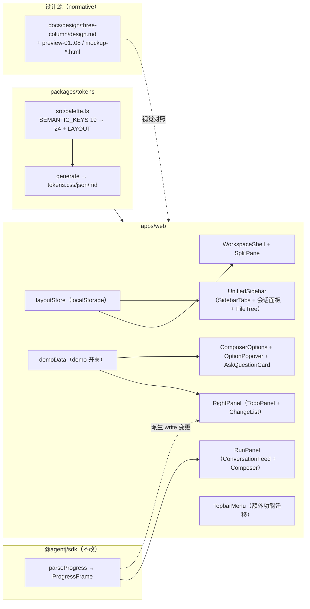
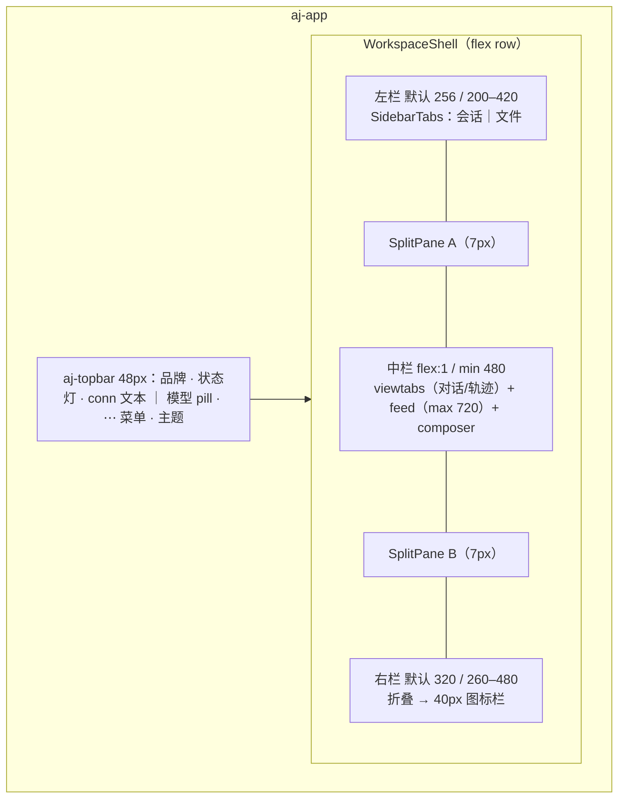
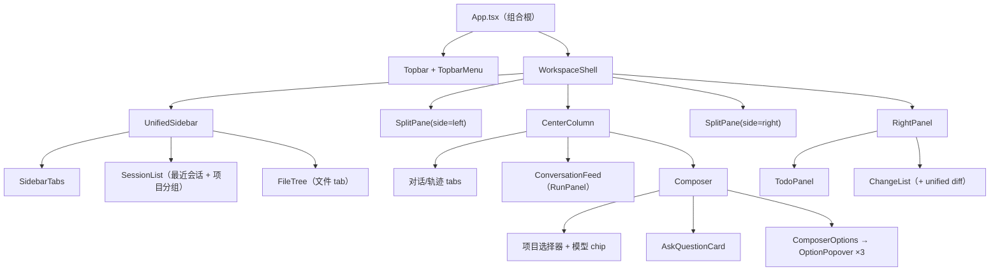
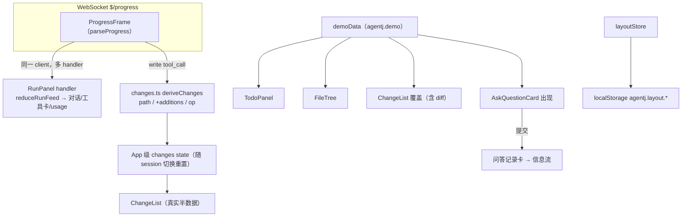

# 设计文档：agentj 工作台三栏布局 + Composer 选项 + 模型提问卡片（Web + Desktop, 0.14.0）

> 视觉单源：`docs/design/three-column/design.md` + `preview-01..08.png`（1440×900，深浅双主题）+ `mockup-*.html`。
> 协议契约（阶段二）：`docs/design/three-column/protocol-extension-prompt.md`。
> 实现范围：仅 `agentj-ui/apps/web`（Desktop 复用 Web 产物），Rust/SDK/protocol 零改造。阶段一全部占位/半数据 + demo 开关驱动；阶段二接协议。
> 视觉纪律：界面必须与 `preview-*.png` 对齐；预览与 `design.md` 冲突处以 `design.md` 为准（用户决策）。

## 概述

当前 Web（v0.13.0）为两栏工作台：`UnifiedSidebar 256px + 居中列`（`App.tsx` 内裸 `.aj-layout`），composer 为「项目选择器 + 模型 chip + 文本域 + Plan chip + 发送」。目标为参考 DeepSeek Web 信息架构的**三段式工作台**：左栏导航区（会话 / 文件 tab）、中栏对话区（对话 / 轨迹 tab + composer）、右栏运行详情区（任务 TODO + 文件变更 + unified diff）；composer 增加「模型 / Agent / 熵变」三个可展开选择器，并支持「模型提问卡片」（可折叠）+ 信息流问答记录。

阶段一在不改协议的前提下交付**全部视觉与交互**：TODO 列表、文件树、提问卡以 demo 数据呈现（顶栏菜单可开关），文件变更从 `write` tool_call 派生半数据；阶段二按 `protocol-extension-prompt.md` 换真实数据源（`file/list`、`$/progress` 的 `todo`/`file_change`、`$/askQuestion` + `question/respond`）。本设计只定 WHAT 与 WHY；任务级 TDD 拆分归实现计划（`/jskill-feature-plan`）阶段。

## 调研摘要（一手事实）

### 现状（`agentj-ui/apps/web` @0.13.0，已核实）

| 区域 | 事实 |
|---|---|
| Shell | `App.tsx` 416 行：顶栏 + `.aj-layout`（`UnifiedSidebar` + `main.aj-main`）+ `ApprovalDialog`；**无右栏、无分隔条、无 portal**（popover 全部 `position:absolute` 于相对容器内） |
| 左栏 | `UnifiedSidebar.tsx` 612 行：Threads header（Filter/Sort/View 为无行为占位图标）+ 搜索 + `ConnectionBar` + `ContinueField`（手输 session id）+ Favorites 分组 + 项目文件夹分组（虚拟分页 50）+ 底栏 Settings/Help（占位）；宽度双源：`index.css --aj-sidebar-width:256px` 与 `sidebar.css` 硬编码 256px |
| 中栏 | `RunPanel.tsx` 635 行：`reduceRunFeed`（text/tool_call/tool_result/usage/permission）+ `ConversationFeed`/`ToolCard` + composer（`@`/`/` 补全为本地 mock）；`.aj-main` 为 `clamp(680px,64%,920px)` 居中列（需改为「中栏全宽 + feed 内容 720 居中」） |
| 数据流 | `$/progress` 经 `@agentj/sdk` `parseProgress` → `ProgressFrame`；tool_call 携带 `{id, name, arguments: unknown}`；`write` 工具参数为 `{path, content}`，result 恒为 `"ok"`（**无 diff、无行数**）；无 `edit` 工具注册 |
| 协议 | `methods.json` 18 方法，**无 TODO/diff/文件列举/提问方法**（`session/list` 仅有会话摘要） |
| 持久化 | `agentj.theme-mode`、`agentj.currentProject`、`agentj.projects`、`agentj.projectMap`、`agentj.projectCollapsed`、`agentj.favorites(.stale)`；`projectStore.ts` 为唯一 store 模块（`safeParse` + try/catch + 自定义事件 + `storage` 事件同步） |
| Tokens | `palette.ts` 19 keys 与设计稿色值**已逐一对齐**；缺 `radiusCtl(设计 8px)`（现存 index.css `--aj-radius-ctl:6px`）、`radiusCard(设计 12px)`（现存 `:10px`）、accent 淡底 tint；`inlineCodeBg` 已定义但零消费；`hero.css` 硬编码 22px 未用 `radiusXl` |
| 测试 | 13 个 vitest 文件；`App.test.tsx`/`RunPanel.test.tsx` 编码当前 DOM 结构；`scaffold.test.ts`/`a11y.test.tsx`/`theme.test.ts`/`ui-tokens.test.ts` 读 CSS 文本/断言 token 清单（重构必须同步更新） |

### 预览与设计源事实

- 8 张预览（深/浅 × 4 状态）与 4 份自包含 mockup（`mockup-main/files/options/question.html`）共享同一视觉系统；`design.md` 已给出完整规格（顶栏 48px、栏宽 256/320、分隔条 7px 命中区等）。
- **Composer 形态冲突（已裁决）**：main/files 预览为 2 行（发送钮在输入行内、无选择器），options/question 预览为 3 行（底部工具栏 = 三选择器 + 圆形发送）。**以 `design.md §5` 为准：统一 3 行版**（用户决策）。
- **mockup 为示意而非规范的部分**（`design.md` 优先）：options 预览同时展开 Agent + 熵变两个面板（规范为同一时刻仅一个）；模型面板从未渲染（按 `design.md §5` 规格实现）；splitter hover/拖拽高亮、提问卡折叠态、焦点态均未在静态稿出现（按 `design.md` 规格实现）。
- **信息架构变化（用户决策）**：左栏严格按预览重构；现有额外功能（连接表单、继续会话、收藏、排序/过滤、设置/帮助）**迁入顶栏右上角「⋯」下拉菜单**承载。

### 存量测试风险

`scaffold.test.ts`（CSS 文件存在性/断点断言）、`a11y.test.tsx`（键盘/reduced-motion）、`theme.test.ts`（token 顺序/radius 变量）、`ui-tokens.test.ts`（palette key 清单）、`App.test.tsx`/`RunPanel.test.tsx`（DOM 结构断言）都会因本次重构失败，属预期改动，随实现同步更新（见「测试策略」）。

## 目标与非目标

### 目标

- **G1 三栏 Shell（P0）**：`WorkspaceShell` + 两条 `SplitPane` 组成三栏；中栏吸收剩余空间（min 480px、内容 max-width 720px 居中）；右栏可折叠为 40px 图标栏且不丢滚动位置；顶栏沿用 48px。
- **G2 左栏信息架构（P0）**：`会话 / 文件` 分段 tab（记忆）；会话面板 = 搜索 + `+ 新建会话` + 最近会话平铺列表（激活项 accent 竖条）+ 项目分组 + `+ 添加项目`；文件面板 = 目录树（懒展开、git 状态点）+ 底部统计。
- **G3 右栏运行详情（P0）**：任务 TODO（勾选态 + 状态 pill + 计数）与文件变更（`+N/-N` + 徽标 + 可展开 unified diff）；阶段一 demo/半数据，阶段二接协议。
- **G4 Composer 选项（P0）**：3 行版 composer；模型 / Agent / 熵变三个向上展开选择器（同一时刻仅一个），选中持久化、面板不被裁剪。
- **G5 提问卡（P0）**：composer 内可折叠提问卡 + 提交/跳过 + 信息流问答记录卡；阶段一 demo 驱动，阶段二接 `$/askQuestion`。
- **G6 交互与可达性（P0）**：拖拽调宽 + 双击复位 + localStorage 持久化；分隔条 `role=separator` 全键盘可达；`<1024px` 左右栏各自抽屉化；`prefers-reduced-motion` 关闭动效。

### 非目标

- ❌ 不改任何 Rust crate / `packages/sdk` / `packages/protocol` / `PROTOCOL_VERSION`（保持 0.12.1）；阶段一不新增协议方法。
- ❌ 不动 TUI（`apps/tui` 无任何变更；不要求同步侧栏）。
- ❌ 不重做主题配色（深浅色即现有 token）；不引第三方 UI 库（仅 `lucide-react`）；不做第四栏。
- ❌ 阶段一 TODO/文件树/提问卡不接真实数据；变更列表不做 `-N`/diff 伪造（不可得则隐藏）。
- ❌ 不实现模型选择的下发（阶段一仅持久化 + 展示，不改 `session/run` 行为）。

## 设计方案（选定路线：方案 A 组件化重构）

新增 `WorkspaceShell` + `SplitPane` 壳层与 `layoutStore`，`App.tsx` 瘦身为组合根；功能组件按 `design.md §7` 映射拆分（SidebarTabs / FileTree / RightPanel / TodoPanel / ChangeList / OptionPopover / ComposerOptions / AskQuestionCard）；左栏额外功能迁入顶栏菜单；demo 模块驱动占位数据。

### 备选方案

| 方案 | 优点 | 缺点 | 为何未选用 |
|------|------|------|-----------|
| **A 组件化重构（选用）** | 与 `design.md §7` 组件映射一一对应；SplitPane 拖拽/键盘/持久化可独立单测；`App.tsx`/`RunPanel.tsx` 瘦身，阶段二接入点清晰 | 新文件约 12+，存量测试需同步更新 | **选中（用户决策）** |
| B 就地最小改造 | 改动集中、落地快 | `App.tsx`(416)+`RunPanel.tsx`(635) 继续膨胀；拖拽/持久化难单测；`design.md §7` 组件拆分落空 | 长期维护与阶段二接入成本高 |
| C 引入面板库（react-resizable-panels） | 拖拽/键盘/collapse 开箱即用 | 违反 `design.md`「不引第三方 UI 库」硬约束 | 硬约束排除 |

## 架构

### 总体架构

### Shell 与三栏

- 左/右栏 `flex: 0 1 {width}px` + `min/max-width`；中栏 `flex: 1 1 auto; min-width: 480px`。窗口收紧时浏览器自动压缩左右栏（**不覆写**存储值），窗口恢复回弹。
- `≥1024px` 三栏常驻；`<1024px` 左栏沿用现有抽屉（scrim + `translateX`），右栏改为右侧抽屉（新 scrim + 顶栏开关按钮，`aria-expanded` 同步），两条分隔条隐藏（不可拖）。
- 右栏折叠：宽度过渡至 40px 图标栏，**内容不卸载**（`visibility` 隐藏）以保留滚动位置；状态入 `agentj.layout.rightCollapsed`。

### 组件树

### 数据流

要点：

- **变更派生（半数据）**：`deriveChanges(prev, frame)` 仅在 `name === "write"` 且 `arguments.path` 可读时更新；`additions = content.split("\n").length`；同一路径首次出现 `op="add"`、再次出现 `op="modify"`；`deletions` 与 `diff` 不可得 → 对应 UI 隐藏（**不伪造**）。
- **demo 覆盖**：demo 开启时，TodoPanel / FileTree / ChangeList（含示例 diff）/ AskQuestionCard 全部改用 demo 数据（对话流保持真实）；关闭时 TODO/文件树显示「待协议支持」空态、变更列表仅渲染真实派生数据、提问卡不出现。
- **问答记录**：demo 提问卡提交后由 RunPanel 追加 `qa` 记录条目进信息流；`跳过` 不产生回答。

### 持久化键（全部经 `layoutStore`）

| 键 | 值 | 默认 | 约束 |
|---|---|---|---|
| `agentj.layout.leftWidth` | number(px) | 256 | clamp 200–420 |
| `agentj.layout.rightWidth` | number(px) | 320 | clamp 260–480 |
| `agentj.layout.leftTab` | `"sessions" \| "files"` | `sessions` | 枚举校验 |
| `agentj.layout.rightCollapsed` | `"0" \| "1"` | `0` | 布尔解析 |
| `agentj.composer.model` | string | `default_model` | — |
| `agentj.composer.agent` | `"build" \| "plan" \| "explore"` | `build` | 枚举校验 |
| `agentj.composer.entropy` | number(0–2) | 0.7 | clamp 0–2 |
| `agentj.ask.collapsed` | `"0" \| "1"` | `0` | 布尔解析 |
| `agentj.demo` | `"0" \| "1"` | `0` | 或 `?demo=1` 覆盖 |

## 关键设计决策

**D1 三栏 Shell 与 SplitPane（P0）**
- `WorkspaceShell` 持有 `leftWidth/rightWidth/rightCollapsed` 状态（初始值同步读 `layoutStore` 防 CLS）；`SplitPane` 为受控组件：`{ side, width, min, max, defaultWidth, collapsed?, onResize, onReset, onToggleCollapse? }`。
- 拖拽：`pointerdown` → `setPointerCapture`；`pointermove` 实时 clamp（并保证中栏 ≥480px）；`pointerup` 写入 store；`pointercancel` 还原拖拽前宽度；**双击复位**默认宽（256/320）。
- 键盘：`role="separator"` + `aria-orientation="vertical"` + `tabindex=0` + `aria-valuenow/min/max`；`←/→` ±8px（右分隔条方向相反：`←` 加宽）、`Shift+←/→` ±32px、`Home` 复位、右分隔条 `Enter/Space` 切换折叠；键盘操作即时持久化。
- 视觉：7px 命中区（`--aj-splitterHit`）、1px 发丝线 + 垂直居中 3 点 grip；hover/拖拽态高亮 `--aj-accent`、grip 透明度提升（静态稿无此态，`design.md` 规定本项为补充）。

**D2 layoutStore（P0）**
- 新模块 `src/layoutStore.ts`，沿用 `projectStore.ts` 模式：`safeParse` + try/catch + 类型校验 + clamp + 默认回退；`loadLayout()/saveLayout(patch)`；自定义事件 `agentj:layout-updated` + 原生 `storage`（多标签同步，应用时再次 clamp）。
- 宽度自动压缩不写回；仅用户显式操作（拖拽结束/键盘/复位）持久化。

**D3 左栏信息架构（P0，用户决策：额外功能迁顶栏菜单）**
- `SidebarTabs` 分段控件（激活 = `--aj-panel` 底 + 发丝边）；切换仅换面板内容、不改宽度。
- 会话面板：搜索（`搜索会话…`）→ `+ 新建会话`（accent 实底、`--aj-accentOnAccent` 文字）→ **最近会话平铺列表**（标题 + `时间 · 项目名` 副行；激活 = panel 底 + 边 + 2px accent 左竖条）→ 分隔线 → `项目` 小节 → 项目文件夹分组（沿用现有折叠 + 虚拟分页）→ 底栏 `+ 添加项目`。平铺列表 = 全部会话按最近活动倒序、不设分组标题；与项目分组视图并存（同一会话可同时出现于两处）；顶栏菜单的「排序/过滤」作用于该列表。
- 文件面板：`FileTree`（demo 数据；`▸/▾` 折叠 + 16px/级缩进 + 懒展开状态组件内；`M 橙 / A 绿 / U 灰 / D 红` 字母 + 6px 圆点；底栏 `N 个文件 · M 处变更 / 展开全部`）。
- **迁出左栏**：`ConnectionBar`、`ContinueField`、Favorites 分组、Filter/Sort/View 图标、Settings/Help → 顶栏菜单（D8）。会话行 hover 星标（收藏切换）保留。

**D4 Composer 3 行版 + 选项系统（P0，`design.md` 为准）**
- 结构：`head（项目选择器 + 模型 chip）` → `文本域（保留 @ / / 补全）` → `toolbar（◆ 模型 ⌄ / ⚙ Agent ⌄ / ∿ 熵变 ⌄ 左对齐 + 圆形发送钮右置）`；**移除 composer 头状态 popover**（信息并入顶栏菜单；预览亦无）。
- `OptionPopover`：锚定 toolbar（`position:relative` + 绝对定位向上），宽 288px（熵变 264px）、padding 6、圆角 12、`--aj-shadowRaised`、z-index 30；`max-height: min(420px, 60vh)` + 溢出滚动（静态稿无上限，属健壮性补充）；**同一时刻仅一个展开**（`ComposerOptions` 持有 `openId`）；外部点击/`Esc` 关闭并焦点返回触发钮；`↑/↓` 高亮 + `Enter` 确认；触发钮 26px 高、`--aj-panel` 底、发丝边、12px `--aj-textMuted`、`aria-expanded` + `aria-haspopup="listbox"`。
- 面板：**模型**（名称 13px + 11px muted 能力说明 + 当前项 `✓` + accent 淡底；阶段一静态列表，默认项取 `kernel/status.default_model`）；**Agent**（`Build 默认·读写工具全开` / `Plan 只读·先出方案不落盘` / `Explore 只读·大范围检索` + 底注 `Agent 决定可用工具与权限范围。`）；**熵变**（预设 `低温·精确 0.2` / `均衡·推荐 0.7`（默认）/ `高温·发散 1.2` + 分隔线 + `自定义` 滑块 0–2 + 数值展示 + 说明；映射 `ModelOptions.temperature`，**阶段一仅持久化与展示，不下发 run 请求**）。
- 持久化：`agentj.composer.model/.agent/.entropy`；选中即更新触发标签。

**D5 提问卡（P0，demo 驱动）**
- 展开态（composer 内、文本域之上、发丝线分隔）：22px `?` 徽标（accent 淡底）+ 问题 13px/600 + 折叠 chevron；说明行 11px caption（缩进 30px）；选项行（16px 单选圈 + 13px 标签 + 右侧 11px hint；选中 = accent 填充 + 淡底 + 白色内点）；底行 = `其他…` 输入（flex-1、32px、发丝边）+ `跳过` ghost + `提交` accent。
- 折叠态：单行 `✓ 已选择：X` + chevron（12px `--aj-textMuted`，点击展开）；持久化 `agentj.ask.collapsed`。
- 提交：卡片从 composer 移除，信息流追加**问答记录卡**（`? 模型提问` + `已折叠 ⌄` + 问题 + `→ 选择` accent 淡底 pill + 可选 `已按此决定继续执行。`）；`跳过` 不产生回答。单选 = 点击行即选；多选预留 checkbox（阶段二协议 `allow_multiple`）。
- a11y：`role="group"` + `aria-labelledby` 指向问题文本；选项用原生 `radio`/`checkbox`；折叠钮 `aria-expanded`。

**D6 右栏运行详情（P0）**
- `RightPanel`：头部 44px（`运行详情` + 折叠钮 `»`）；两块 section（`任务` / `文件变更`），`sec-head` 11px 大写 + 计数 pill；折叠为 40px 图标栏（D1）。
- `TodoPanel`：计数 `N / M`；行 = 16px 复选框（完成 = success 实底 `✓`；进行中 = accent 描边 + 6px 脉冲点；待办 = 灰描边）+ 标签 + 状态 pill（已完成/进行中/待办）；props 接口 `items: {id, content, status}[]`，阶段二由 `$/progress kind:"todo"` 全量快照驱动。
- `ChangeList`：行 = 文件徽标（如 `TS`）+ mono 路径 + `+N` 绿/`-N` 红 + `新增/修改/删除` 徽标；点击展开 unified diff（头行 `路径 · unified diff` + `+N -N`；新增行 `diffAddTint` + `+`、删除行 `diffDelTint` + `-`、上下文 muted）；`diff` 缺失时行不可展开。数据 = 真实派生（`deriveChanges`）或 demo 覆盖。

**D7 Demo 模式（P0）**
- 激活：`localStorage agentj.demo=1` 或 `?demo=1`（Desktop WebView 以 localStorage 为主）；顶栏菜单提供「演示数据」开关（即时生效）。
- `src/demoData.ts` 导出：`DEMO_TODOS`、`DEMO_FILE_TREE`、`DEMO_CHANGES`（含 diff 文本）、`DEMO_QUESTION` + `DEMO_QA_RECORD`、`isDemoEnabled()/setDemoEnabled()/subscribeDemo()`；数据内容对齐 `preview-01..08`（供像素级对照）。

**D8 顶栏菜单迁移（P0，用户决策）**
- 右上角「⋯」下拉（`role="menu"`）：`连接状态/模块信息`（现 popover 内容）｜ `连接设置…`（对话框承载 `ConnectionBar`：host/port/token + 连接/断开）｜ `继续会话…`（对话框：session id 输入 + 继续，承接 `ContinueField`）｜ `收藏会话`（列表跳转）｜ `排序`（最近活动/创建时间）｜ `过滤`（全部/仅收藏）｜ `演示数据` 开关 ｜ `设置` / `帮助`（占位项）。
- 顶栏布局按预览：左 = 品牌 + 状态灯（8px success + 3px 光晕）+ conn 文本；右 = 模型 pill（6px accent 点）+ ⋯ + 主题切换；`<1024px` 追加抽屉开关。

**D9 Tokens 增量（P0）**
- `palette.ts` 新增 5 个语义 key（双主题值）：`radiusCtl: "8px"`、`radiusCard: "12px"`、`accentTint`（深 `rgba(103,158,254,.12)` / 浅 `rgba(65,118,230,.10)`，用于选中/淡底）、`diffAddTint`（深 `rgba(34,197,94,.12)` / 浅 `rgba(34,197,94,.14)`）、`diffDelTint`（深 `rgba(242,90,90,.12)` / 浅 `rgba(236,19,19,.10)`）；`SEMANTIC_KEYS 19 → 24`。
- 新增非主题常量块 `LAYOUT`（`leftWidth 256 / leftMin 200 / leftMax 420 / rightWidth 320 / rightMin 260 / rightMax 480 / splitterHit 7 / topbarHeight 48 / gap 12`），生成器输出至 `:root`（不随主题；变量名按既有生成规则为 camelCase，如 `--aj-leftWidth`、`--aj-splitterHit`、`--aj-topbarH`）；`--aj-gap` 从 `index.css` 迁移入此单源（值不变）。
- 迁移：`--aj-radius-ctl:6px → --aj-radiusCtl:8px`、`--aj-radius-card:10px → --aj-radiusCard:12px`（21 处引用更新，含 index.css 定义与 theme.test.ts 断言；旧 kebab 变量删除）；`hero.css` 硬编码 22px 改用 `--aj-radiusXl`；`inlineCodeBg` 在行内 code 样式接入（现零消费）。
- 生成链：改 `palette.ts` 后 `npm --prefix agentj-ui run generate --workspace=@agentj/tokens`（**不手改** `tokens.css`）；`palette.test.ts`/`ui-tokens.test.ts`/`theme.test.ts` 期望值同步 24 keys + 新变量。

**D10 版本与范围（P0）**
- `0.13.0 → 0.14.0`（feature minor）：`Cargo.toml`（workspace）+ `packages/sdk/src/config.ts` `VERSION` + `apps/desktop/{package.json, tauri.conf.json, src-tauri/Cargo.toml}` 同源；`PROTOCOL_VERSION` 保持 `0.12.1`（无协议变更）；`./scripts/check-version.sh` 必须通过。

## 组件设计（接口与行为）

| 组件 | 关键接口 | 行为要点 |
|---|---|---|
| `WorkspaceShell` | `{ children 分部 }` 或组合式；内部持有宽度状态 + 抽屉态 | 三栏 flex；`<1024` 抽屉模式；向 SplitPane 下发 clamp 边界（含中栏 480 保底） |
| `SplitPane` | `{ side, width, min, max, defaultWidth, collapsed?, onResize, onReset, onToggleCollapse? }` | D1：pointer/keyboard/dblclick；`aria-*` 全量 |
| `layoutStore` | `loadLayout() / saveLayout(patch) / subscribeLayout(cb)` | D2：容错 + 事件；纯函数式校验，可单测 |
| `SidebarTabs` | `{ tab, onChange }` | 分段控件；`aria-selected` |
| `SessionList`（改造自 UnifiedSidebar 主体） | 现有 `session/list` 数据 + `projects/projectMap` | 平铺最近会话 + 项目分组；搜索沿用；虚拟分页保留 |
| `FileTree` | `{ nodes: FileNode[]（demo）, onToggle? }` | 懒展开（组件内 state）；git 状态点；底栏统计 |
| `RightPanel` | `{ collapsed, onToggle, children }` | 40px 折叠栏；内容不卸载 |
| `TodoPanel` | `{ items: TodoItem[] }` | 状态 pill；demo/空态 |
| `ChangeList` | `{ changes: FileChangeRow[], demo?: boolean }` | 展开 diff；无 diff 不可展开；空态文案「待协议支持」 |
| `OptionPopover` | `{ id, open, anchor, align, width, onClose, children, labelledBy }` | 向上绝对定位；互斥由父级 `openId` 控制；Esc/外部点击/焦点返回 |
| `ComposerOptions` | `{ model, agent, entropy, onChange }` | 三触发钮 + 面板内容（D4）；持久化 |
| `AskQuestionCard` | `{ question: AskQuestion, collapsed, onSubmit(answers), onSkip }` | 展开/折叠；单选/多选；其他… 输入 |
| `TopbarMenu` | `{ conn 信息, onOpenConnect, onOpenContinue, favorites, sort, filter, demo, … }` | D8 菜单项与对话框 |
| `demoData` | `DEMO_*` 常量 + `isDemoEnabled()/setDemoEnabled()/subscribeDemo()` | D7 |

## 视觉规格（与预览对齐的硬性值）

| 区块 | 值（深/浅差异仅颜色 token） |
|---|---|
| 顶栏 | 48px；`padding 0 16px`；底边 0.5px `--aj-border`；品牌 16px/700；状态灯 8px success + `0 0 0 3px rgba(34,197,94,.15)`；conn 12px muted；pill 28px/圆角 999/`--aj-panel`/12px 600；icon 钮 32×32 圆角 8 |
| 左栏 | 默认 256（200–420）；seg 钮 30px 圆角 8；搜索 32px 圆角 8；`+ 新建会话` 34px 圆角 8 accent 实底；会话行 padding 8 10 圆角 8（激活 panel 底 + 边 + 2px accent 竖条 top/bottom 6px）；标题 12px/600 + 副行 11px caption；项目行 12px muted + 9px chevron；文件树 mono 12.5px、行 padding 3 6、缩进 16px/级、状态字母 10px/700 + 6px 点 |
| 分隔条 | 7px 命中区；1px 线 + 两侧 0.5px 边；grip 3×2px 点 gap 3 透明度 .6；hover/拖拽 accent |
| 中栏 | viewtabs 36px（13px/600，激活 2px accent 下边）；feed gap 14px、内容 max 720；用户气泡 max 78%、圆角 22/右下 4、padding 10 14、`--aj-userBubble`；AI 块 2px accent 左条 + 左缩进 12、13px/1.7；行内 code 11.5px mono `--aj-inlineCodeBg` 圆角 4；代码块 12px mono `--aj-codeBg` 圆角 6 padding 10 12；工具卡圆角 12 padding 6 10、8px 状态点（成功 success / 运行中 accent 脉冲 1.2s / 失败 error + 边框 `rgba(error,.35)`）、mono 12px；失败预览条 11px error；usage 12px mono muted |
| Composer | 卡片圆角 22、`--aj-panel`、`--aj-shadowRaised`、padding 10 12、gap 8；项目钮 26px 圆角 999；模型 chip 11px；输入区 min 36 圆角 12 `--aj-raised`；发送 32px 圆形 accent；选择器 26px 圆角 999、12px muted；面板宽 288/264、padding 6、圆角 12；选中行 accent 淡底 + `✓`；滑块 4px（填充 accent、旋钮 12px 描边 accent）；说明 11px caption |
| 提问卡 | `?` 徽标 22px 圆角 7 accent 淡底；问题 13px/600；说明 11px（缩进 30）；选项行 padding 7 8 圆角 8 gap 9；单选圈 16px 1.5px 描边；选中淡底 + accent 填充 + 6px 白内点；底行控件 32px 圆角 8（提交 accent）；记录卡圆角 12 padding 10 12、徽标 18px、答案 pill `3px 9px` 圆角 999 |
| 右栏 | 默认 320（260–480）；头 44px；section 头 11px 大写 letterspacing .06em + 计数 pill；TODO 复选 16px 圆角 4（done success 实底/`prog` accent 描边 + 脉冲/pending 灰描边）；变更行 padding 7 9 圆角 8 gap 8、徽标 22px 圆角 6、路径 mono 12.5、计数 11px；diff 容器圆角 8 `--aj-codeBg`、头行 11px、行 11.5px mono（add/del 用 `diffAddTint`/`diffDelTint` + `+`/`-` 前缀） |
| 主题 | 全部颜色走 `--aj-*`；浅色下卡片**必须靠 `--aj-border` 发丝线区分**（panel=bg、raised=sidebar）；选中淡底/徽标 tint 均用 D9 新 token |

> 预览对照：`preview-01/03`（会话 tab + 右栏 TODO/变更）、`02/04`（文件 tab + diff 展开）、`05/07`（三选择器面板）、`06/08`（提问卡 + 问答记录），深浅各一；验收在 demo 模式下逐张对照。

## 错误处理

| 场景 | 行为 |
|---|---|
| `localStorage` 读失败/脏数据（宽度、tab、tint、demo） | `safeParse` + clamp + 默认回退；不阻塞渲染 |
| 拖拽中 `pointercancel` / 窗口失焦 | 还原拖拽前宽度；不写入 store |
| 左右栏 min/max 与中栏 480 冲突（窄窗口） | 拖拽实时 clamp；自动压缩仅视觉、不覆写存储值 |
| 多标签页同时调宽 | `storage` 事件应用远端值（再次 clamp）；最后写入者生效 |
| write tool_call 参数畸形（无 path/content） | 跳过该帧，变更列表不更新、不 crash |
| `-N`/diff 不可得 | 对应元素隐藏；不展示伪造计数 |
| popover 矮视口 | `max-height: min(420px, 60vh)` + 内部滚动（不裁剪） |
| demo 开关切换瞬间 | 数据源原子切换（同一 render 内），无中间态闪烁 |
| 提问卡重复提交/空选择 | 提交钮在选择非空时可用；重复提交忽略（阶段二幂等由协议保证） |
| `prefers-reduced-motion` | 关闭全部过渡/脉冲（含抽屉、折叠、tool 脉冲） |

## 测试策略

- **新增单测**：`layoutStore.test.ts`（clamp/回退/事件）、`splitPane.test.tsx`（pointer 拖拽、键盘 8/32/Home、双击复位、`aria-*`）、`workspaceShell.test.tsx`（三栏/折叠/抽屉断点）、`sidebarTabs.test.tsx`（切换 + 持久化）、`fileTree.test.tsx`（展开/折叠、状态点）、`todoPanel.test.tsx`、`changeList.test.tsx`（diff 展开、无 diff 不可展开、空态）、`changes.test.ts`（deriveChanges 纯函数：add→modify、畸形帧、重置）、`optionPopover.test.tsx`（互斥/Esc/外点/焦点返回）、`composerOptions.test.tsx`（选择 + 持久化）、`askQuestionCard.test.tsx`（展开/折叠/提交/跳过/记录）、`topbarMenu.test.tsx`（菜单项 + 对话框）、`demoData.test.ts`（开关解析 + 订阅）。
- **更新存量**：`App.test.tsx`（三栏结构、抽屉、菜单）、`RunPanel.test.tsx`（composer 结构/testid）、`UnifiedSidebar.test.tsx`（tabs + 平铺列表 + 迁出项移除）、`scaffold.test.ts`（新 CSS 文件/断点断言）、`a11y.test.tsx`（新增 separator/菜单键盘路径 + reduced-motion）、`theme.test.ts`/`ui-tokens.test.ts`（24 keys + `LAYOUT` 变量 + kebab→camel 迁移）、`palette.test.ts`。
- **门禁**：`npm --prefix agentj-ui test --workspace=@agentj/web`、`npm --prefix agentj-ui run build --workspace=@agentj/web`（`tsc -b`）通过；`sdk` 29 测试不受影响；`cargo test/clippy/fmt` 与 drift 不受影响仍须通过；`./scripts/check-version.sh`（0.14.0 同源）。
- **手动验收**：demo 开启后与 `preview-01..08` 逐张对照（深浅）；键盘全链路（调宽 → 折叠右栏 → 切 tab → 展开选择器选中 → 提交回答）；`<1024px` 抽屉无横向滚动；`prefers-reduced-motion`。

## 阶段划分

### 阶段一：UI 重构交付（本设计主体，0.14.0）

- 三栏 Shell + SplitPane + layoutStore；左栏（tabs + 会话 + 文件树）；右栏（TODO + 变更 + diff）；Composer 3 行版 + 三选择器；提问卡 + 问答记录；顶栏菜单迁移；demo 模式；tokens 增量；响应式与 a11y；测试与门禁。
- 数据：会话真实（`session/list` + `$/progress`）；文件变更半数据（`write` 派生）；TODO/文件树/提问卡 demo/空态。

### 阶段二：协议扩展接入（路线图，独立设计/计划）

> 契约详见 `docs/design/three-column/protocol-extension-prompt.md`；本阶段不改动阶段一交付的视觉与交互规格，仅替换数据源。

- `file/list`（请求）→ `FileTree` 懒加载真实目录（越界拒绝 + `-32807`）。
- `$/progress` 加性 `kind:"todo"`（全量快照 + `revision` 单调）→ `TodoPanel`；`kind:"file_change"`（含 `diff`、`tool_call_id`）→ `ChangeList` 真实计数与 diff。
- `$/askQuestion`（通知）+ `question/respond`（请求）→ `AskQuestionCard` 作答闭环（owner 归属、幂等、skip 结算）。
- 门禁：schemas 漂移 + methods.json + 规范 §8.18–§8.20 + TS 生成 + `PROTOCOL_VERSION` minor 抬升 + clippy。

## 依赖

- **前置**：v0.13.0（`UnifiedSidebar 256 + projectStore + Composer 增强 + tokens 19 keys` 已齐）；设计源 `docs/design/three-column/*` 已提交。
- **外部**：无新增依赖（`lucide-react` 覆盖所需图标；不引第三方 UI 库）。
- **阻塞**：无后端阻塞（阶段一纯前端）；`@agentj/tokens` 生成链为第一门；阶段二依赖协议扩展实施。

## 产出与验收

- **交付物**：`WorkspaceShell + SplitPane + layoutStore`；左栏 tabs（会话/文件 tree）；右栏 `RightPanel + TodoPanel + ChangeList`；`ComposerOptions + OptionPopover`（模型/Agent/熵变）；`AskQuestionCard` + 问答记录；`TopbarMenu` 迁移；`demoData`；tokens 24 keys + LAYOUT；版本 `0.14.0`。
- **验收（对齐 `design.md §9`）**：
  1. 两条分隔条可拖拽，刷新后宽度保持；双击复位。
  2. 左栏「会话/文件」切换正常且记忆；目录树可展开/折叠。
  3. 右栏可折叠/展开，TODO 与文件变更在占位数据下渲染正常。
  4. Composer 三个选择器可展开/收起，同一时刻仅一个展开，选中项持久化；面板不被裁剪。
  5. 提问卡可展开/折叠；提交后问答记录进入信息流；跳过可用。
  6. `<1024px` 左/右栏各自退化为抽屉，无内容溢出、无横向滚动。
  7. 仅用键盘可完成「调宽 + 折叠右栏 + 切换左栏 tab + 展开选择器并选中 + 提交回答」。
  8. `npm --prefix agentj-ui test --workspace=@agentj/web` 与 `tsc -b` 通过；demo 模式逐张对照 `preview-01..08`。

## TODO 清单（plan 阶段逐期勾选）

> 状态：**Phase 1（UI，0.14.0）全部完成 — 2026-09-13**；
> 对应 SDD 实现任务 T0-T28 全部提交，全量门禁与文档同步见
> `.agents/summary/summary_and_next.md`（验证结果逐条记录）。
> Phase 2（协议扩展：TODO/文件变更事件、`file/list`、`$/askQuestion`）
> 为独立 feature，待协议支持后另行规划。

- [x] T0 tokens 增量（`palette.ts` 24 keys：`radiusCtl 8 / radiusCard 12 / accentTint / diffAddTint / diffDelTint` + `LAYOUT` 常量块；generate + kebab→camel 迁移 + `palette/ui-tokens/theme` 测试更新）
- [x] T1 `layoutStore`（键/容错/clamp/事件）+ 单测
- [x] T2 `SplitPane`（拖拽/键盘/双击/aria）+ `split.css` + 单测
- [x] T3 `WorkspaceShell` 接线 `App.tsx`（三栏 + 右栏折叠 + `<1024` 右抽屉；`.aj-main` 改全宽 + feed 720 居中）
- [x] T4 左栏重构（`SidebarTabs` + 最近会话平铺 + 项目分组视觉对齐；视觉规格按预览）
- [x] T5 `FileTree` + 文件 tab（demo/空态 + 状态点 + 底部统计）
- [x] T6 `RightPanel + TodoPanel + ChangeList`（含 `deriveChanges` 半数据 + demo 覆盖 + diff 展开）
- [x] T7 `TopbarMenu` 迁移（连接设置/继续会话/收藏/排序/过滤/设置/帮助 + demo 开关；dialogs）
- [x] T8 Composer 3 行版（`OptionPopover + ComposerOptions`：模型/Agent/熵变 + 互斥 + 持久化）
- [x] T9 `AskQuestionCard` + 问答记录（demo 驱动 + 折叠持久化）
- [x] T10 响应式与 a11y 收尾（抽屉/popover 满宽/焦点/reduced-motion）
- [x] T11 测试更新 + 全量门禁（web test/build + sdk + cargo + drift + check-version）+ 文档同步（AGENTS/README/summary）+ 版本 0.14.0
