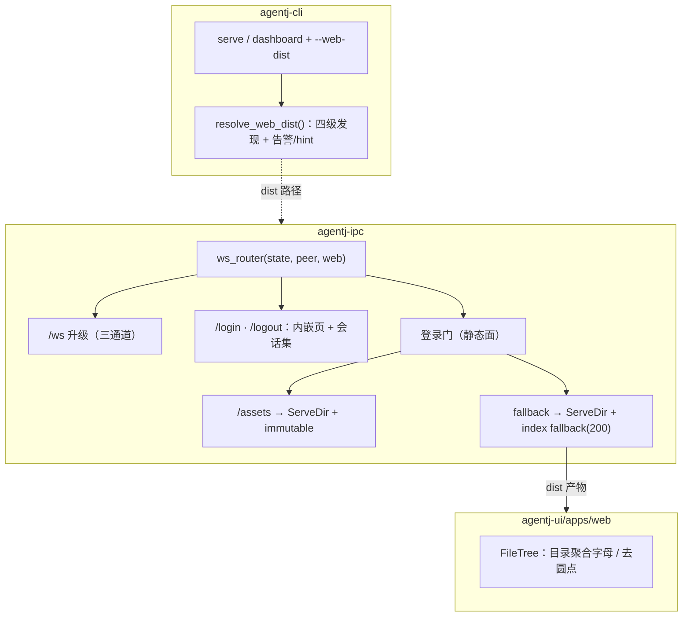
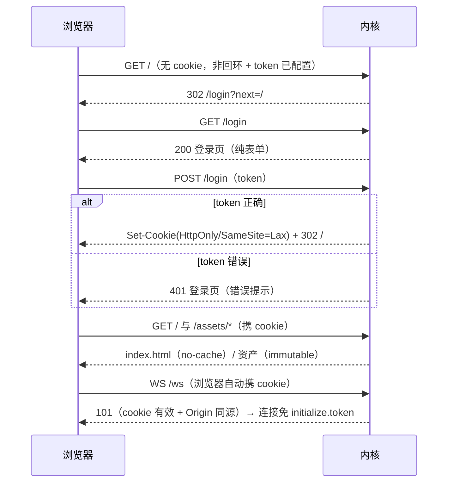
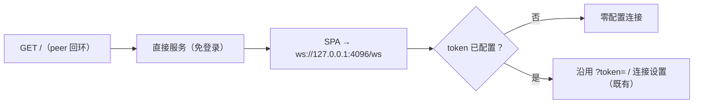
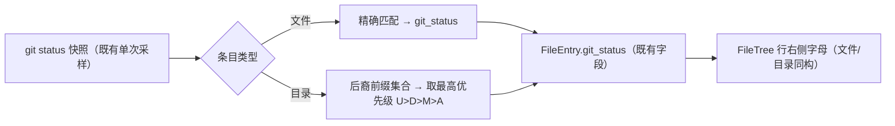

# 设计文档：AgentJ 内核托管 Web UI（静态文件服务 + 远程登录）与文件树状态补强

> 状态：**设计定稿（待评审）** ｜ 日期：2026-09-19 ｜ 版本影响：工作区 0.18.1 → **0.19.0**；`PROTOCOL_VERSION` 保持 **0.13.0**（无 wire 契约变化）
>
> 上游输入：用户 feature 请求（2026-09-19，两项）；`.agents/summary/summary_and_next.md`「下一步」候选（内核直接托管 Web UI）。
> 调研依据：3 路并行代码调研（后端协议 / 前端渲染 / IPC+CLI 接线）+ 本地 vendored 源码提取（tower-http 0.6.11 / axum 0.8.9，与 `Cargo.lock` 完全同版本）。
>
> 本文档定义 **WHAT / WHY**；任务级 TDD 拆解属下一阶段（`/jskill-feature-plan`）。

## 概述

本特性包含两部分，同属一个版本（0.19.0）、一分支一 PR：

1. **文件树状态补强（用户请求 item 1）**：v0.15.0 已交付「右栏运行详情（任务/文件变更）协议驱动」与「左栏文件树 git 状态字母」；本次为**实机核对回归** + 两个小补强：
   - ① **目录行聚合状态**：折叠目录即可见后裔变更（并让「已删除」以父目录聚合形式可见——文件树不列已删文件的语义不变）；
   - ② **状态显示收敛**：移除冗余圆点，保留字母 + 色义。
   - 实施上仅**填充既有可选字段**（`FileEntry.git_status`），**不改协议**。
2. **内核直接托管 Web UI（用户请求 item 2）**：`agentj serve` / `agentj dashboard` 用 axum `ServeDir` 在同端口托管 `agentj-ui/apps/web/dist` —— 远程打开 `http://<host>:4096/` 即用、WS 同源零配置。含 `--web-dist` + 四级 dist 发现、`/` 与 `/ws` 路由共存、混合鉴权（回环开放 / 非回环 + token 走 cookie 登录门）、测试与文档。

## 目标与非目标

### 目标

| # | 目标 |
|---|------|
| G1 | 文件树目录行显示聚合状态（优先级 `U > D > M > A`，多级递归），wire/schema 零变化 |
| G2 | 文件树行右侧状态收敛（字母 + 色义保留、冗余圆点移除）；实机核对右栏/文件树现状并回归锁定 |
| G3 | `serve`/`dashboard` 同端口静态托管：`GET /` 200（index.html）、`/assets/*` 长缓存、未知路径 SPA fallback 200、`/ws` 优先级与既有语义不回退 |
| G4 | 混合鉴权：回环 peer 免登录；非回环 + token → 内嵌登录页 + 不透明会话 cookie（HttpOnly/SameSite=Lax）；登录后 WS 自动可用（cookie 通道 + Origin 同源校验） |
| G5 | dist 发现：`--web-dist` > `AGENTJ_WEB_DIST` > CWD 仓库布局 > exe 相对布局 > 无（404 + 启动 hint；登录门停用） |
| G6 | 门禁全绿：cargo test/clippy/fmt/drift、SDK/Web/TUI、web build、check-version（0.19.0）、desktop-ui |
| G7 | 文档同步：README、`docs/specs/ipc-protocol.md`（传输鉴权节）、AGENTS.md、summary、本设计文档 |

### 非目标

- ❌ **不改 JSON-RPC wire 契约**：无新方法/类型/schema；`PROTOCOL_VERSION` 保持 0.13.0（目录聚合仅填充既有可选字段）。
- ❌ 不做 TLS/HTTPS、用户体系、登录速率限制（LAN 工具；后续候选）。
- ❌ 不做页面 URL `?token=` 自动带入（Web 连接设置已支持手填 + 持久化 + 刷新重连）。
- ❌ **不新增运行生命周期区块**（协议无 run 实体：无 `run_id`/状态/起止事件；「运行状态」类右栏增强列为后续候选）。
- ❌ 不做 `rust-embed` 内嵌产物、独立静态端口、多实例编排、OS 级守护。
- ❌ 不改 TUI/Desktop 行为（Desktop 自带 `frontendDist`，不受影响）。
- ❌ 不新增第三方依赖（`tower-http`/`uuid` 均已在 `Cargo.lock` / 工作区）。

## 设计方案

### 选定路线

- **静态回退挂载**：现有 `ws_router` 增 `.nest_service("/assets", 缓存包裹的 ServeDir)` + `.fallback_service(SPA 服务)`；显式路由 `/ws`、`/login`、`/logout` 优先。
- **混合鉴权**：回环 peer 开放；非回环 + token → 登录门（内嵌页 + 不透明会话 cookie）；WS 三通道：`?token=`（既有）/ cookie（新）/ `initialize.token`（既有）。
- **dist 四级发现** + 显式路径无效仅告警（API 优先）。
- **文件树补强**：服务端 `attach_git_statuses` 为目录项填充聚合状态；前端移除圆点。

### 备选方案

| 方案 | 优点 | 缺点 | 为何未选用 |
|---|---|---|---|
| A. ServeDir 挂现有 router fallback（选定） | 同端口同源零配置；复用既有分类器/token/连接骨架；dev 循环快 | fallback 语义需精细（200 vs 404） | — |
| B. 独立静态端口 | 隔离 | 跨端口跨源（CORS/WS 地址配置）、token 面翻倍 | 与「同源零配置」目标冲突 |
| C. `rust-embed` 内嵌产物 | 单二进制、无路径发现 | 改 UI 需重建二进制；dev 循环差；体积膨胀 | 与仓库内 dev 工作流不符 |
| D. cookie 存原始 token | 实现最简 | token 落浏览器、不可撤销（换 token 即全失效） | 不透明会话 ID 成本极低、收益明确 |
| E. 静态完全开放（无登录门） | 范围最小 | 远程用户可直接取 UI 壳 | 用户选定混合策略 |
| F. 前端聚合目录状态 | 纯前端 | 折叠目录永远无状态 | 服务端一次快照即可全局可见 |
| G. SPA fallback 用 `not_found_service` | 直白 | 强制 404 状态 | 源码确认应使用 `.fallback()`（200 语义） |

## 架构

### 组件图

### 路由与共存

| 路由 | 方法 | 归属 | 说明 |
|---|---|---|---|
| `/ws` | GET（升级） | 既有 | 显式路由优先于 fallback；三通道鉴权（见矩阵） |
| `/login` | GET/POST | 新 | 内嵌登录页（不依赖 dist）；POST 校验 token |
| `/logout` | POST | 新 | 会话失效 + 清 cookie |
| `/assets/*` | GET/HEAD | 新（门内） | `nest_service`（前缀剥离）→ `ServeDir(dist/assets)` + 长缓存 |
| 其余全部 | GET/HEAD | 新（门内） | fallback → `ServeDir(dist)` + `.fallback(ServeFile(index))`（200 语义）；未通过门 → `302 /login` |

> 连接分类器不动：HTTP 请求沿用 `looks_like_http` 分支（不计入 active、不触发停机、不受 `max-connections` 限制——既有语义，记录为已知边界）。

### 鉴权矩阵（`--token` × 来源 × 资源）

| 请求 | 条件 | 行为 |
|---|---|---|
| 静态 GET/HEAD | **peer 回环** | 直接服务（免登录） |
| 静态 GET/HEAD | 非回环，token 未配置 | 直接服务（沿用 v0.16.2 启动告警） |
| 静态 GET/HEAD | 非回环，token 已配置，有效会话 cookie | 服务 |
| 静态 GET/HEAD | 非回环，token 已配置，无/无效 cookie | `302 → /login?next=<同源相对路径>` |
| GET/POST `/login` | 任何（**不在门后**，防重定向环） | 登录页；POST：对 → 会话 + `Set-Cookie: agentj_session=<uuid>; HttpOnly; SameSite=Lax; Path=/` + `302 → next`；错 → 401 + 错误提示 |
| POST `/logout` | 有效会话 | 会话失效 + 清 cookie + `302 → /login` |
| `/ws` 升级 | `?token=` / **有效会话 cookie（须带同源 Origin）** / `initialize.token` | 升级 |
| `/ws` 升级 | 无有效通道，token 已配置 | 403（既有） |
| 其余路径 | dist 已解析 | SPA fallback → `index.html`（200） |
| 其余路径 | dist 未解析 | 404（既有行为）+ 启动时 hint（**登录门仅在 dist 已解析时启用**——无静态可保护时不设登录墙） |

### 数据流

#### A. 远程登录闭环（无 JS 依赖）

#### B. 本地开放（回环 peer）

#### C. 文件树目录聚合（item 1）

## 关键设计决策

**D1 同端口 fallback 托管（与 `/ws` 共存）**
显式路由优先于 fallback（axum `path_router` 失配才走 fallback，源码确认）；根路径必须 `fallback_service`（`nest_service("/")` panic）；`serve_http` 的 hyper-util 桥接零改动；连接分类器不动。

**D2 混合鉴权（回环开放 / 远程登录）**
门控条件 =（非回环 peer）∧（token 已配置）∧（dist 已解析）。「回环」= **请求来源 peer IP**（用户选定语义）；绑 `0.0.0.0` 时本机经 `127.0.0.1` 免登录、经 LAN IP 或远程需登录。非回环无 token 的启动告警沿用 v0.16.2。

**D3 不透明会话 cookie**
登录成功 → `uuid` 随机会话 ID 入内存集合（读写锁）+ `Set-Cookie: agentj_session=<id>; HttpOnly; SameSite=Lax; Path=/`（**会话 cookie、无 Max-Age**；重启即失效）。浏览器永不持有原始 token；`/logout` 可撤销；无持久化（重启 = 重新登录，符合预期）。

**D4 WS cookie 通道 + Origin 校验**
升级判定三通道：`?token=`（行为不变）/ cookie（有效会话且 Origin 与 Host 同源）/ `initialize.token`（行为不变）。cookie 通道连接**免 `initialize.token`**（升级层已完成鉴权）；Origin 缺失或不匹配仅拒绝 cookie 通道——非浏览器客户端无 Origin，不受影响。

**D5 dist 四级发现**
`--web-dist` > `AGENTJ_WEB_DIST` > `<cwd>/agentj-ui/apps/web/dist` > exe 相对（`../share/agentj/web`、`./web`）；首个含 `index.html` 者胜出。**显式来源（flag/env）无效/缺 index → 启动显著警告 + 停止发现（静态面禁用，避免静默服务错目录）**；自动候选无 index → 静默跳过下一个；全部落空 → 静态面 404 + 启动 hint（打印已搜索候选 + 构建命令）。服务不因 UI 资产问题退出（API 优先）。

**D6 缓存策略（逐服务包裹）**
`/assets`（Vite hash 产物）→ `SetResponseHeaderLayer::overriding(Cache-Control: public, max-age=31536000, immutable)`；根 fallback → `overriding(no-cache)`（index.html 走 `If-Modified-Since` 304 重验）。**不用 `Router::layer`**（会波及 `/ws` 与登录路由）——二者均为对服务单独包裹后再挂载。

**D7 目录聚合（服务端填充）**
由既有单次 git 快照构造「后裔前缀」判定集；目录取最高优先级 `U > D > M > A`；目录聚合使「删除」以父目录形式可见（文件树不列已删文件的语义不变）。仅填充 `FileEntry.git_status` 可选字段，wire/schema 零变化。

**D8 前端状态收敛**
`FileTree` 移除 `.dot` 元素与对应样式；字母 + 色义保留（`.status-M/A/U/D`）；目录行复用同一字母渲染；测试同步（含「无 dot」断言与目录状态用例）。

**D9 SPA fallback 200 语义**
`ServeDir::fallback(ServeFile::new(index))`（源码确认 200；`not_found_service` 会强制 404）。未知**页面**路径返回 index 200；错拼的 `/assets/*` 路径返回 404（assets 子树无 fallback）—— 单页应用常规行为，记录为已知限制。

**D10 版本与门禁**
工作区 0.18.1 → 0.19.0（feature minor）；`PROTOCOL_VERSION` 保持 0.13.0；`check-version.sh` 同步（Cargo + sdk VERSION + desktop 三处 + methods.json 0.13.0）。

## 错误处理

| 场景 | 行为 |
|---|---|
| 登录 token 错误 | 401 + 登录页错误提示（单一凭证）；**无速率限制**（LAN 工具，已接受限制，后续候选） |
| `next` 参数畸形/跨站 | 白名单校验：必须以 `/` 开头、非 `//` 开头、且不含反斜杠/控制字符，否则回落 `/`（防开放重定向，含反斜杠规范化变体） |
| cookie 失效（重启/登出/伪造） | 视同无 cookie → `302 /login`；**资产请求同样 302**（页面半损坏属预期，重新登录刷新即恢复） |
| `--web-dist` / `AGENTJ_WEB_DIST` 无效/缺 `index.html` | 启动显著警告 + 静态面禁用（**不静默回落自动发现**）；服务继续运行（API 优先） |
| 自动发现全部落空 | 静默降级 + 启动 hint（候选路径 + 构建命令 `npm --prefix agentj-ui run build --workspace=@agentj/web`） |
| WS cookie 通道 Origin 缺失/不匹配 | 仅拒绝 cookie 通道（403）；`?token=` / `initialize.token` 通道不受影响 |
| ServeDir 既有边界 | 词法拒绝 `..`/绝对路径/反斜杠（404/fallback）；**跟随符号链接**（不 canonicalize——已接受边界，dist 为本地产物）；目录无尾斜杠 307；单段 Range 206 / 多段 416；非 GET/HEAD 405；无 ETag；MIME 兜底 `application/octet-stream` |
| dist 未解析 | 静态面 404；登录门停用（无可保护资源） |
| 会话集合并发 | 读写锁；内存态、无持久化 |
| 既有语义不动 | `?token=` 403、`initialize.token` -32806、`max-connections` 503、非回环无 token 启动告警、HTTP 不触发停机 |

## 测试策略

### Rust（agentj-ipc，in-process：oneshot + 注入假 peer + tempdir fixture dist）

1. **登录门/登录流（8 项）**：回环直出；非回环无 token 直出；非回环 + token 无 cookie → 302；POST 正确 → `Set-Cookie` + 302；错误 → 401；有效 cookie 放行；无效 cookie → 302；`next` 白名单（外站/`//` → `/`，正常相对路径保留）。
2. **静态服务**：`/` 200；`/assets/x.js` 200 + immutable；`/unknown` → index 200；dist 缺失 → 404 且登录门停用。
3. **WS cookie 通道**：有效 cookie + 同源 Origin → 升级且免 `initialize.token`；无效 cookie / Origin 缺失或不匹配 → cookie 通道拒绝；`?token=` 通道回归通过。
4. **目录聚合**：git fixture 断言多级目录聚合与优先级 `U > D > M > A`；clean/非 git → null。
5. **e2e 新 `e2e_http_static.rs`**（模板 = `e2e_ws.rs` 的 `free_port`/`wait_for_listen` + 手写最小 HTTP GET/POST，零新 dev 依赖）：`serve --port 0 --web-dist <fixture>` → `/` 200、`/unknown` → index、`/ws` 语义不回退；无 dist → 404 + 启动 hint 断言。

### Web（vitest）

`FileTree` 目录聚合字母渲染、字母保留、**无 `.dot`** 断言更新；其余不回归。

### 实机核对清单（G2）

右栏「任务」（勾选/进行中脉冲/状态 pill/计数/空态）；「文件变更」（徽标/`+N/-N`/diff 展开/无 diff 不可展开）；文件树（懒加载/图标/状态字母）；核对后回归锁定。

### 验收（实机 Playwright）

本地打开即用 + 视觉核对；远程门用本机 LAN IP 访问（源地址 = 非回环）→ 登录页 → token → 全站可用（含 WS）；`curl -I` 断言缓存头（index no-cache / assets immutable）。

### 门禁清单

- `cargo fmt` / `cargo test --workspace` / `clippy -D warnings` / drift 2 passed
- SDK 46 / Web（更新后计数）/ TUI 71 / web build
- `./scripts/check-version.sh`（0.19.0；`PROTOCOL_VERSION` 0.13.0）
- `node agentj-ui/apps/desktop/check-desktop-ui.mjs`

## 依赖

- **新增直接依赖**：
  - `agentj-ipc` += `tower-http { version = "0.6", features = ["fs", "set-header"] }` —— **非新第三方**（`Cargo.lock` 已在 0.6.11，经 reqwest 传递）；启用 feature 后新增 `http-range-header` / `mime_guess` / `unicase` 三个 lock 条目，**均已本地 registry 缓存，`--offline` 可解析**。
  - `agentj-ipc` += `uuid`（工作区既有；确认/启用 `v4` feature）。
- **前置**：v0.18.1 main（已达成）；无阻塞项。
- **触点**：`agentj-ipc`（新 web 模块 / `ws.rs` / `file_list.rs` 目录聚合 / `Cargo.toml`）、`agentj-cli`（flags / 发现 / 日志）、`agentj-ui/apps/web`（`FileTree` + 测试）、文档四处、版本六处。

## 已知限制

1. ServeDir 跟随符号链接（不 canonicalize）——dist 为本地构建产物，接受；如需 containment 另立。
2. 登录无速率限制/锁定（LAN 工具）。
3. 多段 Range 返回 416（tower-http 语义，无 multipart）。
4. HTTP 静态请求不受 `max-connections` 限制、不触发停机（既有分类器语义）。
5. SPA fallback 对未知**页面**路径返回 index 200；错拼的 `/assets/*` 路径返回 404（assets 子树无 fallback）——单页应用常规行为。
6. 会话内存态：重启/换 token 即需重新登录（符合预期）。

## 验收标准

| # | 标准 |
|---|---|
| 1 | 目录聚合：多级目录在有后裔变更时显示最高优先级字母；clean/非 git 无状态 |
| 2 | 文件树无圆点；字母与色义一致 |
| 3 | `serve --port 0 --web-dist <fixture>`：`/` 200、`/assets/*` immutable、未知路径 index 200、`/ws` 不回退 |
| 4 | 远程流：非回环 + token → 登录页 → 登录后 UI 与 WS 全可用（cookie 通道） |
| 5 | 回环 peer 免登录；dist 缺失 404 + hint |
| 6 | 门禁全绿（见清单） |

## 实施状态

> **已落地（v0.19.0）**：工作区 `0.19.0` / `PROTOCOL_VERSION` 保持 `0.13.0`；分支 `feature/kernel-hosted-web-ui`；PR 由验收流程在通过后创建。
>
> 门禁清单（全绿）：`cargo fmt` / `cargo test --workspace` / `clippy -D warnings`（零警告）/ drift 2 passed / sdk 46 / web 480 / tui 71 / web build / `./scripts/check-version.sh` 0.19.0 / desktop-ui。
>
> 给后续读者的两处实现适配：
> - (a) **WS cookie 通道如何免 `initialize.token`**：cookie 鉴权通过的连接在服务端装配 initialize 参数时注入 server token——`serve_connection` 的 token 参数已属遗留/冗余，故 cookie 通道客户端无需再传 `initialize.token`；`?token=` 与 `initialize.token` 两通道语义不变。
> - (b) **T8 e2e 断言**：`e2e_http_static` 除断言 `/assets/*` 状态码外，还**持有 stdout reader**（避免子进程 stdout 提前关闭）。
