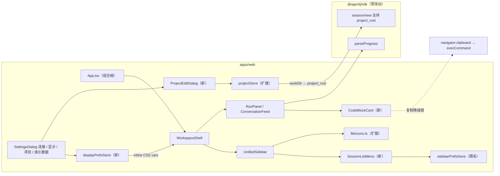
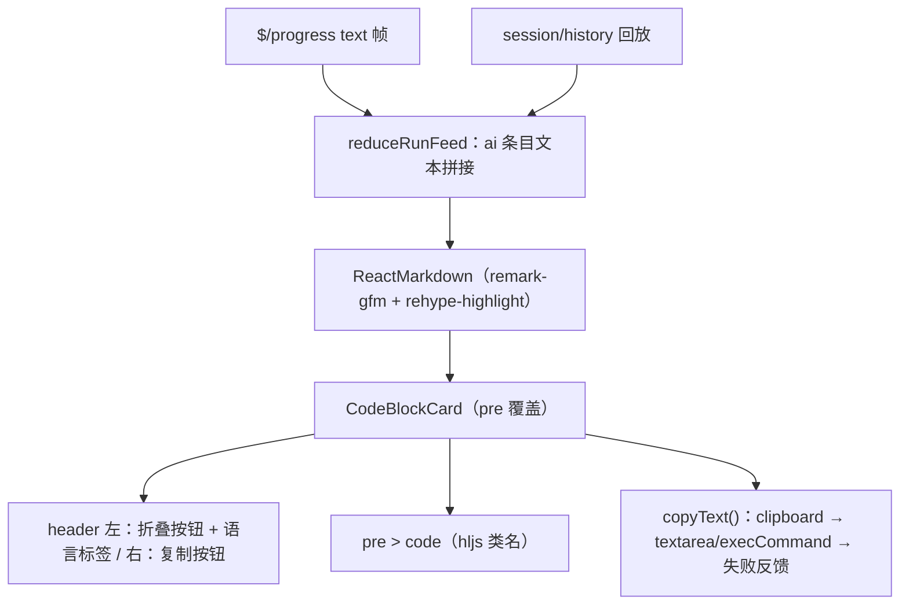
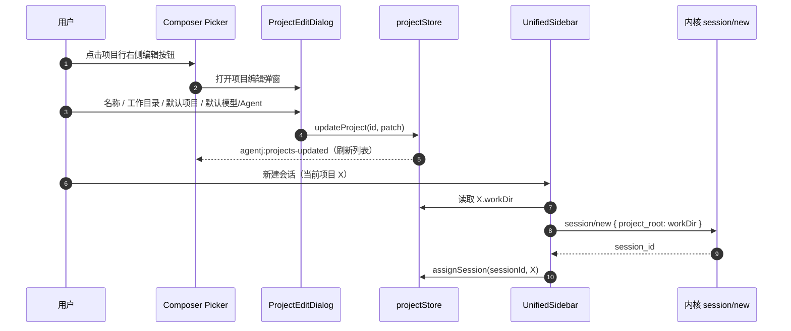
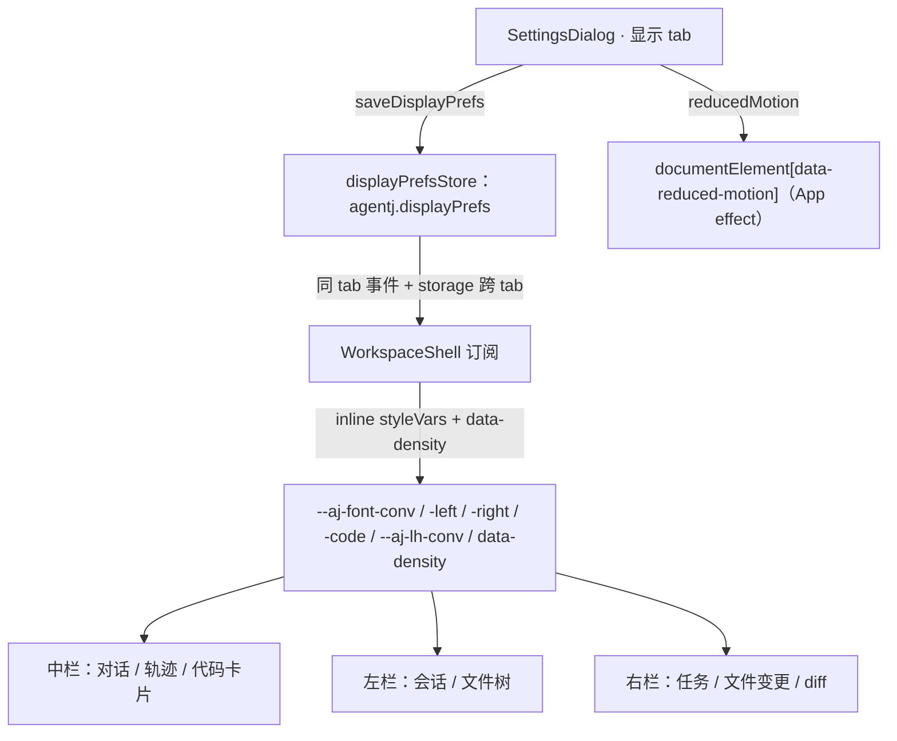
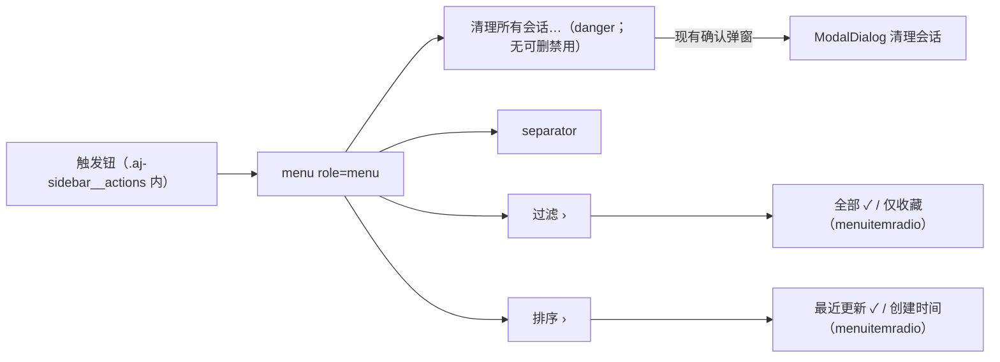

# 设计文档：Web 工作台六项增强 —— 代码卡片 / 显示设置 / 会话菜单 / 项目配置（0.17.0）

> 来源=用户反馈（6 项）：① 对话中栏代码输出应以独立卡片呈现（左上展开折叠 + 右上复制）；
> ② 设置提供显示设置（对话/轨迹、左栏、右栏字号独立 + 其他必要项）；
> ③ 文件树为 rust 等源码文件提供图标；④ 左栏清理按钮改为下拉菜单（设置中「会话列表」
> 项迁入 + 悬停自动展开二级菜单选过滤/排序）；⑤ composer 项目下拉每项提供编辑按钮
> （工作目录、默认项目等）；⑥ 设置弹窗提供项目公共配置。
> 范围：仅 `agentj-ui/apps/web`（Desktop 复用 Web 产物）；**Rust / SDK / protocol 零改动**；
> `PROTOCOL_VERSION` 保持 `0.13.0`。本设计只定 WHAT/WHY；任务级 TDD 拆分归
> `/jskill-feature-plan` 阶段。

## 概述

v0.16.5 的 Web 三栏工作台已具备真实协议驱动（TODO/变更/文件树/提问）与完整会话管理。
本次针对六项体验缺口做增量增强：**代码呈现质量**（卡片化 + 高亮 + 复制）、
**可访问性/个性化**（独立分区字号、行高、密度、减弱动画）、**文件识别度**（源码图标）、
**信息架构收敛**（会话列表设置从设置弹窗迁回侧栏菜单）、**项目模型完整化**
（工作目录/默认项目/默认模型 + 编辑入口 + 设置集中管理）。

其中第 ⑤ 项伴随一个**真实功能缺口修复**：协议自 v0.13.0 起支持 `session/new`
的 `project_root`（后端 canonicalize 后作为 file/list 沙箱、bash cwd、权限 workspace_root、
工具相对路径、file_change 相对路径五处同源基准），但 Web 端所有 `session/new` 调用
均以空参数 `{}` 发起——项目工作目录设置将首次打通该链路（无协议改动，仅前端启用）。

## 调研摘要（一手事实 @0.16.5，已核实）

| 区域 | 事实 |
|---|---|
| 中栏代码 | `RunPanel.tsx:212` 为全仓唯一 ReactMarkdown 渲染点（`remarkPlugins=[remarkGfm]`；无 `components` 覆盖、无 rehype 插件）；代码围栏走默认 `<pre><code>`；`package.json` 无任何高亮库；全仓无 `navigator.clipboard`/复制工具；`.aj-ai pre` 未设字号（继承正文）、行内 `.aj-ai code` 11.5px、`.aj-tool-output` 12px（`conversation.css:37-50,93-103`） |
| 流式 | `reduceRunFeed`（`RunPanel.tsx:21-67`）把 `text` 帧追加到末尾 `kind:"ai"` 条目；卡片须在流式重渲染中保持折叠态；未闭合围栏由 react-markdown 兜底为代码块 |
| 字体 | `--aj-font-sm(13)/md(15)/lg(18)`、`--aj-line-height(1.6)` 静态于 `index.css:17-20`；tokens 包**无字体 token**；运行时动态变量唯一先例 = `WorkspaceShell` inline `--aj-left-w/--aj-right-w`；主题机制 = `documentElement.dataset.theme`（`App.tsx` effect + `agentj.theme-mode`） |
| 设置弹窗 | `SettingsDialog.tsx`：`CategoryId = connection / sessions / demo`；`role=tablist` + 单 `role=tabpanel`；`ModalDialog` + `cardClassName="aj-settings"`（680px）；排序/过滤单选组在 sessions tab（`pickSort/pickFilter` → `saveSidebarPrefs`） |
| 持久化约定 | `sidebarPrefsStore.ts` 模式：单 JSON 键 + 字段级枚举校验 + `load/save(patch)/subscribe` + 同 tab `CustomEvent` + 跨 tab `storage`；`layoutStore.ts` 同族（多键）；`projectStore.ts`：`agentj.projects / projectMap / projectCollapsed / currentProject` + 事件 `agentj:projects-updated`、`agentj:current-project-updated` |
| 侧栏清理 | `UnifiedSidebar.tsx:393-402` 清理按钮（`.aj-sidebar__cleanup`）**直接打开确认 ModalDialog**；`deletableIds` 排除当前会话；`requestCleanup/requestDelete/performDelete`（-32802/-32803 幂等容忍）；`flatRows`（344-354）应用 `prefs.filter/sort` |
| 菜单模式 | `TopbarMenu` hover 飞出（`FLYOUT_CLOSE_DELAY_MS=120`、桥接 `::before`、Esc 分层、`onFlyoutKeyDown`、focus 开启 + suppress refs）；几何 `right: calc(100% + 6px)`（向左飞出）——左栏场景须**镜像向右** |
| 文件图标 | `fileIcons.ts` 8 类 + default；`code` 仅 `ts/tsx/js/jsx/mjs/cjs/vue/svelte`；**缺 `rs/go/py/java/c/cpp` 等主流源码扩展名**；`extensionOf` 有 dotfile/大小写处理；`.file-icon--<category>` 有配色规则 |
| 项目模型 | `Project = { id, name, createdAt }`；`createProject/renameProject/assignSession/getProjectForSession/loadCurrentProject/setCurrentProject`；`renameProject` **不派发事件**；**无 update/delete**；`session/new` 全部以 `{}` 调用（`UnifiedSidebar.tsx:181/186`、`SessionPanel.tsx:120/203`） |
| composer picker | `RunPanel.tsx:549-644`：`ul role=listbox` + `li role=option`（点击 = `setCurrentProject`），末项 `New Project`；键盘 ↑↓/Enter/Esc（`pickerIndex`） |
| 依赖 | `lucide-react`、`react-markdown@10`、`remark-gfm@4`；无高亮库 |
| 测试基线 | web 308 tests（35 文件）；`settingsDialog.test.tsx` 覆盖排序/过滤持久化（本次迁移）；`fileIcons.test.ts` 21 用例映射表；`UnifiedSidebar.test.tsx`（项目归属继承）；`topbarMenu.test.tsx`/`a11y.test.tsx`（飞出菜单键盘） |

## 目标与非目标

### 目标

- **G1 代码卡片（P0）**：对话中 markdown 围栏代码渲染为独立卡片 `CodeBlockCard`——左上折叠/展开（默认展开、折叠态保留 header）、右上复制（clipboard → execCommand 降级链 + 瞬态反馈）；`rehype-highlight`（hljs common 语言集）高亮，主题色映射到现有语义色变量；流式安全（折叠态不因追加重渲染丢失）；行内 code 样式不变。
- **G2 显示设置（P0）**：新 `displayPrefsStore`（`agentj.displayPrefs`）——`fontConversation/fontLeft/fontRight/fontCode`（档位 小/中/大/特大）+ `lineHeight`（紧凑 1.4 / 默认 1.6 / 宽松 1.8）+ `density`（默认/紧凑）+ `reducedMotion`（bool）；设置弹窗新增「显示」tab（含「恢复默认」）；即时生效；中档 = 当前视觉；CSS 变量注入 + `var()` fallback 保值。
- **G3 文件图标（P1）**：`fileIcons.ts` 覆盖主流源码扩展名（rs/go/py/java/c/cpp/cs/rb/php/kt/swift/scala/lua/dart 等）+ 新增 `db` 类（`Database` 图标）+ 文件名特例（Dockerfile/Makefile/CMakeLists.txt → code）。
- **G4 会话列表菜单（P0）**：左栏清理按钮改为下拉菜单 `SessionListMenu`——`清理所有会话…`（打开既有确认弹窗，无可删时禁用）+ `过滤 ›`（全部/仅收藏）+ `排序 ›`（最近更新/创建时间）；悬停行自动展开二级飞出（镜像 TopbarMenu 模式，方向向右）；设置弹窗「会话列表」tab 整体移除。
- **G5 项目编辑（P0）**：`Project` 记录扩展 `workDir/isDefault/defaultModel/defaultAgent`（可选字段，零迁移）；store 新增 `updateProject`（isDefault 全局互斥；补齐 rename 事件）与 `deleteProject`；composer picker 每行右侧编辑按钮 → `ProjectEditDialog`；**工作目录打通 `session/new { project_root }`**；默认模型/Agent 随项目切换应用。
- **G6 设置「项目」（P0）**：设置弹窗新增「项目」tab——全局区（默认项目选择、新项目工作目录预填 `agentj.projectDefaults`）+ 项目列表（名称/工作目录/默认徽标/编辑/删除）；Inbox 不可删；删除时会话归属回退。

### 非目标

- ❌ 不改任何 Rust crate / `packages/sdk` / `packages/protocol` / `PROTOCOL_VERSION`（保持 0.13.0）；不新增协议方法（`project_root` 为已发布能力）。
- ❌ 不动 TUI / Desktop 源码（Desktop 复用 Web 产物）；不改消息区宽度（v0.16.0 全宽拉伸保持）。
- ❌ 不重构工具卡（`ToolCard` 已有折叠）与轨迹文本渲染；不改提问卡。
- ❌ 不为语法高亮新增 tokens 包语法色 key（复用现有语义色；如对比度不足在实现评审时另行决策）。
- ❌ 不做项目级会话数据迁移、不做服务端改动。

## 设计方案（选定路线：纯前端增量 + 既有模式复用）

六个子特性相互独立、全部落在 `apps/web` 内，复用既有的三类先例：**store 模式**
（`sidebarPrefsStore`）、**菜单/对话框模式**（`TopbarMenu` 飞出 + `ModalDialog`）、
**动态 CSS 变量模式**（`WorkspaceShell` inline vars）。无新架构层、无跨包改动；
唯一新依赖 `rehype-highlight`（web workspace）。

### 备选方案（总表）

| 决策点 | 选用 | 备选 | 未选原因 |
|---|---|---|---|
| 代码高亮 | `rehype-highlight`（hljs common） | 无高亮；shiki | 用户决策：hljs 同步渲染、与 react-markdown 生态直通、流式友好；shiki 异步集成复杂、包体大 |
| 字号机制 | CSS 变量 + 四档位（小/中/大/特大） | px 滑杆连续值；根 rem 全局缩放 | 档位确定性强、可测、免输入校验；全局缩放无法分区独立 |
| 高亮主题 | 复用现有语义色变量映射 `.hljs-*` | tokens 包新增语法色 key；引入官方主题 CSS | 零 tokens 生成链改动；官方主题无法复用现有三态（system/light/dark）机制 |
| 会话列表设置入口 | 完全迁入侧栏菜单（设置 tab 移除） | 设置 + 菜单双入口 | 用户需求明确「修改至该下拉菜单内」；双入口状态一致性成本高 |
| 项目字段承载 | 扩展 `Project` 记录（单源） | 独立 projectConfig store | 避免双写同步；旧数据天然兼容（可选字段） |
| 菜单实现 | 复用 `.aj-menu*` 样式 + `--right` 修饰 + 新组件 | 独立新实现 | hover 延迟/桥接/Esc 分层/键盘已解决，行为一致性直接继承 |

## 架构

### 总览

### 代码卡片渲染管线（G1）

### 项目编辑与 project_root 数据流（G5/G6）

### 显示设置数据流（G2）

### 会话列表菜单结构（G4）

## 关键设计决策

**D1 代码卡片接入方式（G1）**
- 覆盖 react-markdown 的 `pre` 组件（`components={{ pre: CodeBlockCard }}`）+ `rehypePlugins={[rehypeHighlight]}`；行内 code 无语言类不受影响。
- 卡片结构 `figure > figcaption + pre`：header 左 = 折叠按钮（chevron，`aria-expanded`）+ 语言标签（提取 `language-*`）；header 右 = 复制按钮。折叠 = header 保留、body 以 `hidden` 隐藏（**不卸载**，复制读取 `textContent` 不受影响）。
- 折叠状态为卡片组件内 `useState`：React 按位置协调，流式文本追加不重置状态；同一消息多个代码块各自独立。
- 复制文本源 = `<pre>` ref `textContent`（高亮只增加元素层级，不改文本内容）。

**D2 复制降级链（G1）**
- `navigator.clipboard.writeText` → 失败/不可用（**http 局域网访问为非安全上下文**，v0.16.2 远程场景）降级 textarea + `document.execCommand("copy")` → 双失败显示「复制失败」瞬态。
- 成功反馈：图标切换 Check + 「已复制」1.5s；`aria-live="polite"` 状态文本。
- 提炼纯工具函数 `copyText(text): Promise<boolean>` 便于单测降级路径。

**D3 高亮主题映射（G1）**
- `.hljs-*` 类映射现有语义色（浅/深/系统三态自动随 tokens 机制）：keyword/literal → `--aj-accent`；string/attr → `--aj-success`；number/built_in/type → `--aj-warning`；comment/quote → `--aj-textMuted`（italic）；title/function → `--aj-text`（600）；tag/deletion → `--aj-error`。
- 不新增 tokens key；不引官方主题 CSS（避免三态重复）。

**D4 字号机制与注入点（G2）**
- `displayPrefsStore` 沿用 `sidebarPrefsStore` 模式（单 JSON 键 + 字段枚举校验 + 事件 + storage）；`saveDisplayPrefs(patch)` 返回归一化结果。
- 注入点 = `WorkspaceShell` 现有 inline styleVars 扩展（既有唯一先例）：`--aj-font-conv/-left/-right/-code`、`--aj-lh-conv` + `data-density`；消费侧一律 `var(--aj-font-*, 现值)` fallback（无 JS / 单测环境渲染结果与现值一致）。
- 档位映射（中档 = 现值；次级文本用 `calc(变量 ± 固定差)` 保持档间比例）：

| 变量 | 小 | 中（默认） | 大 | 特大 |
|---|---|---|---|---|
| `--aj-font-conv`（对话/轨迹主体） | 13 | 15 | 17 | 19 |
| `--aj-font-left`（会话/文件树主体） | 12 | 13 | 14.5 | 16 |
| `--aj-font-right`（任务/变更主体） | 12 | 13 | 14.5 | 16 |
| `--aj-font-code`（代码块/工具输出） | 11 | 12 | 13.5 | 15 |
| 行内 code / diff 行 | `calc(var(--aj-font-code) - 0.5px)`（中档 = 11.5，与现值一致） | — | — | — |

- 轨迹分组：节点正文 = `calc(var(--aj-font-conv) - 2px)`（中档 = 13 现值）、次要行 = `calc(var(--aj-font-conv) - 3px)`（中档 = 12 现值）。
- **对齐修正（随实现记录）**：`.aj-ai pre` 现状未显式设字号（继承正文 15px），本次统一为 `--aj-font-code` 中档 12px（对齐 v0.14 视觉规格「代码块 12px」）；行内 code / diff 行 / 工具输出经 `calc` 在中档精确保留现值。
- 密度：`data-density="compact"` 仅收紧 4 类间距（对话 gap、会话行内边距、右栏行内边距、composer 内边距），不改字号与控件命中区。

**D5 减弱动画（G2）**
- `reducedMotion` 由 App effect 写 `documentElement.dataset.reducedMotion`（镜像 theme 机制，覆盖 portal 弹窗）；CSS 以 `:root[data-reduced-motion="true"] *` 熔断过渡/动画（时长趋零）。
- 默认 `false`（不改变现状）；既有 `@media (prefers-reduced-motion: reduce)` 规则保留（系统偏好仍自动生效）。

**D6 设置迁移与新增 tab（G2/G4/G6）**
- `SettingsDialog` 分类最终为：**连接 / 显示 / 项目 / 演示数据**（「会话列表」移除，排序/过滤控件删除；对应测试迁移至 `SessionListMenu`）。
- 「显示」tab：3 组字号 + 代码字号 + 行高 + 密度 + 减弱动画 + 「恢复默认」；改动即时生效（无需保存按钮）。
- 「项目」tab：全局区（默认项目 select、新项目工作目录 input）+ 项目列表（名称/工作目录/默认徽标/编辑/删除）。

**D7 菜单复用与镜像（G4）**
- 复用 `.aj-menu*` 类与行为（120ms 延迟关闭、桥接、Esc 分层、键盘 ↑↓、外部点击关闭）；新增修饰 `.aj-menu__flyout--right`（`left: calc(100% + 6px)`，桥接镜像）供左栏场景。
- 新组件 `SessionListMenu`：触发钮（⋯ 图标 + `aria-haspopup="menu"`）替代原清理按钮位置；`清理所有会话…` 打开既有确认弹窗（清理语义不变）；过滤/排序 `menuitemradio` + ✓ 直写 `saveSidebarPrefs`（`UnifiedSidebar` 已订阅，即时生效）。
- 无可删会话（`deletableIds` 为空）时清理项禁用（菜单其余项保持可用）；菜单项点击后收起全部层级。

**D8 项目记录扩展与写入路径（G5/G6）**
- `Project` 加可选字段：`workDir?: string | null`、`isDefault?: boolean`、`defaultModel?: string | null`、`defaultAgent?: string | null`；`loadProjects` 容错旧数据（缺失字段视为未设置，**零迁移**）。
- 新 `updateProject(id, patch)`：名称去重（沿用 create 规则）、`isDefault: true` 时**互斥清除其他项目**默认标记、统一派发 `agentj:projects-updated`；`renameProject` 折叠为 `updateProject` 包装（修复其静默不通知问题）。
- 新 `deleteProject(id)`：守卫 Inbox（`"default"` 不可删）；`projectMap` 中该项目会话归属回退 `"default"`；清理 `projectCollapsed[id]`；修正当前/默认指向；派发事件；返回受影响会话数（确认弹窗展示「N 个会话将归属回 Inbox」）。
- 新 `loadProjectDefaults/saveProjectDefaults`（`agentj.projectDefaults`，`{ workDir }`）：新项目工作目录预填（添加项目对话框 + 设置「项目」tab 全局区）。

**D9 project_root 打通（G5）**
- `UnifiedSidebar.handleNewSession(targetProjectId)`：读取目标项目 `workDir`；非空 → `session/new { project_root: workDir }`，为空 → 维持 `{}`（后端默认进程 CWD）。
- 前端校验：`workDir` 须为绝对路径（以 `/` 开头；Windows 盘符不做前端推断，交由后端 canonicalize）；非法输入在编辑弹窗内联报错、不落库。
- 后端 canonicalize 失败 → `session/new` 错误经既有错误横幅展示，会话不创建；不改协议/后端。
- `SessionPanel.tsx`（legacy 备用面板）仅在其仍处于 App 渲染路径时同步补 `project_root`（实现阶段核对；死代码仅记录不改造）。

**D10 默认项目语义与删除守卫（G5/G6）**
- `isDefault` 全局唯一（`updateProject` 互斥维护）；`loadCurrentProject()` 回退链：已存 current（有效）→ `isDefault` 项目 → Inbox。
- 启动时若 current 缺失走回退链（`App.tsx` 现有 stale 清理逻辑扩展）。
- `deleteProject`：Inbox 不可删；被删项目下会话归属回退 Inbox；若删除的是当前项目 → current 重算（回退链）；若删除的是默认项目 → 默认标记清除。

**D11 默认模型/Agent 联动（G5）**
- 项目切换（`agentj:current-project-updated`，来源：composer picker / 顶栏项目飞出 / 设置默认项目选择）→ 若目标项目设 `defaultModel/defaultAgent` 则写入 composer 持久化选择（`agentj.composer.*`）并同步 UI；未设置则保留当前选择。
- 应用启动时按当前项目（回退链结果）同样应用一次。
- 语义：**「切换时应用」而非「强制」**——用户在 composer 的显式选择立即生效并持久化（项目内可临时换模型；切走再切回会重新应用项目默认）。
- 候选模型/Agent 列表与 composer 同源（kernel/status；App 下传）；列表不可用时选择器禁用并提示「连接后可用」。

**D12 嵌套弹窗栈（G6）**
- 设置弹窗内打开 `ProjectEditDialog` 与删除确认 → 两层 `ModalDialog` 叠加；`ModalDialog` 引入模块级栈：仅**栈顶实例**响应 Esc 与遮罩点击，卸载出栈；关闭时焦点归还其触发元素。
- 现有单层用法（连接设置、继续会话、添加项目、清理确认）行为不变。

**D13 版本与范围（G0）**
- `0.16.5 → 0.17.0`（feature minor）：`Cargo.toml`（workspace）+ `packages/sdk/src/config.ts` `VERSION` + `apps/desktop/{package.json, tauri.conf.json}` 同源（按 `scripts/check-version.sh` 实际清单执行）；`PROTOCOL_VERSION` 保持 `0.13.0`。
- 新依赖：`rehype-highlight`（web workspace `dependencies`）；其余零新增。

## 组件设计（接口与行为）

| 组件/模块 | 关键接口 | 行为要点 |
|---|---|---|
| `CodeBlockCard` | react-markdown `pre` 覆盖：`{ children }` | D1/D2/D3；折叠态留 header；语言标签；`copyText`；`aria-live` 反馈 |
| `copyText` | `(text: string) => Promise<boolean>` | clipboard → execCommand 降级链；纯工具可单测 |
| `displayPrefsStore` | `loadDisplayPrefs / saveDisplayPrefs(patch) / subscribeDisplayPrefs` + `DISPLAY_PREFS_KEY/EVENT/DEFAULTS` | D4；枚举校验；同 tab 事件 + storage 跨 tab |
| `SessionListMenu` | `{ deletableCount, busy, onCleanup }` | D7；trigger/menu/flyout 三层；`aria-haspopup/expanded`；Esc 分层 |
| `ProjectEditDialog` | `{ project, models, agents, onClose, onSaved? }` | 字段校验（名称必填、workDir 绝对路径）；isDefault 提示互斥；保存走 `updateProject` |
| `projectStore` 扩展 | `updateProject / deleteProject / loadProjectDefaults / saveProjectDefaults` | D8/D10；事件派发；delete 返回受影响会话数 |
| `SettingsDialog` | 新 `CategoryId: display / project`；props 增 `models/agents`（穿透） | D6；显示面板 + 项目面板（列表复用 `ProjectEditDialog`） |
| `WorkspaceShell` | 订阅 display prefs → inline styleVars + `data-density` | D4；`var()` fallback 保值 |
| `App.tsx` | `reducedMotion` effect；项目回退链初始化；models/agents 下传 | D5/D10/D11 |
| `fileIcons.ts` | `fileIconFor` 扩展（语言列表 + db 类 + 文件名特例） | G3；fallback 不变 |
| `ModalDialog` | 模块级模态栈（仅栈顶响应 Esc/遮罩） | D12；现有单层用法行为不变 |

## 视觉规格（关键值）

| 区块 | 规格 |
|---|---|
| 代码卡片 | 外框圆角 `--aj-radiusCard`；body `--aj-codeBg` + padding 10 12；header 28px、语言标签 11px mono `--aj-textMuted`；按钮 22px（`.aj-icon-btn` 血统）；折叠态仅 header；高亮色见 D3 |
| 显示设置面板 | 沿用 settingsDialog 表单样式（fieldset + 分段/单选）；「恢复默认」ghost 按钮置底 |
| 会话列表菜单 | 沿用 `.aj-menu`（min-width 200、item 30px）；飞出 `--right`（`left: calc(100% + 6px)`、桥接 8px）；清理项 danger（`--aj-error`） |
| 项目列表行 | 名称 13px/600 + 工作目录 11px mono `--aj-textMuted`（省略号）+ 默认徽标（`accentTint` 底 + accent 文字）+ 编辑/删除 icon 钮 |
| 编辑弹窗 | 沿用 `.aj-dialog-card`；字段 label 12px + input 32px；内联错误 11px `--aj-error` |

## 错误处理

| 场景 | 行为 |
|---|---|
| 复制不可用/被拒（http 局域网等非安全上下文） | 降级 textarea + execCommand；双失败显示「复制失败」瞬态，不抛异常 |
| 未知语言代码块 | hljs 不染色，卡片正常渲染（普通 code 样式） |
| displayPrefs / projectDefaults 脏 JSON | 字段级校验 + 默认回退（沿用 store 约定），不阻塞渲染 |
| workDir 非绝对路径 | 编辑弹窗内联错误、保存禁用；不落库 |
| workDir 后端 canonicalize 失败 | `session/new` 错误经既有错误横幅展示；会话不创建；项目设置保留（用户可修正） |
| 删除 Inbox / 唯一默认 | Inbox 行删除按钮禁用；删除默认项目后默认标记清除、current 回退链重算 |
| 无可删会话 | 清理项禁用（aria-disabled + muted），过滤/排序仍可用 |
| 嵌套弹窗 Esc | 仅栈顶关闭（模态栈）；焦点归还触发元素 |
| 流式未闭合围栏 | react-markdown 兜底为代码块；卡片折叠态按位置保持 |
| 模型列表未就绪 | 默认模型/Agent 选择器禁用 + 「连接后可用」提示 |
| 菜单矮视口 | 飞出层 `max-height:50vh` 内部滚动（沿用 topbar 菜单） |

## 测试策略

- **新增单测**：`displayPrefsStore.test.ts`（默认/往返/枚举校验/事件/跨 tab/恢复默认）、`codeBlockCard.test.tsx`（渲染/语言标签/折叠/折叠态流式追加保持/复制成功反馈/降级路径/失败反馈/aria）、`copyText.test.ts`（clipboard 成功 / 抛错降级 / 双失败；可并入卡片测试）、`sessionListMenu.test.tsx`（开合/悬停飞出与延迟/键盘/Esc 分层/外部点击/prefs 持久化与事件/清理项禁用）、`projectStore.test.ts` 扩展（updateProject 去重与互斥 / deleteProject 回退与计数 / 守卫默认 / 回退链 / 事件）、`projectEditDialog.test.tsx`（字段校验/保存接线/默认互斥提示）、`unifiedSidebar.test.tsx` 扩展（新建会话携带 `project_root`；无 workDir 不携带）、`fileIcons.test.ts` 扩列（rs/go/py/java 等 + db 类 + 文件名特例）、`workspaceShell.test.tsx` 扩展（display vars 注入）、`scaffold.test.ts`/`theme.test.ts` 更新（codeblock.css 导入、菜单修饰类）。`settingsDialog.test.tsx` 更新（分类 = 连接/显示/项目/演示数据；显示面板即时生效与恢复默认；项目列表渲染与删除确认）。
- **更新存量**：`settingsDialog.test`（排序/过滤迁移至菜单测试）、`topbarMenu.test`（添加项目对话框补 workDir 字段）、`a11y.test`（新菜单键盘/Esc 路径）、`RunPanel.test`（代码卡片渲染）。
- **门禁**：`npm --prefix agentj-ui test --workspace=@agentj/web`、`npm --prefix agentj-ui run build --workspace=@agentj/web`；sdk 46 不变；`cargo fmt/test/clippy` 与 drift 零变化；`./scripts/check-version.sh`（0.17.0 同源）；`bun --cwd agentj-ui/apps/tui test` 不变；`node agentj-ui/apps/desktop/check-desktop-ui.mjs`。
- **实机验收（Playwright，沿用既有流程）**：六项逐条 + 深浅主题 + 键盘链路；复制成功路径（回环）与降级路径（单元覆盖）；`prefers-reduced-motion` 不回归。

## 依赖

- **前置**：v0.16.5（三栏工作台、设置弹窗、飞出菜单、`fileIcons` 已就绪）。
- **外部**：`rehype-highlight`（含 highlight.js common 语言集）；无其他新增。
- **阻塞**：无（纯前端；`project_root` 后端 v0.13.0 已支持）。
- **生成链**：不改 `packages/tokens`（无 generate 步骤）。

## 产出与验收

- **交付物**：`CodeBlockCard` + `copyText`；`displayPrefsStore` + 设置「显示」tab；`fileIcons.ts` 扩展；`SessionListMenu`（含 `.aj-menu__flyout--right`）；`projectStore` 扩展 + `ProjectEditDialog` + composer 行内编辑 + `project_root` 打通；设置「项目」tab（全局默认 + 列表 + 删除）；`ModalDialog` 模态栈；版本 0.17.0。
- **验收清单**：
  1. 对话回复含 fenced code → 独立卡片、高亮、左上折叠（流式期间折叠态保持）、右上复制（成功反馈；http 环境走降级链）。
  2. 设置「显示」：三区字号 + 代码字号 + 行高 + 密度 + 减弱动画即时生效；刷新保持；「恢复默认」还原；中档 = 现状（代码块 12px 对齐修正除外）。
  3. 文件树 `.rs/.go/.py/...` 显示 code 图标、`.sql` 显示 db 图标、Dockerfile/Makefile 显示 code 图标。
  4. 左栏 ⋯ 菜单：清理项打开确认弹窗（无可删禁用）；悬停过滤/排序自动展开二级；选择即生效并持久化；设置弹窗不再有「会话列表」。
  5. composer 项目行编辑按钮 → 弹窗设置名称/工作目录/默认项目/默认模型；该项目新建会话在 WS 帧中携带 `project_root`；默认项目启动选中。
  6. 设置「项目」tab：全局默认项目/新项目工作目录；列表编辑/删除（Inbox 不可删、确认展示会话回退数）；删除后归属回退 Inbox。
  7. 门禁全绿 + 文档同步（AGENTS/README/summary）+ 版本 0.17.0。

## TODO 清单（plan 阶段拆分任务并逐期勾选）

> 状态：**设计完成（2026-09-19），待实现计划**。
> `/jskill-feature-plan` 将按本设计产出 T0..Tn 任务级清单（TDD）并回填本节。

- [ ] G1 代码卡片（`CodeBlockCard` + `copyText` + hljs 语义色映射）
- [ ] G2 显示设置（`displayPrefsStore` + 设置「显示」tab + 三栏 CSS 变量消费）
- [ ] G3 文件树源码图标（扩展名 + db 类 + 文件名特例）
- [ ] G4 会话列表菜单（`SessionListMenu` + 设置「会话列表」移除）
- [ ] G5 项目编辑（记录扩展 + 编辑弹窗 + picker 行内编辑 + `project_root` 打通 + 默认模型联动）
- [ ] G6 设置「项目」tab（全局默认 + 列表 + 删除 + 嵌套弹窗栈）
- [ ] G0 横切：版本 0.17.0 + 全量门禁 + 文档同步
