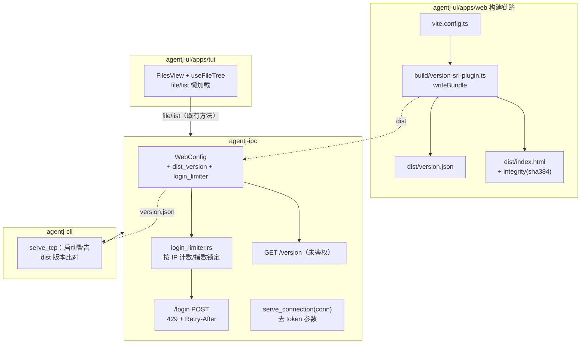
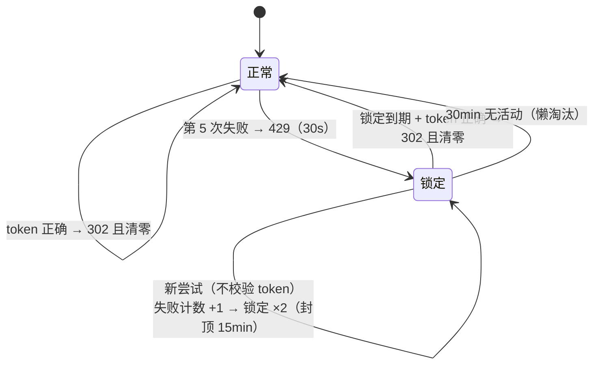
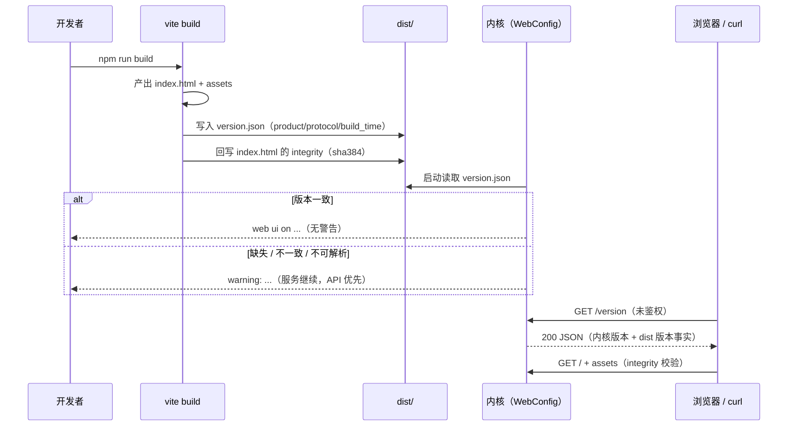
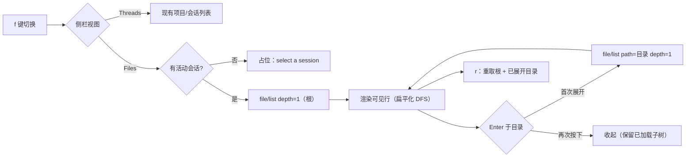

# 设计文档：AgentJ v0.20.0 —— 内核托管面加固与 TUI 文件视图

> 状态：**设计定稿（待评审）** ｜ 日期：2026-09-20 ｜ 版本影响：工作区 0.19.0 → **0.20.0**；`PROTOCOL_VERSION` 保持 **0.13.0**（无 wire 契约变化）
>
> 上游输入：用户 feature 请求（2026-09-20，四项）；`.agents/summary/summary_and_next.md`「下一步」候选（v0.19.0 验收遗留）。
> 调研依据：4 路并行代码调研（agentj-ipc `web`/`ws` token 接线；TUI 应用结构；dist 构建与版本常量；登录门与测试面）。
>
> 本文档定义 **WHAT / WHY**；任务级 TDD 拆解属下一阶段（`/jskill-feature-plan`）。

## 概述

本特性是 v0.19.0「内核托管 Web UI」的后续四项加固与补全，同属一个版本（0.20.0）、一分支一 PR：

1. **WS cookie 通道遗留 token 参数清理**：`IpcServer::serve_connection` 的第三参数 `_token` 自 v0.19.0 cookie 通道落地后已完全未使用（服务端在 WS 升级层完成鉴权与 initialize token 注入）。删除该参数及全部调用点，属纯重构、零行为变化。
2. **登录失败速率限制 / 退避**：v0.19.0 验收记录的已知限制（「登录无速率限制/锁定」）。按来源 IP 计数失败尝试，达到阈值后指数锁定（429 + `Retry-After`），锁定期间继续尝试会升级锁定；登录成功清零。
3. **内核托管 dist 的版本探测 / 资产完整性（SRI）**：dist 是 gitignored 构建产物、构建时未写入任何版本信息，内核可能托管陈旧 dist 而无法察觉；同时页面资产无 SRI 声明。本项在 web 构建链路生成 `dist/version.json` 与入口 HTML 的 `integrity` 属性，内核启动比对版本并新增未鉴权 `GET /version` 探针，Web 连接面板展示 UI/内核版本。
4. **目录聚合状态在 TUI 侧栏的呈现**：v0.19.0 已让 `file/list` 返回目录聚合 git 状态、Web 文件树已渲染，TUI 侧栏目前完全没有文件列表。本项在 32 字符侧栏新增 Files 视图（懒加载树 + 状态字母色义），与 Web 语义对齐。

## 目标与非目标

### 目标

| # | 目标 |
|---|------|
| G1 | 删除 `serve_connection` 遗留 token 参数：签名 + 2 生产调用点 + 6 测试调用点；清除失活局部变量；`WsServerState.token`/`WsQuery.token` 保留不变 |
| G2 | 登录限流：按 IP 计数，第 5 次失败起指数锁定（30s 起、×2、封顶 15min），锁定响应 `429 + Retry-After`；锁定期不校验 token、新尝试升级锁定；成功清零；内存态、无界增长防护 |
| G3 | dist 版本事实：web 构建生成 `dist/version.json`（product/protocol/build_time）；内核启动读取并与二进制版本比对，不一致/缺失/不可解析 → 启动警告（不阻断服务） |
| G4 | `GET /version` 探针：未鉴权、显式路由（优先于 SPA fallback）、`Cache-Control: no-store`，返回内核版本 + dist 版本事实 |
| G5 | 构建时 SRI：对入口 `index.html` 中同源 `script`/`stylesheet`/`modulepreload` 引用写入 `sha384-<base64>` `integrity`；本地引用缺失 → 构建失败（拒绝静默降级）；零新增依赖 |
| G6 | Web 版本展示：SDK barrel 导出 `VERSION`；`ConnectionStatus` hover 面板展示「UI 版本 · 内核版本」（不一致 warning 色 + `⚠`） |
| G7 | TUI Files 视图：侧栏 `Threads`/`Files` 双视图（`f` 切换）、`file/list` 懒加载树（depth 1）、目录聚合状态字母（色义同 Web）、`r` 刷新、无活动会话占位；展开状态不持久化 |
| G8 | 门禁全绿：cargo fmt / test / clippy / drift、SDK / Web / TUI、web build、check-version（0.20.0）、desktop-ui |
| G9 | 文档同步：`docs/specs/ipc-protocol.md` §2.3（`/version` + 429 语义）、README、AGENTS.md、summary、本设计文档 |

### 非目标

- ❌ **不改 JSON-RPC wire 契约**：无新方法/类型/schema；`PROTOCOL_VERSION` 保持 0.13.0（`/version` 为 HTTP 静态面路由，非 JSON-RPC 方法）。
- ❌ 不做 TLS/HTTPS、用户体系、多凭证、登录审计日志。
- ❌ 不做内核侧哈希校验（不引入 `sha2`/`base64` 直接依赖）；SRI 为构建期机制。
- ❌ 不改 serve/tcp 鉴权语义：`?token=` 403、`initialize.token` `-32806`、`max-connections` 503、回环/无 token 直出均不动。
- ❌ 不改 Desktop（自动继承 web 产物增强，无代码改动）；不改 Web 连接/会话/composer 既有行为。
- ❌ TUI 不做文件打开/编辑、不做搜索/过滤、不做 `@` 补全接入（`Composer.files` 保持现状）、不做展开状态持久化。
- ❌ 不新增第三方依赖（Node 内建 `crypto`；Rust 仅 std/serde_json 既有依赖）。

## 设计方案

### 选定路线

- **① 清理**：直接删除未使用参数与失活局部变量；不保留 deprecated 形态（无外部消费者，`serve_connection` 为进程内 API）。
- **② 限流**：新增独立模块 `crates/agentj-ipc/src/login_limiter.rs`（`pub(crate)`，策略可注入、时间显式传参），`WebConfig` 持有实例；`auth_routes` 增传 `peer`。
- **③ 版本/SRI**：web 构建新增仓库内 Vite 插件（`apps/web/build/`）在 `writeBundle` 阶段生成 `version.json` 并注入 SRI；内核 `WebConfig` 读取 `version.json` + 启动警告 + `/version` 路由；Web 用 wire 的 `server_info.version` 展示。
- **④ TUI**：侧栏新增受控 `FilesView` 组件 + `useFileTree` hook；键位在 App 全局处理器内按视图分支；纯函数（扁平化/选中移动/行格式化）独立可测。

### 备选方案

| 方案 | 优点 | 缺点 | 为何未选用 |
|---|---|---|---|
| **①-A 删除参数（选定）** | 消除误导性 API；clippy 可达零警告 | 改动 8 个调用点 | — |
| ①-B 保留参数并标注 `#[deprecated]` | 少改动 | 无外部消费者；遗留永久化 | 无兼容性收益 |
| **②-A 计数 + 指数锁定 429（选定）** | 标准、可测、连接零占用；升级机制抗持续爆破 | 需新状态与键位线程接线 | — |
| ②-B 仅响应延迟退避 | 无锁定状态 | 占用连接、并行爆破防护弱、无可感知反馈 | 防护效果差且难验收 |
| ②-C 固定窗口 + 固定锁定 | 实现最简 | 不随持续尝试升级 | 选定方案仅略增复杂度、抗爆破更强 |
| ②-D 仅日志告警 | 零风险 | 无任何防护 | 不满足「速率限制」目标 |
| **③-A 构建注入 + 内核比对 + /version + Web 展示（选定）** | 形成「构建→部署→运行」闭环；零新依赖 | 触点含 Rust/构建/Web 三侧 | — |
| ③-B 构建注入 + 内核哈希校验 | 可发现磁盘损坏/不完整构建 | 新 Rust 直接依赖；能改 dist 者可改内核，威胁模型不对等；非常规模式 | YAGNI |
| ③-C 仅 `/version` 探针 | 最小 | 无 dist 版本事实，无法发现陈旧 dist | 不完整 |
| ③-D 独立 post-build 脚本 | 与 Vite 解耦 | `vite build` 直跑会跳过 → 双重路径/易漏 | 插件随构建自动生效 |
| ③-E 引入社区 SRI 插件 | 现成实现 | 新增依赖 | 项目偏好零新增依赖 |
| ③-F index.html `<meta>` 版本 | 无需新文件 | 需解析 HTML 提取；不便扩展 | `version.json` 结构化且可扩展 |
| **④-A 侧栏 Files 视图 + 懒加载树（选定）** | 复用侧栏空间；语义对齐 Web；大仓库按需加载 | 32 字符限深；需新键位/状态 | — |
| ④-B 侧栏扁平一层列表 | 实现最简 | 深层目录聚合状态不可见 | 核心价值丢失 |
| ④-C runview 文件区块 | 无需新导航 | 非侧栏；不能浏览目录 | 与「侧栏呈现」不符 |
| ④-D 右侧三栏面板 | 空间大、层级深 | 布局改动大、窄终端拥挤 | 超出「侧栏呈现」范围 |

## 架构

### 组件图（四项总览）

### ② 登录限流状态机

### ③ 版本探测与 SRI 数据流

### ④ TUI 侧栏 Files 视图

## 关键设计决策

**D1 删除而非保留 deprecated（①）**
`serve_connection` 是进程内方法（2 生产 + 6 测试调用点，全仓库无外部消费者）；参数自落地起即未使用。删除是零行为变化的可验证重构，保留 deprecated 只会永久化误导。

**D2 限流状态与会话集合同构（②）**
limiter 存于 `WebConfig`（已被 `Arc` 共享、每连接路由器共享同一实例），内存态、无持久化——与既有 `sessions: RwLock<HashSet>` 语义一致：重启即清空，符合 LAN 工具定位。

**D3 锁定期不校验 token，且新尝试升级锁定（②）**
锁定期直接 429，不比较凭证（避免时序侧信道、逻辑单一）；每次尝试将失败计数 +1 并按公式延长锁定。代价：锁定中提交正确 token 也被拒（用户需等待到期）；这是选定策略的显式取舍，登录页错误提示附带剩余秒数。

**D4 时间显式传参而非 mock clock（②）**
工作区无 `tokio::time::pause`/可注入时钟基建（permission/question 均为真实时长测试）。limiter 方法接收 `now: Instant`，策略由 `Policy` 注入（测试用毫秒级小参数），兼顾单元矩阵测试与毫秒级 HTTP 真实等待测试。

**D5 `dist/version.json` 为 dist 版本事实来源（③）**
结构化、可扩展（未来可加 git rev 等），由构建自动生成；内核只读取、不推导。缺失与不可解析区分处理（旧 dist vs 损坏），分别给出不同启动警告。

**D6 SRI 构建期生成，覆盖入口引用，本地缺失即构建失败（③）**
仅对入口 `index.html` 的 `script`/`stylesheet`/`modulepreload` 同源引用计算 `sha384-<base64>`；跳过带 scheme、`//`、`data:`、`#` 的引用。本地引用文件不存在 → 抛错终止构建（宁可失败不可静默产出不完整产物）。Vite 已为入口 script/link 输出 `crossorigin`，SRI 生效前置条件满足。

**D7 内核只比对版本、不做哈希校验（③）**
SRI 由浏览器强制执行；内核侧哈希校验需新直接依赖且威胁模型不对等（可写 dist 者可写二进制），列为非目标。

**D8 `/version` 未鉴权、显式路由（③）**
与 `/login`/`/logout` 同类不置于登录门后（探针可用性优先；版本信息非机密）。必须作为显式路由注册于 `static_surface` 之前——否则会被 SPA fallback 以 200 + index.html 吞掉。`Cache-Control: no-store`。

**D9 Web 展示用 wire 数据而非 `/version`（③）**
`initialize` 已在 wire 上返回 `server_info.version`（前端当前丢弃）；直接消费可在 Vite dev 模式（无内核静态面）下同样显示，且零额外请求。`/version` 面向脚本/部署验证。

**D10 TUI 复用 `file/list` 既有语义（④）**
服务端是目录聚合的唯一真源（`file/list` 已聚合后代最高优先级字母），TUI 仅消费；`session_id` 入参由内核解析 `project_root`，前端不拼路径、不做沙箱判断。风格对齐：字母色义与 Web 完全一致（M→warning、A→success、U→textCaption、D→error）。

**D11 TUI 展开状态不持久化（④）**
与侧栏项目折叠（持久化）不同，文件树展开态随会话切换/重启清空：文件树是「当前工作状态的快照」，持久化陈旧展开态反而困惑；且避免新的存储键与迁移面。

**D12 版本与协议（跨项）**
工作区 0.19.0 → 0.20.0（feature minor）；`PROTOCOL_VERSION` 保持 0.13.0（无 JSON-RPC wire 变化）；`check-version.sh` 同步五处（Cargo / sdk VERSION / sdk PROTOCOL_VERSION / protocol 常量 / methods.json + desktop 三处）。

## 接口与契约（新增面）

### `/login` POST 限流响应（②）

| 场景 | 状态码 | 头 | 体 |
|---|---|---|---|
| 失败 1–4 次 | `401` | — | 登录页（「访问令牌无效」） |
| 第 5 次失败起 / 锁定中尝试 | `429` | `Retry-After: <秒，向上取整，≥1>` | 登录页（「尝试次数过多，请 N 秒后重试」+ hidden next） |
| 成功（未锁定） | `302` | `Set-Cookie`（既有语义） | — |

### ② 限流策略参数（常量，测试可注入覆盖）

| 常量 | 默认值 | 说明 |
|---|---|---|
| `FREE_ATTEMPTS` | 5 | 第 5 次失败触发锁定 |
| `BASE_LOCKOUT` | 30s | 锁定基数（`min(BASE × 2^(n−5), MAX)`） |
| `MAX_LOCKOUT` | 15min | 锁定封顶 |
| `IDLE_TTL` | 30min | 无活动条目懒淘汰 |
| `MAX_TRACKED` | 1024 | 条目上限；超限淘汰最久未活动条目 |

### `GET /version`（HTTP，未鉴权，③）

| 项 | 值 |
|---|---|
| 方法 | GET（HEAD 由 axum `get` 一并匹配） |
| 响应 | `200 application/json`；`Cache-Control: no-store` |
| 字段 | `product_version`（内核 `env!("CARGO_PKG_VERSION")`）、`protocol_version`（编译期常量）、`dist_present`（bool）、`dist`（对象或 `null`） |
| `dist` 对象 | `product_version`、`protocol_version`、`build_time?`；`version.json` 缺失/不可解析时为 `null` |
| 门控 | 不在登录门后；显式路由优先于 SPA fallback；dist 未解析时仍可用 |

### `dist/version.json`（构建产物，③）

| 字段 | 类型 | 说明 |
|---|---|---|
| `product_version` | string | 来自 `packages/sdk/src/config.ts`（单一真源） |
| `protocol_version` | string | 同上 |
| `build_time` | string | ISO-8601 UTC（构建时刻） |

### ④ TUI Files 视图键位与行格式

- 焦点模式（BUG-009 修复）：composer（默认，字母输入进 composer）⇄ sidebar（侧栏/文件树快捷键生效）；`Tab` 双向切换，`Esc` 在 sidebar 下返回 composer（composer 内 Esc 仍清空文本）；composer 挂载且补全弹层可见时 `Tab` 优先插入补全。

| 键 | 行为（sidebar 焦点 + Files 视图内） |
|---|---|
| `Tab` / `Esc` | 切换焦点 composer ⇄ sidebar（见上） |
| `f` | 切换视图（Threads ↔ Files；sidebar 焦点下可用） |
| `j` / `↓`、`k` / `↑` | 在可见行（扁平化 DFS）间移动选中行 |
| `Enter` / `l` / `→` | 目录：展开/收起切换（首次展开触发 `file/list` 懒加载）；文件：无操作 |
| `h` / `←` | 目录已展开 → 收起；否则跳到父目录行；根层 → 无操作 |
| `r` | 刷新：重取根 + 已展开目录（保留展开态） |
| `n`、`/` 等 | 沿用既有全局行为（新建会话、palette；sidebar 焦点下可用） |

- 行格式：`{选中标记}{缩进}{chevron}{名称}` + 右对齐状态字母；缩进 2 字符/层（上限 6 层）；`chevron` = `▶`（收起）/`▼`（展开），文件无 chevron；字母缺失时补齐列位以保持右对齐。
- 字符预算（内容宽 28）：先保证「字母 + 1 空格」列位，剩余宽度用于名称，超长经 `truncate` 截断（不截字母）。
- 选中标记：选中行 `●`（accent）、未选中行空格（与既有会话行 `●`/`○` 风格对齐）。
- 目录行名称取 `palette.text`，文件行取 `palette.textMuted`，字母取色见 D10。

## 错误处理

| 场景 | 行为 |
|---|---|
| ② 锁定中提交正确 token | `429`（不校验；附新 `Retry-After`） |
| ② 并发登录请求同 IP | `std::sync::Mutex` 串行判定；临界区内无 `await` |
| ② 重启内核 | 计数/锁定清空（内存态，符合预期） |
| ② 反向代理/NAT 后多客户端 | 共享源 IP → 整组受限（已记录为已知限制；不支持代理场景） |
| ③ `version.json` 缺失（旧 dist） | 启动警告「缺 version.json，建议重建 UI」；`/version` 的 `dist: null`；服务继续 |
| ③ `version.json` 不可解析 | 启动警告含错误摘要；`/version` 的 `dist: null` |
| ③ dist 与内核版本不一致 | 启动警告列出两侧版本；服务继续（API 优先） |
| ③ `/version` 无 dist | `200` + `dist_present: false`、`dist: null`（不 404） |
| ③ SRI：入口引用的本地文件缺失 | 构建失败（插件抛错，非零退出） |
| ③ SRI：外链/`data:`/`//` 引用 | 跳过，不注入 `integrity` |
| ④ 无活动会话 | Files 视图显示占位提示；`f` 仍可切换 |
| ④ `file/list` 返回错误（如 `-32802`/`-32807`） | 内联错误行（红字，含错误信息）；树保持可用 |
| ④ 目录加载中 / 空目录 | 加载中 → 暗色 `…` 行；空 → 暗色 `(empty)` 行 |
| ④ `truncated: true` | 该目录子级末尾追加暗色 `… (truncated)` 行 |
| ④ 会话切换 / 删除 | 清空树与选中态；`activeId` 变化路径统一处理 |
| ① 删除参数 | 无运行时错误路径；编译期由 clippy dead-code 兜底 |

## 测试策略

### Rust（agentj-ipc）

1. **① 回归**：既有 `serve_connection` 相关测试全部改签名后通过；`cargo clippy -D warnings` 确认无失活变量残留。
2. **② 限流单元矩阵**（`login_limiter.rs` 内测，合成 `now`）：前 4 次 `Allow`；第 5 次 `Locked(30s)`；锁定期 +1 失败 → 60s/120s…封顶 900s；`Retry-After` 向上取整下限 1s；成功清零后重新计数；空闲条目淘汰；`MAX_TRACKED` 淘汰最久未活动条目；不同 IP 互不影响；回环 IP 同样计数。
3. **② HTTP 层**（`web.rs` 内测，复用 `form_post`/`get` + `oneshot`）：连续 5 次错 token → 第 5 次 `429` + `Retry-After: 30` + 无 `Set-Cookie`；锁定中提交正确 token → 仍 `429`（不校验）；`with_policy`（毫秒级）锁定过期后正确 token → `302`；3 次错 + 成功 → 3 次错（计数已清）。`auth_routes` 传入的 peer 可注入（现测试 helper 已传 `SocketAddr`）。
4. **③ 内核**：`DistVersion` 解析（合法/缺字段 `build_time` 容忍/非法 JSON → 错误分支）；`startup_warnings()` 四种组合（一致沉默 / 缺失 / 不可解析 / 产品与协议不一致）；`/version` 端点（有 dist / 无 dist / 远端 peer 未鉴权可访问 / `no-store` 头 / 不落入 SPA fallback）。
5. **③ e2e**（`e2e_http_static.rs` 扩展）：fixture dist 增加 `version.json` → 启动日志无版本警告、`/version` JSON 断言；再增一例 fixture 写入错误版本 → stderr 出现版本不一致警告。
6. **④ 无 Rust 改动**（`file/list` 既有；仅回归确认）。

### Web（vitest）

- **③ 构建插件纯函数**（`build/**`，`include` 扩展）：sha384 已知向量；多标签逐个注入；外链/`//`/`data:` 跳过；本地缺失抛错；既有 `integrity` 覆盖（幂等重跑）；`version.json` 字段与来源（断言与 sdk `VERSION` 一致）。
- **③ UI**：`ConnectionStatus` 展示「UI 版本 · 内核」；`serverVersion` 缺失 → `未知`；不一致 → warning 态（可断言 `data-state`/role）；`App` 保留 `server_info` 的接线测试（initialize 响应 → 传入面板）。
- **回归**：既有 46 files 不回归。

### TUI（bun test）

- **④ 纯函数**：`flattenVisible`（折叠/展开/空目录占位）、`moveSelection` 边界、行格式化（缩进上限 6 层、名称截断不截字母、字母右对齐）、`statusLetterColor` 映射（M/A/U/D/无）。
- **④ 组件**：`FilesView` 受控渲染（帧含 `Files` 标题、`src/ … M`、展开后子行、空态占位、错误行）。
- **④ App 集成**（假 transport）：`f` 切换 → 断言 `file/list {session_id, depth:1}`；Enter 展开 → 第二次请求含 `path`；`r` → 重取；会话切换 → 清空重取。
- **④ mock WS e2e**：`e2e/mock-kernel.ts` 增加 `file/list` 处理与条目 fixture。

### 实机验收

- ② `curl` 连续错 token → 观察 `429` + `Retry-After`；等待到期 → 正确 token `302`（本机非回环地址触发门）。
- ③ `npm run build` 后检查 `dist/index.html` 含 `integrity="sha384-…"` 与 `dist/version.json`；`serve --web-dist <dist>` 启动日志与 `/version` JSON；人为改版本号 → 启动警告。
- ④ TUI 实机（终端）切换 Files、展开目录、核对状态字母与色义、`r` 刷新。

### 门禁清单

- `cargo fmt` / `cargo test --workspace` / `clippy -D warnings` / drift 2 passed
- SDK 46（不变）/ Web（新增后计数）/ TUI（新增后计数）/ web build
- `./scripts/check-version.sh`（0.20.0；`PROTOCOL_VERSION` 0.13.0）
- `node agentj-ui/apps/desktop/check-desktop-ui.mjs`

### 验收标准

| # | 标准 |
|---|---|
| 1 | `serve_connection` 无 token 参数；全仓库无遗留调用；行为零变化（回归全绿） |
| 2 | 第 5 次失败起 `429 + Retry-After`；锁定中正确 token 仍 429；到期后正确 token 可登录；成功清零 |
| 3 | 构建产物含 `version.json` 与入口 `integrity`；内核启动对缺失/不一致/不可解析给出警告且服务继续 |
| 4 | `GET /version` 未鉴权 200 JSON（含 dist 事实）；无 dist 时 `dist: null`；不落入 SPA fallback |
| 5 | Web 连接面板展示 UI/内核版本；不一致可见警示 |
| 6 | TUI 侧栏 `f` 切换 Files；懒加载树渲染目录聚合字母（色义同 Web）；`r` 刷新；无会话占位 |
| 7 | 门禁全绿；`PROTOCOL_VERSION` 保持 0.13.0；工作区 0.20.0 |

## 依赖

- **新增直接依赖**：无（Node 内建 `crypto`；Rust 复用 std + 既有 `serde_json`/`uuid`/`tower-http`）。
- **前置**：v0.19.0 main（已合并，`d452297`）；无阻塞项。
- **触点**：
  - `crates/agentj-ipc`：`lib.rs`（①）、`tcp.rs`（①）、`ws.rs`（①）、新 `login_limiter.rs`（②）、`web.rs`（②③）、`Cargo.toml`（无新依赖）
  - `crates/agentj-cli`：`main.rs`（③ 启动警告打印 + 访问器调用）、`tests/e2e_http_static.rs`（③ fixture）
  - `agentj-ui/apps/web`：`vite.config.ts` + 新 `build/`（③）、`components/ConnectionStatus.tsx`、`App.tsx`（③）
  - `agentj-ui/packages/sdk`：`index.ts`（③ 导出 `VERSION`）
  - `agentj-ui/apps/tui`：新 `files.tsx` + `sidebar.tsx` + `app.tsx` + `e2e/mock-kernel.ts`（④）
  - 文档：`docs/specs/ipc-protocol.md`、README、AGENTS.md、summary、本文件
  - 版本触点：`Cargo.toml`/`Cargo.lock`、sdk `VERSION`、desktop ×3、`check-version.sh`

## 已知限制

1. **② 代理/NAT 共享 IP**：反向代理后所有客户端共享源 IP，锁定影响整组；未支持代理头解析（LAN 直连定位）。
2. **② 回环同样计数**：本机反复试错也会触发锁定（实现无特殊分支的显式取舍）。
3. **② 内存态**：重启清空计数/锁定；无跨实例共享。
4. **③ SRI 覆盖面**：仅入口 HTML 直接引用的资产；JS 内动态加载的 chunk/资源不在 SRI 范围（标准限制）。
5. **③ 内核不校验哈希**：SRI 由浏览器执行；内核侧只比对版本（新依赖与威胁模型权衡，见 D7）。
6. **③ `/version` 未鉴权**：向未登录者暴露版本号（非机密；与登录页同策略）。
7. **④ 32 字符侧栏**：缩进上限 6 层、名称按字符预算截断；极深路径不可读全名。
8. **④ 展开状态不持久化**：会话切换/重启后回到根层（显式取舍，见 D11）。
9. **④ 无文件操作**：Enter 于文件无动作（仅展示）；不做搜索/过滤。

## 实施状态

- **落地版本**：工作区 `0.20.1`（验收 patch；`PROTOCOL_VERSION` 保持 `0.13.0`，无 wire 变更）；分支 `feature/web-hardening-and-tui-files`。
- **门禁（全绿）**：
  - `cargo fmt` / `cargo test --workspace` / `cargo clippy --workspace --all-targets -- -D warnings` / `cargo test -p agentj-protocol -- drift`（2 passed）
  - SDK / Web / TUI 三端套件（sdk 47；web 491（47 files）与 tui 88（17 files）新增后全绿）
  - `npm --prefix agentj-ui run build --workspace=@agentj/web`
  - `./scripts/check-version.sh`（`0.20.1`）
  - `node agentj-ui/apps/desktop/check-desktop-ui.mjs`

- **实机/HTTP 验收（2026-09-21）PASS**：登录限流（429/Retry-After + 锁定升级/到期/清零/重定向守卫）/ 版本探测与 SRI / `serve_connection` 清理 / TUI Files 视图四项全过；发现并修复 BUG-009（high：全局 `f` 快捷键劫持 composer 输入 → `composer ⇄ sidebar` 焦点模型，`5eea70e`）与 BUG-010（low：sidebar 提示词对齐焦点模型，`12ec55a`），均回归 verified、零新增 bug；TUI 85 → 88 tests（17 files）。

- **Oracle 全量复核 PASS（无 must-fix）** + 修复波（TUI stale-reply 守卫 + 父级跳转 clamp + Web 版本不一致行 warn 色 + CSS 契约测试）。
