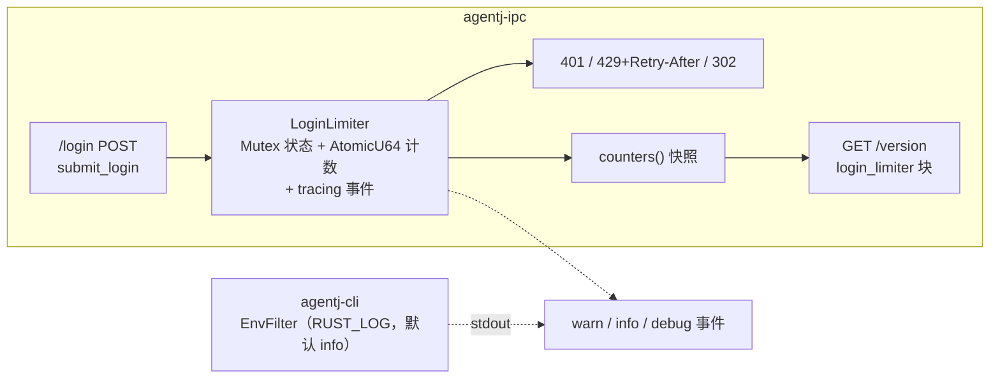
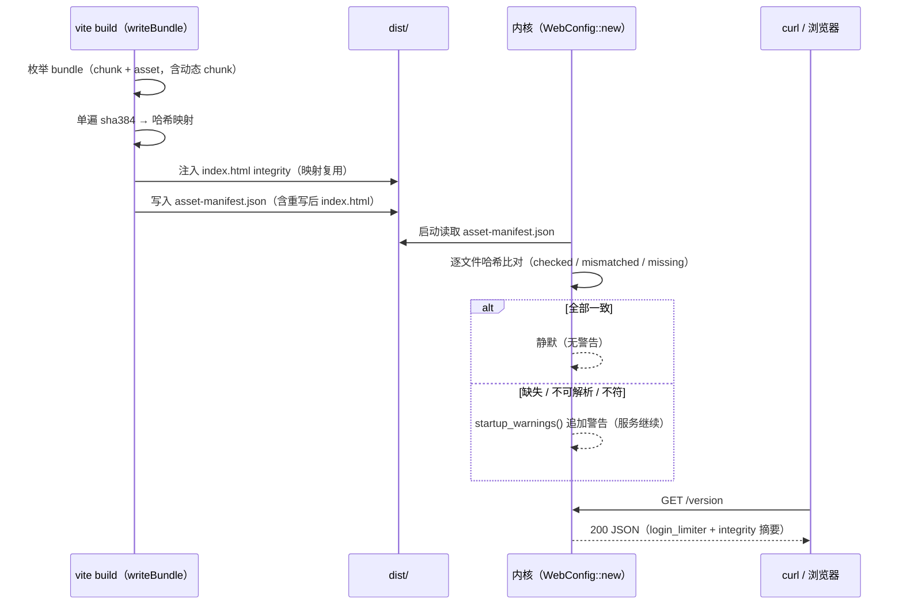
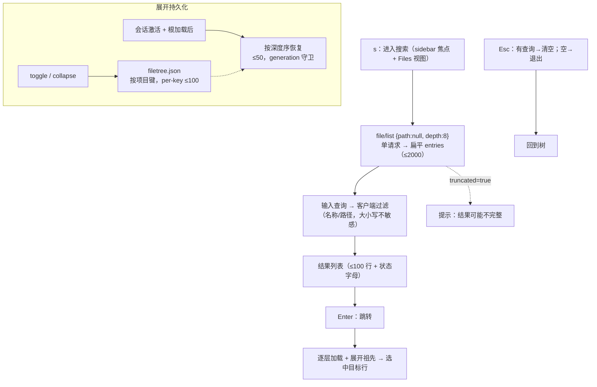
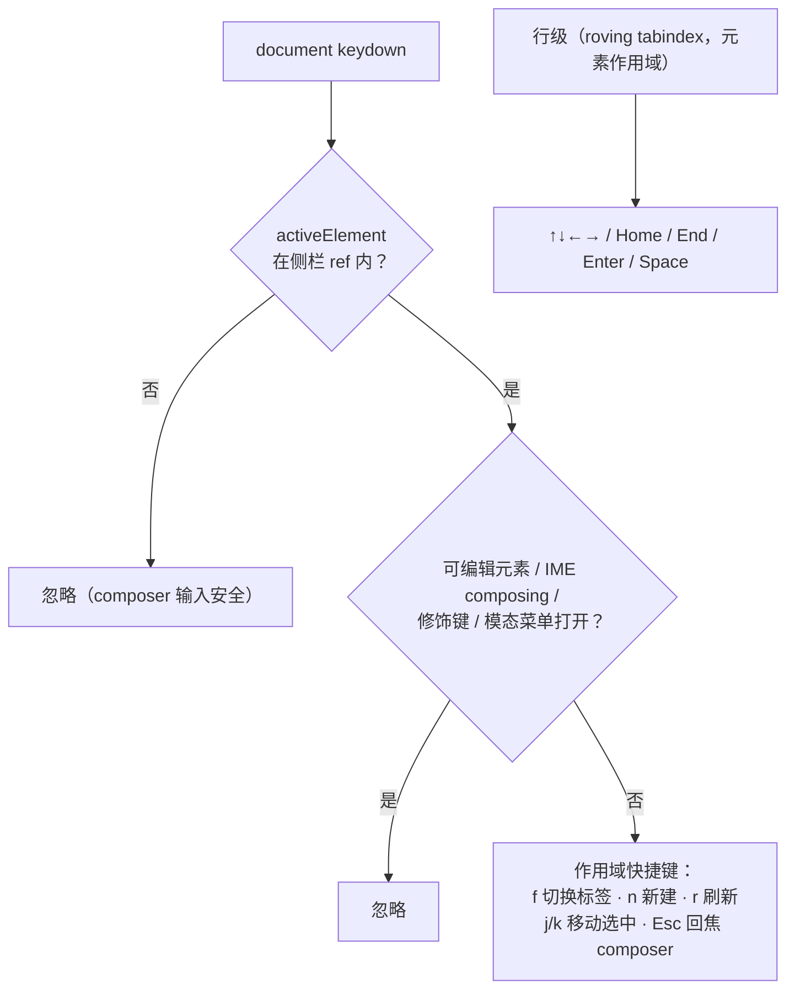

# 设计文档：AgentJ v0.21.0 —— 限流可观测性、资产完整性、TUI 搜索与 Web 焦点作用域

> 状态：**设计定稿（待评审）** ｜ 日期：2026-09-22 ｜ 版本影响：工作区 0.20.1 → **0.21.0**；`PROTOCOL_VERSION` 保持 **0.13.0**（无 wire 契约变化）
>
> 上游输入：用户 feature 请求（2026-09-22，四项）；`.agents/summary/summary_and_next.md`「下一步」候选（v0.20.1 验收遗留）；`2026-09-20-agentj-web-hardening-and-tui-files-design.md`「已知限制」。
> 调研依据：4 路并行代码调研（limiter 与日志基建；SRI 构建链与 chunk 产出；TUI Files 与持久化；Web 键盘/焦点现状）。
>
> 本文档定义 **WHAT / WHY**；任务级 TDD 拆解属下一阶段（`/jskill-feature-plan`）。

## 概述

本特性是 v0.20.x 四项遗留能力的补全与深化，同属一个版本（0.21.0）、一分支一 PR：

1. **登录限流可观测性**：v0.20.0 的 `login_limiter` 零日志、零指标，运维只能看到 429 结果而看不到「谁在被锁、锁了多少次、是否在升级」。本项为 limiter 增加 tracing 事件与进程内聚合计数，并在既有未鉴权 `GET /version` 中暴露非敏感摘要；同时让 CLI 日志支持 `RUST_LOG`（`env-filter` 特性）。
2. **资产完整性清单（SRI 覆盖动态 chunk）**：v0.20.0 的 SRI 仅注入入口 HTML 直接引用的资产，运行时动态 import 的 chunk 天然不受浏览器 SRI 保护（已知限制 #4）。本项在构建期生成覆盖**全部产物**（含动态 chunk）的 `asset-manifest.json`，内核启动时逐文件校验，形成「构建 → 部署 → 运行」完整性闭环。
3. **TUI Files 搜索/过滤与展开状态持久化**：v0.20.0 Files 视图无搜索（32 字符侧栏 + 懒加载树，逐层展开找文件），展开态随会话切换/重启清空（已知限制 #8/#9）。本项新增「深加载索引 + 客户端过滤/跳转」搜索模式，并按项目持久化展开状态。
4. **Web 端焦点作用域**：TUI 在 BUG-009 后拥有 `composer ⇄ sidebar` 焦点分层（单字母快捷键仅在侧栏焦点生效）；Web 则完全没有任何全局单字母快捷键，侧栏（会话列表/文件树）也没有键盘导航，`ModalDialog` 无焦点恢复。本项引入**焦点作用域**（快捷键仅在 DOM 焦点位于侧栏时生效，不劫持 Tab），补齐侧栏键盘导航与对话框焦点恢复。

## 目标与非目标

### 目标

| # | 目标 |
|---|------|
| G1 | `LoginLimiter` 聚合计数：`attempts` / `failures` / `lockouts`（新锁定触发）/ `blocked`（锁定期拒绝）/ `locked_now` / `tracked_ips`；单调累计、重启清零 |
| G2 | tracing 事件：`warn!` 锁定触发、`info!` 成功登录、`debug!` 普通失败与锁定期拒绝（fields 结构化，`ip`/`failures`/`retry_after_secs` 等） |
| G3 | CLI 日志可控：`tracing-subscriber` 启用 `env-filter` 特性，`EnvFilter::try_from_default_env().unwrap_or(info)`；未设 `RUST_LOG` 时行为与现状一致 |
| G4 | `GET /version` 加性 `login_limiter` 摘要块（聚合计数，无 per-IP 明细） |
| G5 | 构建期 `dist/asset-manifest.json`：`sha384` 覆盖全部 bundle 产物（chunk/asset，含动态 chunk）与重写后的 `index.html`；SRI 注入与清单共用单遍哈希 |
| G6 | 内核启动校验：读取清单逐文件哈希比对，结果并入 `startup_warnings()`（缺失/不可解析/不符/文件缺失），不阻断服务；`GET /version` 加性 `integrity` 摘要 |
| G7 | TUI 搜索模式：`s` 进入 → `file/list {depth:8}` 单请求建立扁平索引（≤2000 条）→ 输入过滤（大小写不敏感，名称/路径）→ `Enter` 跳转（自动加载并展开祖先）→ `Esc` 分级退出；`truncated` 提示「结果可能不完整」 |
| G8 | TUI 展开状态持久化：新 `filetree.json`（按本地项目键，per-key ≤100），会话激活后按深度序恢复（≤50，generation 守卫，失效路径静默跳过） |
| G9 | TUI 公共配置模块抽取：`getConfigDir` + JSON 读写助手收敛三处重复（theme/sidebar/session）并供新模块复用 |
| G10 | TUI Files body 引入 `scrollbox`：选中/跳转变化时滚动至可见行（Threads 视图不变） |
| G11 | Web 焦点作用域 hook（`useShortcutScope`）：document keydown 仅在 `activeElement` 位于侧栏、非可编辑元素、非 IME、无修饰键时生效；**不劫持 Tab** |
| G12 | Web 侧栏键盘导航：文件树（roving tabindex + `role=tree/treeitem` + 箭头/Home/End/Enter/Space）与会话列表（↑↓ + Enter/Space + j/k）；`SidebarTabs` 标签箭头切换 |
| G13 | Web 作用域快捷键：`f` 切换侧栏标签、`n` 新建会话、`r` 刷新文件树、`j/k` 移动选中、`Esc` 焦点回 composer 输入框 |
| G14 | Web `ModalDialog` 焦点恢复：打开时记录 `activeElement`，关闭时恢复（原元素已卸载则不恢复） |
| G15 | 门禁全绿：cargo fmt / test / clippy / drift、SDK / Web / TUI、web build、check-version（0.21.0）、desktop-ui |
| G16 | 文档同步：`docs/specs/ipc-protocol.md`（HTTP 面 `/version` 字段）、README、AGENTS.md、summary、本设计文档 |

### 非目标

- ❌ **不改 JSON-RPC wire 契约**：无新方法/类型/schema；`PROTOCOL_VERSION` 保持 0.13.0（① / ② 的新增面均为 HTTP 静态面，非 JSON-RPC）。
- ❌ ① 不做 per-IP 明细端点、Prometheus/`/metrics`、计数持久化（重启清零，与限流内存态一致）、代理头解析。
- ❌ ② 不做浏览器运行时动态 import 校验（fetch→SubtleCrypto→blob import）、不做内核逐请求校验、不引入内核侧信任模型（定位为**部署完整性**，非安全边界）。
- ❌ ② 不强制代码分割（当前应用零动态 import；清单对动态 chunk 的覆盖由合成单测证明，真实分割留待未来）。
- ❌ ③ 不做服务端搜索（`file/list` 不加 query 参数）、不做文件打开/编辑、不持久化搜索词/视图选择/选中索引。
- ❌ ④ 不劫持 Tab、不做 `ModalDialog` 焦点陷阱（`ApprovalDialog` 保持既有陷阱）、不重构既有菜单 roving-focus 逻辑（仅新增共享 hook 供新代码使用）。
- ❌ 不改限流策略语义（阈值/锁定/429/Retry-After 零变化）；不改 TUI 焦点模型（BUG-009 语义保持）；不改 Web 既有键盘行为（对话框/菜单/分隔条）。

## 设计方案

### 选定路线

- **① 可观测性**：`login_limiter.rs` 内维护 `AtomicU64` 聚合计数并在状态变化点发出 tracing 事件；`web.rs` 的 `/version` handler 增加 `login_limiter` 快照块；CLI 日志订阅器换 `EnvFilter`（默认 info）。
- **② 资产清单**：web 构建插件在 `writeBundle(options, bundle)` 中单遍计算全部产物 `sha384`（base64），同一映射用于 `index.html` 的 `integrity` 注入与 `asset-manifest.json` 写入；内核 `WebConfig` 启动读取并逐文件校验，警告并入既有 `startup_warnings()`，摘要进 `/version`。
- **③ TUI 搜索/持久化**：新纯函数 `buildSearchIndex` / `filterEntries`（`files.ts`）＋ 搜索模式状态（`app.tsx` Files 分支前拦截）＋ 新持久化模块 `filetreePrefs.ts`（走新公共 `config.ts`）＋ Files body `scrollbox`。
- **④ Web 焦点作用域**：新 `useShortcutScope(ref, handlers)` + `useRovingFocus` hooks；`FileTree` 增加选中态与 roving tabindex；`UnifiedSidebar` 列表增加箭头导航；`ModalDialog` 增加焦点恢复；快捷键表见「接口与契约」。

### 备选方案

**① 登录限流可观测性**

| 方案 | 优点 | 缺点 | 为何未选用 |
|---|---|---|---|
| **A 日志 + 聚合计数（/version 扩展）（选定）** | 零新端点；未鉴权只暴露非敏感聚合；计数与日志同源 | `/version` 职责略扩（版本事实 + 安全摘要） | — |
| B 仅日志事件 | 最小改动 | 无法快速查看锁定/失败总量，需翻日志 | 不满足「指标」诉求 |
| C 日志 + 计数经新 `GET /status` | 语义更干净、可扩展 | 新增未鉴权 HTTP 面 | 既有 `/version` 已是探针面，避免扩散 |
| D 日志 + 计数 + 鉴权后 per-IP 明细 | 运维最强 | 实现量最大、引入鉴权分支、IP 敏感 | 超出 LAN 工具定位 |

**② 资产完整性清单**

| 方案 | 优点 | 缺点 | 为何未选用 |
|---|---|---|---|
| **A 构建清单 + 内核启动校验（选定）** | 覆盖全部产物（含动态 chunk）；复用 `startup_warnings` 模式；形成部署闭环 | 新直接依赖（sha2/base64，均已在锁文件）；部分逆转 v0.20 D7 | — |
| B 浏览器运行时校验（fetch→SubtleCrypto→blob import） | 唯一浏览器端真覆盖 | 破坏 chunk HTTP 缓存、客户端复杂、需强制代码分割才有目标 | 收益/复杂度不匹配 LAN 工具定位 |
| C 仅生成清单不消费 | 最小改动 | 无自动防陈旧/损坏能力，短期是货架产物 | 不满足「覆盖」诉求 |
| D 内核逐请求校验 `/assets/*` | 持续防护（运行中篡改） | 每请求哈希开销 + 缓存状态 + 实现最重 | 启动校验已覆盖部署完整性问题 |

**③ TUI 搜索模型**

| 方案 | 优点 | 缺点 | 为何未选用 |
|---|---|---|---|
| **A 深加载全树 + 客户端过滤/跳转（选定）** | 单请求全量索引（扁平 ≤2000）；无 wire 变更；覆盖典型仓库（≤8 层） | 受 depth/条目上限（`truncated` 提示）；索引为快照 | — |
| B 仅过滤已加载树 | 零新请求 | 未展开目录搜不到（搜 `main.rs` 需先展开 `src/`） | 搜索体验不成立 |
| C 服务端 `file/list` 加 query | 真正全量、无深度限制 | wire 变更（协议升版）、内核遍历实现重 | 破例节奏，收益不抵 |
| D 仅模糊跳转已加载节点 | 最轻 | 非「搜索」语义 | 不满足诉求 |

**④ Web 焦点模型**

| 方案 | 优点 | 缺点 | 为何未选用 |
|---|---|---|---|
| **A 焦点作用域（DOM activeElement）（选定）** | 平台惯用；不劫持 Tab（a11y 友好）；不变量与 TUI 同构（输入永不劫持） | 快捷键需先进入侧栏（Tab/点击） | — |
| B TUI 式显式模式 + Tab 切换 | 与 TUI 完全同构 | Web 中 Tab 是原生导航键，textarea 内劫持会阻断到发送按钮/选项的键盘路径（a11y 回归） | 平台差异不可忽略 |
| C 可编辑元素守卫（全局单字母） | 最简、不劫持 Tab | 对话区/按钮上按 `f` 也触发，与 TUI 分层不一致 | 分层语义不满足 |
| D 仅架构 + 对话框修复（无快捷键） | 风险最低 | 不交付「单字母快捷键分层」 | 不满足诉求 |

## 架构

### ① 可观测性数据流

### ② 资产清单与内核校验

### ③ TUI 搜索与展开持久化

### ④ Web 焦点作用域

## 接口与契约（新增面）

### `GET /version` 响应（加性，① + ②）

| 字段 | 类型 | 说明 |
|---|---|---|
| `login_limiter.attempts` | u64 | 到达 limiter 的 `/login` POST 次数（含成功、失败、锁定期拒绝） |
| `login_limiter.failures` | u64 | token 校验失败次数（不含锁定期拒绝） |
| `login_limiter.lockouts` | u64 | 锁定**新触发**次数（`locked_until` 由非锁定态进入锁定态；延长不计） |
| `login_limiter.blocked` | u64 | 锁定期被拒请求数（未校验 token） |
| `login_limiter.locked_now` | u64 | 快照时处于锁定中的 IP 数（扫描推导） |
| `login_limiter.tracked_ips` | u64 | 快照时 entries 条目数（扫描推导） |
| `integrity.manifest_present` | bool | `asset-manifest.json` 是否存在且可解析 |
| `integrity.checked` | u64 | 已校验文件数（清单条目且文件存在） |
| `integrity.mismatched` | u64 | 哈希不符数 |
| `integrity.missing` | u64 | 清单列出但文件缺失数 |

> 既有字段（`product_version` / `protocol_version` / `dist_present` / `dist`）不变；`Cache-Control: no-store` 不变；不含 per-IP 明细。

### `dist/asset-manifest.json`（构建产物，②）

| 字段 | 类型 | 说明 |
|---|---|---|
| `algorithm` | string | 固定 `"sha384"`；其他值视为不可用（警告） |
| `assets` | object | 键 = 服务路径（以 `/` 开头，规范相对路径）；值 = `sha384-<base64>`（与 SRI 同格式） |

- 覆盖：全部 Rollup bundle 产物（entry chunk、动态 chunk、CSS、被引用的图片/字体等资产）＋ 重写后的 `/index.html`。
- 排除：`version.json`（由版本比对覆盖）、`asset-manifest.json` 自身、`public/` 透传文件（不经 bundle，如 `favicon.svg`）。
- 键校验：必须为以 `/` 开头、不含 `..` 的规范路径；违反 → 清单视为不可解析（警告，不校验）。

### `filetree.json`（TUI 持久化，③）

| 字段 | 类型 | 说明 |
|---|---|---|
| `expanded` | Record<string, string[]> | 键 = 项目键（`session.projectId ?? "__default__"`）；值 = 相对项目根的展开目录路径（深度序保存） |

- 上限：per-key ≤100 路径（超出丢弃最深项）；恢复 ≤50；保存时仅保留「当前项目 id + `__default__`」的键（删除已移除项目的陈旧键）。
- 位置：`$XDG_CONFIG_HOME/agentj/filetree.json`（否则 `~/.config/agentj/`，否则 `/tmp/agentj/`）。

### TUI 搜索模式键位（③）

| 键 | 行为 |
|---|---|
| `s` | Files 视图 + sidebar 焦点：进入搜索模式（发起 depth=8 索引请求） |
| 可打印字符 | 追加查询（**吞掉**，含 `f`/`n`，不触发其他快捷键） |
| `Backspace` | 删除查询末字符 |
| `Esc` | 查询非空 → 清空；查询为空 → 退出搜索模式（回到树） |
| `↑`/`↓`、`j`/`k` | 结果列表移动选中 |
| `Enter` | 跳转到选中结果（退出搜索、加载并展开祖先、选中目标行） |
| `r` | 重建索引（重发 depth=8 请求） |

- 搜索提示行：`type filter · enter jump · esc back`；`truncated` 时追加 `· partial`。
- 结果行格式：`{标记}{名称}{暗色父目录}{状态字母}`（名称优先截断，字母不截）。

### Web 快捷键表（④）

| 作用域 | 键 | 行为 |
|---|---|---|
| 侧栏（`useShortcutScope`） | `f` | 切换侧栏标签（Sessions ⇄ Files） |
| 侧栏 | `n` | 新建会话 |
| 侧栏 | `r` | 刷新文件树（Files 标签时） |
| 侧栏 | `j` / `k` | 移动当前列表选中（会话列表或文件树） |
| 侧栏 | `Esc` | 焦点回到 composer 输入框（`#aj-prompt`） |
| 文件树行（元素级） | `↑`/`↓` | 移动选中（roving tabindex，焦点随动） |
| 文件树行 | `←` / `→` | 收起 / 展开目录（文件：`←` 跳父目录） |
| 文件树行 | `Home` / `End` | 首行 / 末行 |
| 文件树行 | `Enter` / `Space` | 目录开合；文件无操作（对齐 TUI） |
| 会话列表行 | `↑`/`↓`、`Enter`/`Space` | 移动 / 继续会话（既有 Enter/Space 保留） |
| 标签（tablist） | `←`/`→` | 切换 Sessions / Files 标签 |

> 门控条件（全部满足才生效）：`activeElement` 在侧栏容器内；事件目标非 `input`/`textarea`/`select`/`contenteditable`；`event.isComposing === false`；无 `ctrl`/`meta`/`alt`；无打开的模态/菜单（门户渲染使其焦点天然落在侧栏之外，作用域自动失效）。**Tab 保持浏览器原生行为**。

## 关键设计决策

**D1 ① 计数用 `AtomicU64` 单调累计，`locked_now`/`tracked_ips` 快照扫描推导**
计数器在状态变化点自增，无锁竞争；`locked_now`/`tracked_ips` 需要读取 entries（`Mutex<HashMap>`，≤1024），在快照时短暂持锁扫描推导，不额外维护「当前锁定数」这类易漂移的状态。

**D2 ① 事件在 limiter 内发出，级别按「状态变化 vs 明细」划分**
`warn!` 仅用于状态变化（锁定新触发），避免攻击流量下日志洪泛；`debug!` 承载逐次失败/拒绝明细；`info!` 承载成功登录（频率低，含 `prior_failures`）。`web.rs` 不重复记录，保证单一职责。

**D3 ① `env-filter` 特性开关 + 默认 info**
`tracing_subscriber::fmt::init()` 当前不读 `RUST_LOG` 且默认 INFO。改为 `EnvFilter::try_from_default_env().unwrap_or_else(|_| EnvFilter::new("info"))`：未设环境变量时行为与现状逐字一致，设置后可下探 `debug`。仅特性开关，无新 crate。

**D4 ① `/version` 加性块而非新端点**
`/version` 已是未鉴权探针（v0.20.0 先例），加性字段向后兼容；聚合计数不含 per-IP 明细，未鉴权暴露无敏感信息。属 HTTP 面，`PROTOCOL_VERSION` 不变。

**D5 ② 清单独立于 `version.json`，覆盖 bundle 产物 + 重写后 `index.html`**
两者生命周期不同（版本事实 vs 完整性事实），独立文件避免 `/version` 载荷膨胀与 schema 耦合。`index.html` 在 SRI 注入**之后**哈希入清单（可发现入口文档被改动）；`version.json` 不入清单（由版本比对覆盖）；`public/` 透传文件不经 bundle，明确排除。

**D6 ② 单遍哈希：SRI 注入与清单共用同一映射**
现 `injectSri` 按引用即时计算哈希；重构为「先对全部 bundle 产物计算哈希映射 → 注入 SRI（从映射取值）→ 写清单」。消除重复计算，保证 HTML `integrity` 与清单逐字节一致。

**D7 ② 内核启动校验一次，定位为部署完整性**
逐请求校验引入开销与缓存状态；启动校验恰好覆盖目标问题（陈旧/损坏/不完整部署，含动态 chunk）。这是对 v0.20 D7（内核不做哈希校验）的**部分逆转**：当时理由是威胁模型（可写 dist 者可写二进制）；本项定位为**部署完整性**（磁盘损坏、部分上传、陈旧构建），非安全边界，文档显式记录。

**D8 ② 校验失败不阻断服务**
与 `startup_warnings()` 既有三类警告同构：警告打印到 stderr，服务继续（API 优先）；`/version` 摘要供脚本判定。

**D9 ③ 搜索 = 深加载索引（depth=8 单请求）+ 客户端过滤**
`file/list` 返回**扁平** `entries`（≤2000，`truncated` 标记），depth ≤8 为服务端硬约束。单请求建立索引后全部过滤在客户端（零请求）；`truncated` 时明示「结果可能不完整」。不做服务端搜索（避免 wire 变更与内核遍历）。

**D10 ③ 搜索模式吞掉可打印键**
搜索模式下所有可打印字符（含 `f`/`n`）成为查询文本，避免「输入 frontend 时触发新建会话/切换视图」类误触；`Esc` 分级（先清查询、再退出），与 TUI 既有 palette 的 Esc 语义一致。

**D11 ③ 持久化按本地项目键，非会话/全局**
展开路径相对项目根，跨项目会碰撞（两个项目都有 `src/`）。键取 `session.projectId ?? "__default__"`（TUI 既有项目分组），语义是「项目级浏览状态」；会话级过于易失、全局会碰撞。写入时仅保留当前项目键（自清理已删除项目）。

**D12 ③ 抽取公共 `config.ts`**
`getConfigDir()` 已在 theme/sidebar/session 三处重复；新增第四处不可接受。抽 `getConfigDir` + `readJsonFile`/`writeJsonFile` 助手（try/catch 静默语义不变），四个模块统一引用。行为零变化，既有持久化测试回归锁定。

**D13 ③ Files body 引入 `scrollbox`**
搜索跳转若目标在可视区外则无意义；既有树同样受此限制。Files 视图 body 改用 `<scrollbox>`（`ScrollBoxRenderable.scrollY` 调整，行高恒定 1 行），选中/跳转变化时滚动至可见；Threads 视图不变（列表短，避免行为变化）。

**D14 ④ 焦点作用域而非显式模式**
Web 的 Tab 是原生导航键；照搬 TUI 的「Tab 切换焦点」会阻断 textarea → 发送按钮/选择器的键盘路径。改用「快捷键仅在 DOM 焦点位于侧栏时生效」：同一不变量（输入永不劫持），平台惯用实现；Tab 原生可达性不变。

**D15 ④ 键位分工：元素级导航 + 作用域级快捷键**
树/列表的箭头、Home/End、Enter/Space 走元素级（roving tabindex，标准 WAI-ARIA 树模式，焦点随选中移动）；`f`/`n`/`r`/`j`/`k`/`Esc` 走作用域级 document 监听。`j/k` 由作用域级统一处理（避免与元素级箭头重复实现）。

**D16 ④ `ModalDialog` 仅加焦点恢复，不加陷阱**
焦点恢复是低风险高价值（关闭后回到触发按钮）；陷阱会改变既有对话框的 Tab 行为（设置弹窗等），且 `ApprovalDialog` 已有陷阱。非目标显式排除陷阱。

**D17 ④ 新增共享 hooks，不重构既有菜单**
新 `useShortcutScope` 与 `useRovingFocus`（供文件树/会话列表/标签使用）；`TopbarMenu`/`SessionListMenu` 的既有 roving 逻辑保持不动（避免回归风险），统一重构列为未来项。

**D18 版本与协议（跨项）**
工作区 0.20.1 → 0.21.0（feature minor）；`PROTOCOL_VERSION` 保持 0.13.0（无 JSON-RPC wire 变化；① / ② 均为 HTTP 面加性字段）；`check-version.sh` 同步五处（Cargo / sdk VERSION / sdk PROTOCOL_VERSION / protocol 常量 / methods.json + desktop 三处）。

## 错误处理

| 场景 | 行为 |
|---|---|
| ① `RUST_LOG` 未设置 | `EnvFilter` 默认 `info`，输出行为与现状一致（回归锁定） |
| ① 计数溢出 | `u64` 单调计数，实际不可达；`fetch_add` 溢出语义（wrap）可接受，不做饱和处理 |
| ① `/version` 快照时 entries 持锁 | `Mutex` 临界区仅扫描 ≤1024 条，无 `await`；与既有 `check`/`record_*` 同锁 |
| ② 清单缺失（dist 存在） | 警告「has no asset-manifest.json (stale build?)」；`integrity.manifest_present=false`；服务继续 |
| ② 清单不可解析 / `algorithm` 不支持 / 键非法（`..`、非 `/` 开头） | 警告含错误摘要；视为不可用（不校验）；服务继续 |
| ② 清单列出文件缺失 | `missing` 计数 + 警告（示例名 ≤3 个）；服务继续 |
| ② 哈希不符 | `mismatched` 计数 + 警告（示例名 ≤3 个）；服务继续 |
| ② dist 不存在 | 不读取清单、不校验、无警告（与既有 dist 缺失语义一致） |
| ② 构建期引用的本地文件缺失（SRI 路径） | 构建失败（既有行为不变，插件抛错非零退出） |
| ③ 索引请求失败 | 搜索模式内联错误行（红字 + 错误信息）；`r` 可重试；`Esc` 退出 |
| ③ `truncated=true` | 结果区提示「结果可能不完整」；仍可过滤/跳转 |
| ③ 跳转目标不存在（陈旧索引） | 退出搜索 + 刷新根 + 一次性错误行提示 |
| ③ 持久化文件损坏/不可读 | 忽略（空状态），不崩溃（沿用既有静默语义） |
| ③ 持久化写失败 | 静默忽略（沿用既有语义） |
| ③ 恢复时目录已消失 | 静默跳过该路径（不阻塞其余恢复） |
| ③ 恢复期间会话切换 | `generation` 守卫丢弃过期回包（既有机制） |
| ④ 焦点在 composer/输入框 | 作用域不匹配 → 全部快捷键忽略（回归：BUG-009 等价断言） |
| ④ IME composing 中 | `isComposing` 守卫忽略 |
| ④ 模态/菜单打开 | 焦点在门户内（侧栏之外）→ 作用域失效；无需显式模态检查 |
| ④ 焦点恢复时原元素已卸载 | 不恢复（保持当前焦点），不抛错 |
| ④ 树/列表为空 | 快捷键无操作（选中索引 clamp） |

## 测试策略

### Rust（agentj-ipc / agentj-cli）

1. **① limiter 单测**（合成 `now`，既有 `ip()`/`at()` 助手）：六项计数递增矩阵（attempts 含锁定期拒绝；failures 不含；lockouts 仅新触发、延长不计；blocked 与 lockouts 区分）；`locked_now`/`tracked_ips` 快照（多 IP、过期解锁后归零）；成功登录清 entry 但累计计数不回落。
2. **① HTTP 层**（`web.rs` 测试，既有 `form_post`/`small_policy`）：第 5 次失败后 `/version` JSON 的 `login_limiter` 计数断言；锁定期请求 → `blocked` 递增且 `lockouts` 不重复计（延长）；成功登录 → `info` 语义（`prior_failures`）与计数不回落。
3. **② 清单解析/校验单测**：合法清单全绿；缺文件 → `missing`；篡改 → `mismatched`；非法 JSON / `algorithm` 不支持 / 键含 `..` → 不可用分支；dist 缺失 → 跳过；`startup_warnings()` 四类组合（一致沉默 / 缺失 / 不可解析 / 不符）。
4. **② `/version`**：`integrity` 摘要字段断言（含 `manifest_present=false` 分支）。
5. **② e2e**（`e2e_http_static.rs` 扩展）：fixture 生成正确清单 → 启动 stderr 无完整性警告、`/version` 断言；fixture 篡改一个哈希 → stderr 出现警告（dev-deps 补 `sha2`/`base64` 计算 fixture 哈希）。
6. **③/④ 无 Rust 改动**（`file/list` 既有；回归确认）。

### Web（vitest）

- **② 构建纯函数**（`build/**`）：清单生成（entry chunk + 合成动态 chunk + asset + 重写后 `index.html` 全部入清单）；排除项（`version.json`/清单自身）；键规范校验；SRI 注入与清单哈希一致（同一映射）；既有 6 例不回归。
- **④ hooks**：`useShortcutScope` 门控矩阵（焦点在侧栏内/外、可编辑元素、IME、修饰键、模态门户）；`useRovingFocus` 索引推导（边界/空列表）。
- **④ 组件**：`FileTree` roving tabindex + 箭头/Home/End/Enter/Space + `aria-expanded/selected`；`UnifiedSidebar` 列表箭头导航；`SidebarTabs` 箭头切换；`ModalDialog` 焦点恢复（打开记录/关闭恢复/原元素卸载分支）。
- **④ 集成回归**：侧栏焦点下 `f`/`n`/`r`/`j`/`k`/`Esc` 行为；**composer 输入零误触**（等价 BUG-009 断言：输入含 `f n r j k` 的文本不触发任何快捷键/不切换标签）；既有键盘测试（对话框/菜单/分隔条/设置）全量回归。

### TUI（bun test）

- **③ 纯函数**：`buildSearchIndex`（扁平 entries → 索引；空/`truncated`）；`filterEntries`（名称前缀 > 名称子串 > 路径子串排序；大小写不敏感；上限截断 + `N more`）；行格式化（名称/父目录/字母，32 字符预算）。
- **③ 持久化**（临时 `XDG_CONFIG_HOME`，镜像 `sidebar.test.tsx` 模式）：`filetree.json` 读写往返；per-key 上限 100；项目键过滤（陈旧键删除）；损坏文件 → 空状态。
- **③ 集成**（假 transport）：`s` → 断言 `file/list {path:null, depth:8}`；输入过滤；`Enter` 跳转 → 祖先按序加载（请求序断言）并选中目标；`Esc` 分级；搜索模式输入 `n`/`f` 不触发新建/切视图；恢复流程（激活会话后按深度序展开请求）；`r` 重建索引。
- **③ 公共模块**：`config.ts` 抽取后 theme/sidebar/session 持久化测试全量回归。
- **③ mock WS e2e**：`e2e/mock-kernel.ts` 支持 `depth=8` fixture；搜索结果跳转链路。

### 实机验收

- ① `curl` 连续错 token → 观察 stderr `warn` 行与 `/version` 计数；`RUST_LOG=debug` 观察逐次失败；正确登录观察 `info`。
- ② `npm run build` 后检查 `dist/asset-manifest.json` 与 `index.html` `integrity` 一致；`serve --web-dist` 启动无警告；篡改一个资产字节 → 启动警告 + `/version` 摘要。
- ③ TUI 实机：`s` 搜索、输入过滤、Enter 跳转（深路径）、Esc 分级、重启后同项目展开态恢复、`truncated` 提示。
- ④ Web 实机（Playwright）：Tab 进入侧栏 → `f`/`n`/`r`/`j`/`k`/`Esc` 生效；composer 输入同字符零误触；树键盘导航与 roving 焦点；ModalDialog 关闭焦点恢复；Tab 原生路径（textarea → 发送按钮）不被阻断。

### 门禁清单

- `cargo fmt` / `cargo test --workspace` / `clippy -D warnings` / drift 2 passed
- SDK 47 tests（`VERSION` 升 0.21.0，测试计数不变）/ Web（新增后计数）/ TUI（新增后计数）/ web build
- `./scripts/check-version.sh`（0.21.0；`PROTOCOL_VERSION` 0.13.0）
- `node agentj-ui/apps/desktop/check-desktop-ui.mjs`

### 验收标准

| # | 标准 |
|---|---|
| 1 | `/version` 含 `login_limiter` 六项计数与 `integrity` 四项摘要；限流语义（429/Retry-After/锁定升级/清零）零变化 |
| 2 | 日志：锁定触发 `warn`、成功 `info`、明细 `debug`；`RUST_LOG` 未设时输出行为与现状一致 |
| 3 | 构建产物含 `asset-manifest.json`（全 bundle 产物 + 动态 chunk 合成覆盖 + `index.html`）；SRI 与清单哈希一致 |
| 4 | 内核启动对清单缺失/不可解析/不符/文件缺失给出警告且服务继续；一致时静默 |
| 5 | TUI `s` 搜索（depth=8 单请求）、输入过滤、Enter 跳转（祖先自动展开）、Esc 分级、`truncated` 提示 |
| 6 | TUI 展开状态跨重启恢复（同项目），per-key ≤100、恢复 ≤50、失效路径静默跳过；`config.ts` 抽取后既有持久化回归全绿 |
| 7 | Web 侧栏焦点下 `f`/`n`/`r`/`j`/`k`/`Esc` 生效；composer 输入零误触；树/列表键盘导航与 roving tabindex；`ModalDialog` 焦点恢复 |
| 8 | Tab 原生可达性不变（textarea → 发送按钮路径不被阻断） |
| 9 | 门禁全绿；`PROTOCOL_VERSION` 保持 0.13.0；工作区 0.21.0 |

## 依赖

- **新增直接依赖**：`agentj-ipc` 增加 `sha2`、`base64`（两者均已在 workspace `Cargo.lock` 中间接存在，无新外部 crate）；`agentj-cli` dev-deps 增加 `sha2`（e2e fixture 哈希）；`tracing-subscriber` 启用 `env-filter` 特性（版本不变）。
- **前置**：v0.20.1 main（已合并）；无阻塞项。
- **触点**：
  - `crates/agentj-ipc`：`login_limiter.rs`（①②计数与事件）、`web.rs`（① `/version`、② 清单读取/校验）、`lib.rs`（模块接线）、`Cargo.toml`
  - `crates/agentj-cli`：`main.rs`（① EnvFilter）、`Cargo.toml` + `tests/e2e_http_static.rs`（② fixture 与断言）
  - `agentj-ui/apps/web`：`build/version-sri.ts` + `version-sri-plugin.ts`（② 清单）、`components/FileTree.tsx`、`components/UnifiedSidebar.tsx`、`components/SidebarTabs.tsx`、`components/ModalDialog.tsx`、`hooks/useShortcutScope.ts`（新）、`hooks/useRovingFocus.ts`（新）、`WorkspaceShell.tsx`/`App.tsx`（④ 接线）
  - `agentj-ui/apps/tui`：`files.ts`（③ 搜索纯函数）、`files.tsx`（③ 搜索模式渲染 + scrollbox）、`app.tsx`（③ 键位/状态）、`filetreePrefs.ts`（新）、`config.ts`（新，抽取）、`theme.tsx`/`sidebar.tsx`/`session.tsx`（③ 改用 config.ts）、`e2e/mock-kernel.ts`
  - 文档：`docs/specs/ipc-protocol.md`（HTTP 面）、README、AGENTS.md、summary、本文件
  - 版本触点：`Cargo.toml`/`Cargo.lock`、sdk `VERSION`、desktop ×3、`check-version.sh`
- **建议分支**：`feature/v0.21-observability-integrity-interaction`（一分支一 PR）。

## 已知限制

1. **① 计数为进程内累计**：重启清零；无跨实例共享；`RUST_LOG` 需显式设置才能看到 `debug` 明细。
2. **① 无 per-IP 明细**：未鉴权面只暴露聚合；排查具体 IP 需看日志。
3. **② 启动校验一次**：运行中篡改不检测（逐请求校验为非目标）；`public/` 透传文件与 `version.json` 不在清单内。
4. **② 浏览器端动态 import 仍无 SRI**：SRI 为浏览器机制，动态 chunk 由内核侧启动校验覆盖（部署完整性），非浏览器强制。
5. **③ 索引受服务端上限**：depth ≤8、entries ≤2000；超大仓库 `truncated` 提示「可能不完整」。
6. **③ 持久化为本机 + 本地项目键**：不跨机器共享；项目删除后陈旧键在下次保存时清理；展开恢复 ≤50 条。
7. **③ 搜索模式吞键**：可打印字符（含 `f`/`n`）成为查询文本，属显式取舍（D10）。
8. **④ 快捷键需焦点在侧栏**：需先 Tab/点击进入侧栏（不劫持 Tab 的代价，D14）。
9. **④ `ModalDialog` 无焦点陷阱**：仅恢复焦点；`ApprovalDialog` 保持既有陷阱；菜单 roving 逻辑未统一重构（D16/D17）。

## 实施状态

- **已实施（v0.21.0，2026-09-23）**：计划 `docs/superpowers/plans/2026-09-22-agentj-observability-integrity-and-interaction-plan.md`
  T0–T29 全部落地；工作区 0.20.1 → **0.21.0**（feature minor）；`PROTOCOL_VERSION` 保持
  `0.13.0`（无 JSON-RPC wire 变更；①② 均为 HTTP 面加性字段）。
- **自动化门禁（T29 全量复核 + 复核修复波后复跑，10 项全绿）**：
  | 门禁 | 结果 |
  |---|---|
  | `cargo fmt --check` | clean |
  | `cargo test --workspace` | **622 passed / 0 failed** |
  | `cargo clippy --workspace --all-targets -- -D warnings` | 零警告 |
  | `cargo test -p agentj-protocol -- drift` | 2 passed |
  | `npm --prefix agentj-ui test --workspace=@agentj/sdk` | 47 passed（6 files） |
  | `npm --prefix agentj-ui test --workspace=@agentj/web` | **537 passed（50 files）** |
  | `bun --cwd agentj-ui/apps/tui test` | **130 passed（19 files）** |
  | `npm --prefix agentj-ui run build --workspace=@agentj/web` | clean（`dist/version.json` + `asset-manifest.json` + sha384 integrity 已注入） |
  | `./scripts/check-version.sh` | version-ok（**0.21.0**） |
  | `node agentj-ui/apps/desktop/check-desktop-ui.mjs` | desktop-ui-ok |
- **验收（live acceptance）**：**未执行 —— 显式延后至 `jskill-test-acceptance` 阶段**
  （实机 Playwright / TUI / curl 验收：Web 焦点作用域与 roving 键盘导航、TUI 搜索/跳转/
  展开持久化、`GET /version` 的 `login_limiter`/`integrity` 加性块、`RUST_LOG` 日志下探）。
  本阶段以自动化门禁为退出标准（计划 Global Constraints）。
- **Phase 5 全分支复核（Oracle）+ 修复波**：复核 PASS-WITH-MUST-FIX，3 项发现已修复
  （C1 TUI 搜索在途输入被索引回包覆盖 / C2 索引错误态被按键清除 / C3 空 `RUST_LOG`
  回退 ERROR 默认；`5cdb534`、`22fcc7e`）并通过 scoped 复核；上表为修复波后全量
  复跑结果（Rust 621 → 622、TUI 128 → 130，其余不变）。
- **文档同步**：`AGENTS.md` / `README.md` / `.agents/summary/summary_and_next.md` /
  `docs/specs/ipc-protocol.md`（HTTP 面 / 清单契约 / 限流摘要）已同步 v0.21.0 事实。
