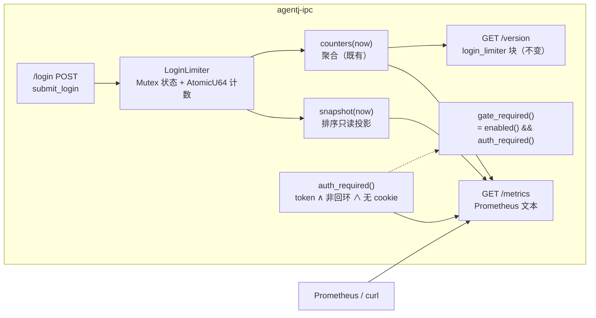
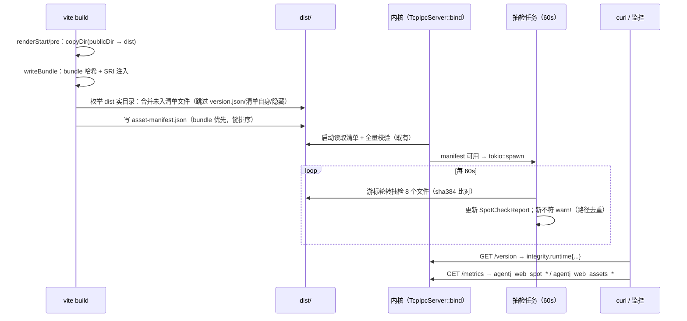
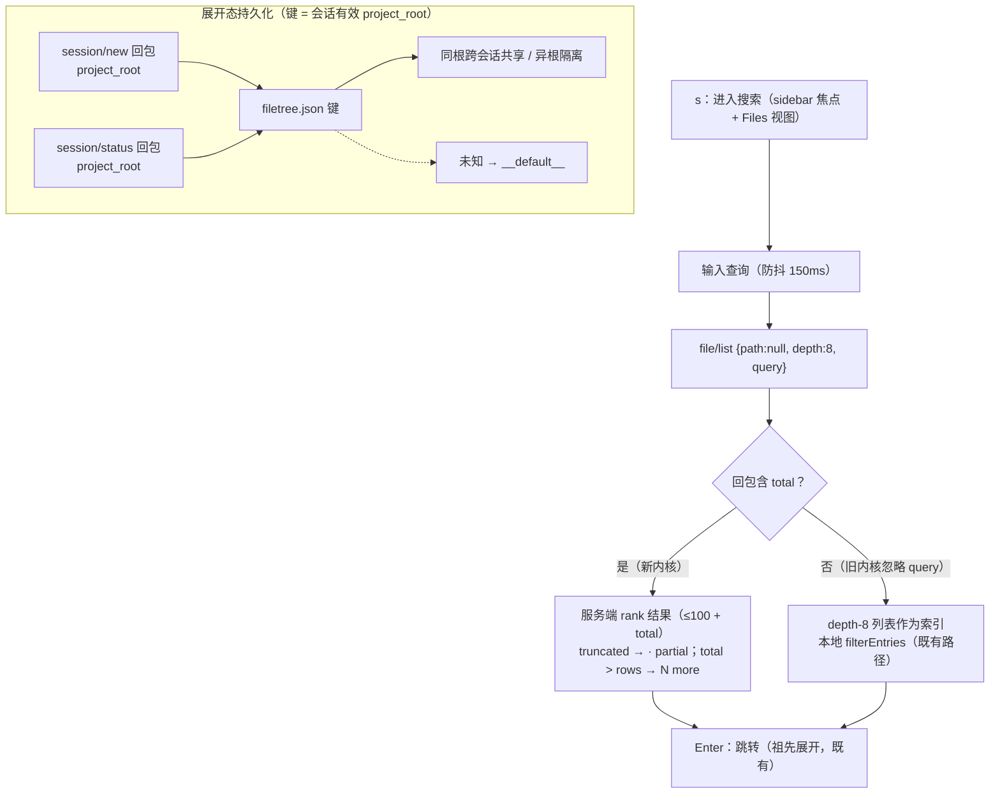
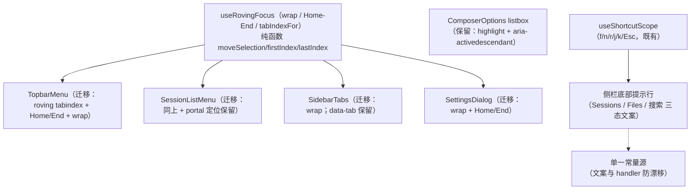

# 设计文档：AgentJ v0.22.0 —— 限流指标导出、资产清单扩展、TUI 服务端搜索与 Web 键位模型收口

> 状态：**设计定稿（待评审）** ｜ 日期：2026-09-24 ｜ 版本影响：工作区 0.21.1 → **0.22.0**；`PROTOCOL_VERSION` 0.13.0 → **0.14.0**（三处加性 wire 变更）
>
> 上游输入：用户 feature 请求（2026-09-24，四项）；`.agents/summary/summary_and_next.md`「下一步」候选（v0.21.1 验收遗留）；`2026-09-22-agentj-observability-integrity-and-interaction-design.md`「已知限制」（#1/#2 per-IP 与指标、#3 `public/` 透传、#5 服务端搜索、#6 展开态、#9 D17）。
> 调研依据：5 路并行代码调研（limiter 与 `/version` 面；资产清单构建→校验链；TUI 搜索与持久化；Rust `file/list` dispatch 与协议流；Web 菜单 roving 与提示现状）。
>
> 本文档定义 **WHAT / WHY**；任务级 TDD 拆解属下一阶段（`/jskill-feature-plan`）。

## 概述

本特性是 v0.21.x 四项遗留能力的补全与深化，同属一个版本（0.22.0）、一分支一 PR：

1. **限流可观测扩展（per-IP 明细 / 指标导出）**：v0.21.0 的 `login_limiter` 只有聚合计数（经未鉴权 `/version`），排查具体 IP 需翻日志、监控无法 scrape。本项为 limiter 增加只读快照 API，并新增**鉴权门控的 `GET /metrics`（Prometheus 文本）**：聚合 counters + per-IP series（Top-50 截断）+ 资产完整性摘要；`/version` 既有「未鉴权、仅聚合」契约零变化。
2. **资产清单扩展（`public/` 透传 + 运行期抽检）**：v0.21.0 清单显式排除 `public/` 透传文件（如 `favicon.svg`），且完整性只在启动校验一次（冻结快照）。本项让构建清单覆盖 dist 全部部署文件，并新增**周期后台抽检**（60s / 每轮 8 文件 / 游标轮转），结果经 `/version` 加性 `integrity.runtime` 与 `/metrics` 暴露。
3. **TUI 搜索增强（服务端搜索 + 展开态跨会话共享）**：v0.21.0 搜索为「depth=8 单请求索引 ≤2000 + 客户端过滤」，深仓库（>8 层或 >2000 条）搜索不完整；展开态键因无会话 `projectId` 实际恒为 `projects[0].id`（多项目串台）。本项新增 `file/list` 加性 `query` 参数（query-aware 遍历预算 + 服务端 rank），TUI 搜索改防抖服务端查询（旧内核自动降级）；展开态键改为**会话有效 `project_root`**（内核真值，与 `file/list` 沙箱根同源）。
4. **Web 键位模型收口（D17 + 侧栏快捷键提示）**：v0.21.0 设计文档显式推迟 D17（菜单 roving 未统一重构），Web 全站无快捷键提示。本项扩展共享 `useRovingFocus`（`wrap` / Home-End），把 **TopbarMenu / SessionListMenu / SidebarTabs / SettingsDialog** 四处手写 roving 迁移到共享实现（ComposerOptions listbox 保留独立 ARIA 模式），并在侧栏底部新增上下文快捷键提示行。

## 目标与非目标

### 目标

| # | 目标 |
|---|------|
| G1 | limiter 新增 `snapshot(now)` 只读投影（ip / failures / locked / retry_after / last_seen，按 `locked desc → failures desc → ip asc` 排序）；不暴露内部 `Entry`/锁 |
| G2 | 新显式路由 `GET /metrics`：Prometheus 文本（`text/plain; version=0.0.4` + `no-store`）；聚合 counters/gauges + per-IP series（Top-50 截断 + `ip_series_truncated` 指示）+ integrity 摘要 |
| G3 | 门控语义：抽出 `auth_required()`（token 已配置 ∧ 非回环 ∧ 无有效会话 cookie）；`/metrics` 未通过 → `401`（机器面不重定向）；`gate_required = enabled() && auth_required()`（静态面语义零变化；`/metrics` 不依赖 dist 存在） |
| G4 | `/version` 契约零变化（既有 `login_limiter`/`integrity` 聚合字段逐字保留；仅 ② 加性 `runtime` 嵌套） |
| G5 | 构建清单覆盖 dist 全部部署文件：bundle 产物（含动态 chunk）+ 重写后 `index.html` + **`public/` 透传文件**（Vite 8 `prepare-out-dir` 在 renderStart/pre 阶段已拷贝，`writeBundle` 可枚举 dist 实目录）；`version.json`/清单自身/隐藏文件排除；bundle 键优先 |
| G6 | 运行期抽检：`TcpIpcServer` 启动后 `tokio::spawn` 周期任务（`interval=60s`、`sample=8`、排序键游标轮转，全量随轮转覆盖）；状态 `RwLock<SpotCheckReport{rounds,checked,mismatched,missing,last_run}>`；配置可注入（测试） |
| G7 | 抽检不符 `warn!`（进程内按路径去重防刷屏）；manifest 缺失/不可用 → 不启动任务；`/version` `integrity` 加性嵌套 `runtime{rounds,checked,mismatched,missing,last_run_age_secs?}` |
| G8 | `file/list` 加性 `query`：trim 后空串视作缺省；query 模式在 `path` 子树内搜索、**忽略 depth**、`.git` 排除与沙箱规则不变；visit 预算 20 000（耗尽 → `truncated`）；rank 镜像客户端（名称前缀 0 > 名称子串 1 > 路径子串 2、大小写不敏感、路径升序 tie-break）；返回 Top-100 |
| G9 | `FileListResult` 加性 `total`（发现的匹配总数，受 visit 预算下限；`skip_serializing_if`） |
| G10 | `SessionNewResult` 与 `SessionStatusResult` 加性 `project_root`（有效根：canonicalized，缺省 = 内核 cwd；与 `file/list` 沙箱根同源） |
| G11 | TUI 搜索改防抖（150ms）服务端查询 `{session_id, path:null, depth:8, query}`；回包无 `total` → 旧内核 → 以 depth-8 列表为索引走既有本地过滤（兼容路径与既有测试保留）；in-flight 输入保留 + 代际守卫；Esc/r/Enter 语义不变 |
| G12 | TUI 展开态键 = 会话有效 `project_root`（激活路径 `session/new`/`session/status` 捕获）；未知回退 `__default__`；同根跨会话共享（含 Web 创建会话）、异根隔离；旧本地项目 id 键按既有 live-key 自清理丢弃 |
| G13 | 共享 hook 扩展：`moveSelection(current, delta, count, { wrap? })` + `firstIndex`/`lastIndex`；`useRovingFocus({ count, wrap? })` |
| G14 | TopbarMenu / SessionListMenu 迁移共享 roving（**采纳 tabindex 0/-1 + Home/End + wrap**）；保留 hover 飞出 / 关闭延迟 / Esc 分层 / 焦点归还 / `menuitemradio`+`aria-checked` / `aria-haspopup/expanded/controls` 全契约 |
| G15 | SidebarTabs / SettingsDialog 迁移共享 roving（wrap 保留；SettingsDialog Home/End 保留；SidebarTabs 不启用 Home/End；`data-tab` 与 BUG-011 焦点 park 保留） |
| G16 | 侧栏底部上下文提示行（Sessions / Files 浏览 / Files 搜索 三态文案，kbd 风格，`aria-hidden`，muted）；键位文案与 handler 共享单一常量源 |
| G17 | 协议升版 0.13.0 → 0.14.0：schema 重生成 + drift + registry/contract 门禁 + 四处版本源 + 两处 SDK 测试字面量同步 |
| G18 | 门禁全绿：cargo fmt / test / clippy / drift、SDK / Web / TUI、web build、check-version（0.22.0）、desktop-ui |
| G19 | 文档同步：`docs/specs/ipc-protocol.md`（`/metrics` + `file/list` query + session 结果字段）、README、AGENTS.md、summary、本设计文档 |

### 非目标

- ❌ ① 不做 Prometheus 依赖/客户端库（手写 exposition v0.0.4）、不做计数持久化/跨实例共享、不解析代理头、不做 per-IP 全量（Top-50 截断）、不改限流策略语义（429/Retry-After/锁定升级/清零零变化）。
- ❌ ② 不做逐请求校验/浏览器端动态 import 校验、不强制代码分割、不做全量重扫（抽检为采样）、不覆盖 dist 隐藏文件、不新增手动全量校验端点。
- ❌ ③ 不改 `file/list` 既有非 query 行为（默认 listing 语义/上限/`truncated` 零变化）、不做 glob/regex/模糊匹配、不做搜索词/选中索引持久化、Web 不接入服务端搜索。
- ❌ ④ 不迁移 ComposerOptions listbox（highlight + `aria-activedescendant` 为另一种合法 ARIA 模式）、不加 `ModalDialog` 焦点陷阱、不把「帮助」菜单项改为弹窗（保持既有行为）。
- ❌ 跨项：无新外部 crate 依赖；`/version` 与静态面既有契约零变化。

## 设计方案

### 选定路线

- **① 指标导出**：`login_limiter.rs` 新增 `snapshot()`；`web.rs` 新增 `auth_required()` + `GET /metrics` handler（Prometheus 文本格式化，零依赖）；`/version` 不动。
- **② 清单与抽检**：`version-sri.ts` 在 `finalizeDist` 中合并「dist 实目录中未入清单的文件」；`web.rs` 保留解析后 manifest + `SpotCheckConfig` + `RwLock<SpotCheckReport>`；`tcp.rs` 在 `bind` 后 spawn 周期任务。
- **③ 搜索与共享**：`file_list.rs` 新增 query-aware 遍历（复用沙箱/跳过规则，独立 visit 预算）；`agentj-protocol` 三处加性字段；TUI `app.tsx` 搜索态改防抖请求 + 降级分支，`useFileTree` 键改 root。
- **④ 收口与提示**：`useRovingFocus` 扩展；四组件迁移；`UnifiedSidebar` 底部新提示行组件 + 常量文案源。

### 备选方案

**① 限流可观测扩展**

| 方案 | 优点 | 缺点 | 为何未选用 |
|---|---|---|---|
| **A 鉴权门控 `GET /metrics` · Prometheus 文本（选定）** | 监控标准导出；零依赖；per-IP 明细受门控（token / 回环 / cookie）；`/version` 契约不动 | 新增路由与门控分支 | — |
| B 鉴权门控 `GET /metrics` · JSON | 与 `/version` 风格一致、人读友好 | 非标准导出，监控侧需自解析 | Prometheus 是「指标导出」事实标准 |
| C 仅 `/version` 聚合扩展（per-IP 仅日志） | 零新路由 | 未交付「per-IP 明细」诉求 | 不满足诉求 |
| D per-IP 经 `/version` 按 cookie 分层响应 | 省一条路由 | 破坏 v0.21 明示的「未鉴权只聚合」契约 | 契约破坏不可接受 |

**② 资产清单扩展**

| 方案 | 优点 | 缺点 | 为何未选用 |
|---|---|---|---|
| **A 构建枚举 dist 实目录 + 周期抽检（选定）** | 覆盖真实部署文件（含 `public/`）；Vite 8 拷贝早于 `writeBundle`（已核实）；运行期可发现事后篡改 | 采样非全量；60s 检测窗口 | — |
| B 枚举 `publicDir` 源目录 | 不依赖拷贝时机 | 与 dist 实际内容可能漂移（如 Vite 跳过项） | dist 实目录更准确 |
| C 惰性按需抽检（挂 `/version` 读取） | 零任务生命周期 | 无探针访问即不抽检；检测依赖外部节奏 | 非「运行期自动抽检」 |
| D 周期任务 + 门控手动全量触发 | 运维可控 | 新路由 + 全量耗时 + 门控分支 | 范围最大，收益边际 |

**③ TUI 服务端搜索与共享键**

| 方案 | 优点 | 缺点 | 为何未选用 |
|---|---|---|---|
| **A `file/list` 加性 `query` + root 键（选定）** | 单方法零扩散；旧客户端/旧内核双向兼容（响应无 `total` 自愈降级）；键与沙箱根同源 | 协议 minor bump | — |
| B 新方法 `file/search` | 独立契约 | +1 方法 + 2 schema + registry/contract 更新；方法面翻倍 | 收益不抵扩散 |
| C 不做 wire 变更（保持客户端搜索） | 零改动 | depth≤8 / ≤2000 限制依旧 | 不满足诉求 |
| D 键 = 本地项目 id（创建时记录） | 零 wire | TUI 无项目选择上下文 → 与现状实质相同；Web 会话仍无归属 | 不解决串台 |

**④ Web 键位模型收口**

| 方案 | 优点 | 缺点 | 为何未选用 |
|---|---|---|---|
| **A 菜单 + 两 tablist 收口（选定）** | 全部 roving-tabindex 类实现统一；四组件均有键盘测试底子；listbox 语义风险规避 | 菜单 Tab 行为变更（见 D13） | — |
| B 仅两菜单（严格 v0.21 设计 D17 原文） | 回归面最小 | tablist 仍留第三套模型 | 收口不彻底 |
| C 五处全收（含 listbox） | 最彻底 | 改变 listbox 焦点/输入语义，a11y 回归风险最高 | 模式不同，不应强并 |
| D 仅抽公共工具函数 | 形式化最弱 | 不解决「多套模型」 | 收益不足 |

## 架构

### ① 指标导出数据流



### ② 清单构建与运行期抽检



### ③ 服务端搜索与展开态键



### ④ 键位模型收口



## 接口与契约（新增面）

### `GET /metrics`（① + ②）

- **路由**：与 `/version` 并列的显式路由（先于 `auth_routes`/静态面注册，优先于 SPA fallback）。
- **门控**：`auth_required()` = `token.is_some() && !peer_is_loopback(peer) && !valid_session_cookie`；未通过 → `401`（`text/plain`，不重定向）；通过（回环 / 未配 token / 有效 cookie）→ 200。
- **响应**：`Content-Type: text/plain; version=0.0.4; charset=utf-8`；`Cache-Control: no-store`。

| 指标 | 类型 | 说明 |
|---|---|---|
| `agentj_login_attempts_total` | counter | 到达 limiter 的 `/login` POST 次数（含成功/失败/锁定期拒绝） |
| `agentj_login_failures_total` | counter | token 校验失败次数（不含锁定期拒绝） |
| `agentj_login_lockouts_total` | counter | 锁定**新触发**次数（延长不计） |
| `agentj_login_blocked_total` | counter | 锁定期被拒请求数 |
| `agentj_login_locked_ips` | gauge | 快照时锁定中的 IP 数 |
| `agentj_login_tracked_ips` | gauge | 快照时 entries 条目数 |
| `agentj_login_ip_failures_total{ip="..."}` | counter | per-IP 失败数（Top-50 截断内） |
| `agentj_login_ip_locked{ip="..."}` | gauge | 该 IP 是否锁定（0/1） |
| `agentj_login_ip_retry_after_seconds{ip="..."}` | gauge | 剩余锁定秒数（未锁定 = 0） |
| `agentj_login_ip_last_seen_seconds{ip="..."}` | gauge | 距该 IP 上次可见的秒数（`@since 0.14.0` 加性；消费 `IpSnapshot.last_seen`，避免该字段只产不用） |
| `agentj_login_ip_series_truncated` | gauge | per-IP 序列是否被 Top-50 截断（0/1） |
| `agentj_web_manifest_present` | gauge | 清单存在且可解析（0/1） |
| `agentj_web_assets_checked` / `_mismatched` / `_missing` | gauge | 启动全量校验计数（既有摘要） |
| `agentj_web_spot_rounds_total` | counter | 抽检轮数 |
| `agentj_web_spot_checked_total` | counter | 抽检累计校验文件数 |
| `agentj_web_spot_mismatched_total` / `_missing_total` | counter | 抽检累计不符 / 缺失数 |

- per-IP 序列排序：`locked desc → failures desc → ip asc`；上限 `PER_IP_SERIES_LIMIT = 50`；聚合 gauge 恒精确。
- 每条指标附 `# HELP` / `# TYPE`；无 per-IP 历史、无持久化。

### `dist/asset-manifest.json`（②，覆盖扩展）

- **覆盖**：bundle 产物（含动态 chunk）+ SRI 注入后的 `/index.html` + **dist 实目录中其余部署文件**（`public/` 透传，如 `/favicon.svg`；Vite 8 在 `renderStart`/pre 阶段已 `copyDir`，`writeBundle` 可见）。
- **排除**：`version.json`、`asset-manifest.json` 自身、名称以 `.` 开头的隐藏文件/目录。
- **优先**：bundle 产物键优先（同键 public 项跳过）；键规范不变（`/` 开头、无 `..`、无 `\`）。
- **失败**：枚举中文件不可读 → 构建失败（与既有 SRI 引用缺失一致）。

### `/version` `integrity` 加性嵌套（②）

```json
"integrity": {
  "manifest_present": true, "checked": 12, "mismatched": 0, "missing": 0,
  "runtime": { "rounds": 7, "checked": 56, "mismatched": 0, "missing": 0, "last_run_age_secs": 23 }
}
```

- `runtime.last_run_age_secs` 为 `Option<u64>`（未运行过则省略）；manifest 缺失/不可用 → `runtime` 全零。
- **首轮时机**：抽检任务 spawn 后**首轮在启动时立即执行**（`tokio::time::interval` 首个 tick 立即返回），此后每 60s 一轮；即 `rounds` 在启动后很快变为 1，而非等待 60s。
- 既有字段（`manifest_present/checked/mismatched/missing`）逐字保留。

### `file/list`（③，加性）

| 字段 | 位置 | 类型 | 语义 |
|---|---|---|---|
| `query` | params | `string?` | trim 后空串视作缺省；大小写不敏感子串匹配（名称/路径） |
| `total` | result | `u64?` | query 模式：发现的匹配总数（受 visit 预算下限）；缺省模式省略 |

- **query 模式**：在 `path` 子树内搜索（默认项目根）；`.git` 排除、符号链接逃逸跳过、沙箱规则与错误码不变；**`depth` 忽略**；**命中仅限文件**（目录会被遍历/访问并计入 visit 预算，但不作为命中返回）。
- **预算**：`SEARCH_VISIT_LIMIT = 20_000` 访问条目；耗尽 → `truncated: true`（结果可能不完整，`total` 为下界）。
- **排序**：名称前缀（0）> 名称子串（1）> 路径子串（2）；大小写不敏感；tie-break 路径升序。
- **返回**：Top `SEARCH_RESULT_LIMIT = 100`；`total > entries.len()` 由客户端展示 `N more`。
- **缺省模式**：逐字保持 v0.21 行为（depth 默认 1 / 1..=8、`ENTRY_LIMIT=2000`、`truncated` 语义）。

### `session/new` / `session/status` 结果（③，加性）

| 字段 | 位置 | 类型 | 语义 |
|---|---|---|---|
| `project_root` | `SessionNewResult` | `string?` | 有效根：canonicalized；请求未给 → 内核 cwd |
| `project_root` | `SessionStatusResult` | `string?` | 有效根（与 `file/list` 沙箱根同源） |

### `filetree.json`（③，键语义变更）

| 字段 | 类型 | 说明 |
|---|---|---|
| `expanded` | `Record<string, string[]>` | 键由「本地项目 id」改为「会话有效 `project_root`」；未知回退 `__default__` |

- 迁移：旧键非 live（`live = [当前 root, "__default__"]`）→ 下次保存时按既有自清理逻辑丢弃；不主动迁移。
- 上限不变：per-key ≤100（超出丢弃最深）、恢复 ≤50、失效路径静默跳过。

### 侧栏快捷键提示行（④）

| 状态 | 文案 |
|---|---|
| Sessions 视图 | `j/k 移动 · Enter 打开 · n 新建 · f 文件视图` |
| Files 视图（浏览） | `j/k 移动 · Enter 展开 · r 刷新` |
| Files 视图（搜索中） | `输入过滤 · Enter 跳转 · Esc 返回` |

- 位置：侧栏底部（两视图统一）；`aria-hidden="true"`；muted 样式；窄视口省略号截断。
- 文案与 handler 共享单一常量源（新模块，如 `shortcutHints.ts`），防键位漂移。
- **Web 实际可达两态**：Web 无搜索模式（设计非目标 ③「Web 不接入服务端搜索」），
  故 Files 搜索态文案组件虽已支持但**不可达**；Files 浏览态文案此前误含 `s 搜索`
  （Web 未绑定该键），已从提示中移除，现为 `j/k 移动 · Enter 展开 · r 刷新`。

## 关键设计决策

**D1 ① 独立 `/metrics` 而非 `/version` 扩展，且为机器面 401**
`/version` 的「未鉴权、仅聚合」是 v0.21 明示契约（其文档注释承诺），per-IP 属敏感明细不可入；门控复用既有原语但抽出 `auth_required()`（token ∧ 非回环 ∧ 无 cookie），`gate_required = enabled() && auth_required()` 使静态面语义逐字不变；`/metrics` 不依赖 dist 存在（headless API 场景可用），未通过返回 401 而非 302（脚本/监控友好）。

**D2 ① Prometheus 文本手写 exposition，零依赖**
六项聚合 + per-IP 序列均为 u64/字符串，格式固定（`# HELP/# TYPE` + 样本行），无需引入 metrics crate；JSON 探针职责继续由 `/version` 承担。

**D3 ① per-IP Top-50 截断 + 截断指示**
`max_tracked=1024` 下全量序列会放大载荷与标签基数；按 `locked desc → failures desc → ip asc` 取前 50 并暴露 `ip_series_truncated` 指示；聚合 gauge 恒精确，需要全量明细可下探 `RUST_LOG=debug` 日志。

**D4 ① snapshot 为排序只读投影**
`snapshot(now)` 在既有 `Mutex<HashMap>` 临界区内（≤1024 条、无 await）产出 `IpSnapshot{ip,failures,locked,retry_after,last_seen}` 并排序；handler 只做格式化与截断，不触碰内部状态。

**D5 ② 构建枚举 dist 实目录（而非 publicDir 源）**
已核实 Vite 8 `vite:prepare-out-dir` 在 `renderStart`（`order: "pre"`）执行 `copyDir(publicDir, outDir)`，早于 `writeBundle`；枚举 dist 得到的是**真实部署文件集**（含 public 与任何落盘文件），比枚举源目录更准确；隐藏文件跳过避免 `.DS_Store` 类噪声；bundle 键优先保持既有 SRI 单遍哈希语义。

**D6 ② 抽检参数：60s / 8 文件 / 游标轮转 + 可注入配置**
游标轮转保证全量覆盖有界（N 文件 ≈ N/8 轮）；60s 与限流观测粒度同量级；`SpotCheckConfig{interval,sample}` 经 WebConfig 注入（测试直调采样函数或短间隔），e2e 不依赖定时器。

**D7 ② 抽检结果单一数据源（WebConfig）双面暴露**
`RwLock<SpotCheckReport>` 由任务写、`/version` 与 `/metrics` 读；warn 按路径进程内去重（持续篡改不刷屏）；manifest 缺失/不可用 → 任务不启动（无对象可抽）。

**D8 ③ 加性 `query` 而非新方法**
`file/list` 已是浏览/搜索唯一通道（TUI 索引即 depth=8 单请求）；加性参数零方法扩散、旧客户端零影响；旧内核忽略未知字段 → 新客户端以「响应无 `total`」自愈降级为本地过滤（同一请求形状携带 `depth:8` 使回退列表可用），无需握手探测。

**D9 ③ query-aware 遍历独立预算，rank 镜像客户端**
既有 BFS 在过滤前按 `ENTRY_LIMIT=2000` 截断是根因；query 模式独立 `SEARCH_VISIT_LIMIT=20000` + Top-100 返回，`truncated` 表达「扫描不完整」、`total` 表达「匹配总量」，两者语义分离；rank 与客户端 `searchRank` 逐条对齐，UX 不变（仅数据源变化）。

**D10 ③ TUI 防抖 + 代际守卫 + in-flight 输入保留**
服务端搜索 = 按键触发请求；150ms 防抖抑制抖动，既有 generation 守卫丢弃陈旧回包；沿用 v0.21 复核修复（C1）的「索引在途不覆盖输入」模式；Esc/r/Enter 键位语义逐字不变。

**D11 ③ 展开态键 = 会话有效 `project_root`**
`file/list` 沙箱根就是会话 `project_root`（内核 `session_store.project_root`），键与「树内容」同源才能正确共享/隔离；`session/new`/`session/status` 加性返回有效根（canonicalized，缺省 cwd）；旧项目 id 键按既有 live-key 语义自清理（不迁移，`__default__` 为唯一保留回退）。

**D12 ④ hook 扩展而非新增第二 hook**
`moveSelection` 加可选 `{wrap}`（既有 clamp 调用零变化）、新增 `firstIndex/lastIndex`；`useRovingFocus` 加 `wrap`。菜单/ tablist 的差异（wrap、Home/End、启用与否）全部落为选项，避免再造一套。

**D13 ④ 菜单采纳 roving tabindex + Home/End（显式行为变更）**
WAI-ARIA menu 模式要求菜单项 `tabindex 0/-1`（当前全部可 Tab）；迁移后 Tab 不再逐项循环而是离开菜单（新增 Home/End 为补偿）；该行为变更显式记录并以回归测试锁定（既有 aria 契约断言全量保留）。

**D14 ④ ComposerOptions 保留独立模式**
listbox 用 highlight + `aria-activedescendant`（焦点留在触发器/输入），与 roving tabindex 是不同 ARIA 模式；强行统一会改变输入焦点模型，a11y 回归风险不可接受；文档记录理由。

**D15 ④ 提示行单一常量源 + 纯展示**
三态文案集中于新常量模块，供提示行渲染（handler 保持既有位置，键位集合以常量源为事实来源）；`aria-hidden` 避免屏幕阅读器噪音（键位为视觉发现性辅助）。

**D16 版本与协议（跨项）**
工作区 0.21.1 → 0.22.0（feature minor）；`PROTOCOL_VERSION` 0.13.0 → 0.14.0（三处加性 wire：`file/list` query/total、`SessionNewResult.project_root`、`SessionStatusResult.project_root`）；四处版本源（`agentj-protocol/src/lib.rs`、`protocol/methods.json`、sdk `config.ts`、`check-version.sh`）+ registry/contract 门禁 + 两处 SDK 测试字面量同步；schema 经 `gen_schemas` 重生成 + drift 锁定。

## 错误处理

| 场景 | 行为 |
|---|---|
| ① `/metrics` 远程无有效 cookie（已配 token） | `401` + `no-store`；不泄露 per-IP/聚合 |
| ① snapshot 持锁扫描 | 临界区 ≤1024 条、无 `await`（与既有 `counters()` 同锁语义） |
| ① 计数溢出 | `u64` 单调计数，实际不可达；wrap 语义可接受（与 v0.21 一致） |
| ② dist 不存在 | 不读取清单、不启动抽检、无警告（既有语义） |
| ② 清单缺失/不可解析/算法不支持/键非法 | 既有启动警告不变；抽检任务不启动；`runtime` 全零 |
| ② 构建枚举中文件不可读 | 构建失败（throw，与 SRI 引用缺失一致） |
| ② 抽检读文件失败 | `missing` 累计 + `warn!`（路径去重） |
| ② 抽检哈希不符 | `mismatched` 累计 + `warn!`（路径去重） |
| ③ `query` 为空串/全空白 | 视作缺省 → 普通 listing（无 `total`） |
| ③ visit 预算耗尽 | `truncated: true`；`total` 为下界；客户端显示 `· partial` |
| ③ 旧内核（响应无 `total`） | TUI 以回包为索引切本地过滤模式（单次索引后续零请求） |
| ③ 搜索请求失败 | 既有内联错误行 + `r` 重试（不变） |
| ③ `session/new`/`status` 无 `project_root`（旧内核） | 展开态键回退 `__default__` |
| ③ 跳转目标不存在（陈旧索引） | 既有「退出搜索 + 根刷新 + 一次性错误行」（不变） |
| ④ hook `count=0` | `selected=-1`、`moveBy` 无操作（既有边界） |
| ④ 菜单项边界 | wrap 语义下环绕；Home/End 到首/末项；焦点随选中移动 |
| ④ 提示行窄视口 | CSS 省略号截断（不换行、不溢出） |

## 测试策略

### Rust（agentj-ipc / agentj-protocol / agentj-cli）

1. **① limiter**：`snapshot()` 排序（locked → failures → ip）、`retry_after` 计算、空表；`/metrics` 聚合值、per-IP 标签与转义、Top-50 截断 + `ip_series_truncated`、`Content-Type`/`no-store`、门控矩阵（回环直出 / 未配 token 直出 / 远程无 cookie 401 / 有效 cookie 200）。
2. **② 内核**：`verify_assets` 对 public 类根级条目（既有测试扩展）；抽检采样函数（游标轮转、样本数、missing/mismatched 计数、warn 去重、`now` 注入）；`/version` `runtime` 块（运行过/未运行/manifest 缺失）；e2e_http_static：fixture 清单含根级 public 文件 → 静默；篡改 → 启动警告（既有模式）。
3. **③ 协议与 dispatch**：`file/list` query rank 顺序（前缀>子串>路径，tie 路径升序）、大小写、**命中仅限文件（目录可被遍历但不返回）**、visit 预算截断 + `total` 下界、Top-100、`.git` 排除、`path` 子域、`depth` 忽略、空 query = 列表、错误码不变；`session/new`/`session/status` `project_root`（canonicalized、cwd 回退、旧快照无根）；serde roundtrip（`total` 缺省省略）；drift + registry（方法数不变 21）+ contract 字面量更新。
4. **Web 构建纯函数**：dist 枚举合并（根级 + 子目录 public、隐藏跳过、bundle 优先、排除项）、键规范、既有 10+3 例不回归。

### Web（vitest）

- **hooks**：`moveSelection({wrap})` 边界/环绕/空表；`firstIndex/lastIndex`。
- **菜单迁移**：TopbarMenu/SessionListMenu 箭头 wrap、Home/End、`tabindex 0/-1`、Tab 离开菜单（新增断言）、既有 hover/延迟/Esc 分层/焦点归还/aria 契约全量回归。
- **tablist 迁移**：SidebarTabs（wrap + `data-tab` + BUG-011 park）、SettingsDialog（wrap + Home/End）回归。
- **提示行**：三态文案渲染（视图/搜索态切换）、单一常量源引用、`aria-hidden`。

### TUI（bun test）

- **服务端搜索**：防抖（fake timers）、请求形状 `{path:null,depth:8,query}`、服务端 rank 展示、`total > rows` → `N more`、`truncated` → `· partial`、旧内核回退（无 `total` → 索引模式 + 本地过滤，单次索引）、陈旧回包丢弃、in-flight 输入保留、Esc/r/Enter 不变。
- **持久化**：`session/new`/`status` 捕获 root 为键、未知回退 `__default__`、旧项目 id 键保存时清理。
- **mock kernel**：`file/list` 支持 query（返回 `total`）+ legacy 模式开关（无 `total` 回包）供降级链路 e2e。

### 实机验收

- ① `curl /metrics`（回环直出；`--host 0.0.0.0 --token` 远程无 cookie 401；登录后 200）；错 token 触发锁定后观察 per-IP series 与聚合变化。
- ② `npm run build` 后清单含 `/favicon.svg`；启动静默；启动后篡改一个资产 → ≤60s 出现 `warn` + `/version` `runtime` + `/metrics` 计数递增。
- ③ TUI 对深路径（>8 层）仓库搜索命中（旧实现不可达）；构造旧内核回包验证降级；两会话同根共享展开态、异根隔离。
- ④ Playwright：菜单箭头 wrap + Home/End + Tab 离开；SidebarTabs/SettingsDialog 回归；提示行三态；composer 输入零误触（BUG-009 等价断言）。

### 门禁清单

- `cargo fmt` / `cargo test --workspace` / `clippy -D warnings` / drift 2 passed
- SDK / Web / TUI 单测（新增后计数）；`web build`（清单含 public 项）
- `./scripts/check-version.sh`（0.22.0；`PROTOCOL_VERSION` 0.14.0）
- `node agentj-ui/apps/desktop/check-desktop-ui.mjs`

### 验收标准

| # | 标准 |
|---|---|
| 1 | `/metrics` 门控矩阵正确（回环/无 token 直出、远程无 cookie 401、cookie 200）；Prometheus 文本含聚合 + per-IP + integrity；Top-50 截断有指示 |
| 2 | `/version` 既有字段逐字不变；`integrity.runtime` 加性出现且随抽检推进 |
| 3 | 清单覆盖 `public/` 透传文件（含根级）；隐藏/排除项不入选；bundle 优先；启动校验对 public 篡改报警 |
| 4 | 抽检周期运行（60s/8 文件/轮转覆盖）；不符 warn 去重；manifest 缺失不启动任务 |
| 5 | `file/list` query 模式 rank 与客户端一致、visit 预算截断、Top-100 + `total`；非 query 行为零变化 |
| 6 | `session/new`/`status` 返回有效 `project_root`；旧内核回包缺省省略 |
| 7 | TUI 搜索走服务端（防抖）、旧内核自动降级、Esc/r/Enter 语义不变、in-flight 输入保留 |
| 8 | 展开态按 root 共享/隔离；旧键自清理；`__default__` 回退 |
| 9 | 四组件迁移后键盘/aria 契约全绿（含 Tab 行为变更锁定）；提示行三态正确 |
| 10 | 门禁全绿；`PROTOCOL_VERSION` 0.14.0；工作区 0.22.0 |

## 依赖

- **新增依赖**：无（Prometheus 文本手写；`sha2`/`base64`/`tokio`/`uuid` 均已在 `agentj-ipc`；前端零新依赖）。
- **前置**：v0.21.1 main（已合并）；无阻塞项。
- **触点**：
  - `crates/agentj-ipc`：`login_limiter.rs`（① snapshot）、`web.rs`（① `auth_required`/`/metrics`；② manifest 保留/抽检状态/`/version` runtime）、`tcp.rs`（② 任务 spawn）、`file_list.rs` + `lib.rs`（③ query 遍历与 dispatch、session 结果字段）
  - `crates/agentj-protocol`：`file.rs`（query/total）、`session.rs`（project_root 结果字段）、`schema.rs` + `bin/gen_schemas.rs`、`tests/registry.rs` + `tests/contract.rs`
  - `crates/agentj-cli`：`tests/e2e_http_static.rs`（② public fixture）
  - `agentj-ui/apps/web`：`build/version-sri.ts`（② dist 枚举）、`hooks/useRovingFocus.ts`、`components/{TopbarMenu,SessionListMenu,SidebarTabs,SettingsDialog,UnifiedSidebar}.tsx`、新提示行组件 + `shortcutHints.ts`
  - `agentj-ui/apps/tui`：`app.tsx`（③ 防抖搜索/降级/root 捕获）、`files.ts`（保留本地过滤兼容）、`files.tsx`/`filetreePrefs.ts`（键语义）、`e2e/mock-kernel.ts`
  - 版本触点：`Cargo.toml`/`Cargo.lock`、`protocol/methods.json`、sdk `config.ts`（+ 测试字面量）、desktop ×3、`check-version.sh`、`schemas/*.json`
  - 文档：`docs/specs/ipc-protocol.md`（HTTP 面 `/metrics`、`file/list` query、session 结果字段）、README、AGENTS.md、summary、本文件
- **建议分支**：`feature/v0.22-metrics-manifest-search-and-keys`（一分支一 PR）。

## 已知限制

1. **① `/metrics` 为进程内计数**：重启清零、无跨实例共享、无 per-IP 历史；per-IP Top-50 截断（全量需 `RUST_LOG=debug` 日志）；Prometheus 拉取需网络可达（门控下需 cookie）。
2. **② 抽检为采样**：非全量、非实时；60s 间隔内存在检测窗口；`public/` 覆盖依赖 dist 实目录（隐藏文件不在清单）；浏览器端动态 import 仍无 SRI（既有定位：部署完整性）。**首轮在启动时立即执行**（Tokio interval 首 tick），与最初「启动后 60s」的措辞差异已澄清；**任务生命周期边界**：`tokio::spawn` 后无 abort-before-replace，`TcpIpcServer::run` 错误路径不调用 `stop_spot_check`（进程退出即回收，无泄漏影响）。
3. **③ 搜索受预算限制**：visit ≤20 000、返回 ≤100；子串匹配（无 glob/regex/模糊）；`total` 在截断时为下界；防抖引入 ≤150ms 输入延迟；旧内核降级为 depth≤8/≤2000 索引（不完整）；TUI 仍不发送 `project_root`（键为内核 cwd 回退）。**命中仅限文件**（目录参与遍历/预算但不作为命中返回）。**降级边界**：`r` 若在 150ms 防抖窗口内按下，该次搜索会话回退为本地索引模式。
4. **④ 菜单 Tab 行为变更**：迁移后 Tab 不再逐项循环（ARIA 对齐，显式记录）；ComposerOptions 保持独立模式；提示行不覆盖菜单/对话框键位（「帮助」项仍为 no-op）；Web 无搜索模式，Files 搜索态提示组件支持但不可达。
5. **③ rank 规则三处镜像**：名称前缀 > 名称子串 > 路径子串的 rank 分别实现于 Rust `file_list::search_rank`、TUI `files.ts::searchRank` 与 mock kernel，属跨语言镜像，未来变更存在漂移风险。
6. **④ 展开态键仅 Web-safe**：`filetree.json` 保存时，既非 `__default__` 也不以 `/` 开头的键（如 Windows `C:\...`）会被剪除，仅保留当前活动键。

## 实施状态

- **已实施（v0.22.0，2026-09-25）**：计划
  `docs/superpowers/plans/2026-09-24-agentj-metrics-manifest-search-and-keys-plan.md`
  T0–T31 全部落地；工作区 0.21.1 → **0.22.0**（feature minor）；`PROTOCOL_VERSION`
  0.13.0 → **0.14.0**（三处加性 wire：`file/list` `query`/`total`、
  `SessionNewResult.project_root`、`SessionStatusResult.project_root`；无新方法/schema，
  schema 总数仍为 51）。
- **自动化门禁（T31 全量复核 + Phase-5 修复波后复跑，10 项全绿）**：
  | 门禁 | 结果 |
  |---|---|
  | `cargo fmt --check` | clean |
  | `cargo test --workspace` | **646 passed / 0 failed**（44 test binaries） |
  | `cargo clippy --workspace --all-targets -- -D warnings` | 零警告 |
  | `cargo test -p agentj-protocol -- drift` | 2 passed |
  | `npm --prefix agentj-ui test --workspace=@agentj/sdk` | 47 passed（6 files） |
  | `npm --prefix agentj-ui test --workspace=@agentj/web` | **552 passed（51 files）** |
  | `bun --cwd agentj-ui/apps/tui test` | **142 passed（19 files）** |
  | `npm --prefix agentj-ui run build --workspace=@agentj/web` | clean |
  | `./scripts/check-version.sh` | version-ok（**0.22.0**；`PROTOCOL_VERSION` **0.14.0**） |
  | `node agentj-ui/apps/desktop/check-desktop-ui.mjs` | desktop-ui-ok |

- **Phase 5 全分支复核（Oracle）+ 修复波**：复核 PASS-WITH-MUST-FIX，1 项 must-fix
  （a11y）：四处共享 `useRovingFocus` 迁移后 `SessionListMenu` 的过滤/排序飞出层丢失
  键盘进入路径（方向键无法进入子菜单）→ 恢复飞出层方向键进入（`cd24cb2`，含回归用例）；
  并修正提示行宣传未绑定键位（Files 浏览态去除 Web 不存在的 `s 搜索`，`784ed8b`）；
  上表为修复波后全量复跑结果。
- **验收（live acceptance）**：**PASS（2026-09-25，`jskill-test-acceptance`）**——0 个新 Bug；
  10 项门禁独立复跑全绿；4 条实机验收项全 PASS（`/metrics` 门控矩阵与锁定 per-IP series、
  清单 public 覆盖 + 篡改抽检告警 + 无清单不抽检、WS 深路径 query/有效根/仅文件命中、
  Playwright 菜单 roving/tablist/提示行/composer）；PR 由流程自动创建，**合并由用户负责**。
- **文档同步**：`AGENTS.md` / `README.md` / `.agents/summary/summary_and_next.md` /
  `docs/specs/ipc-protocol.md` 已同步 v0.22.0 事实（本 T31；含 design 回填与准确性修正）。
