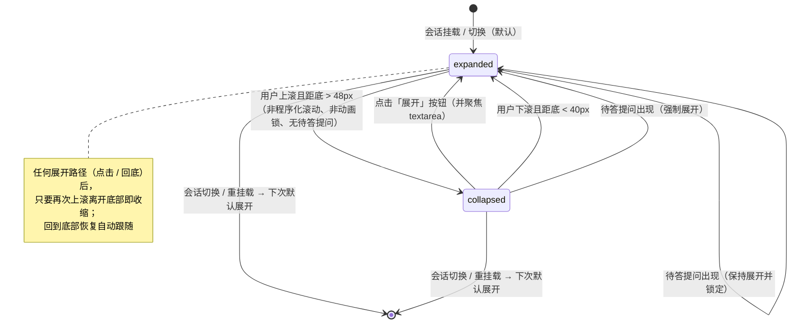
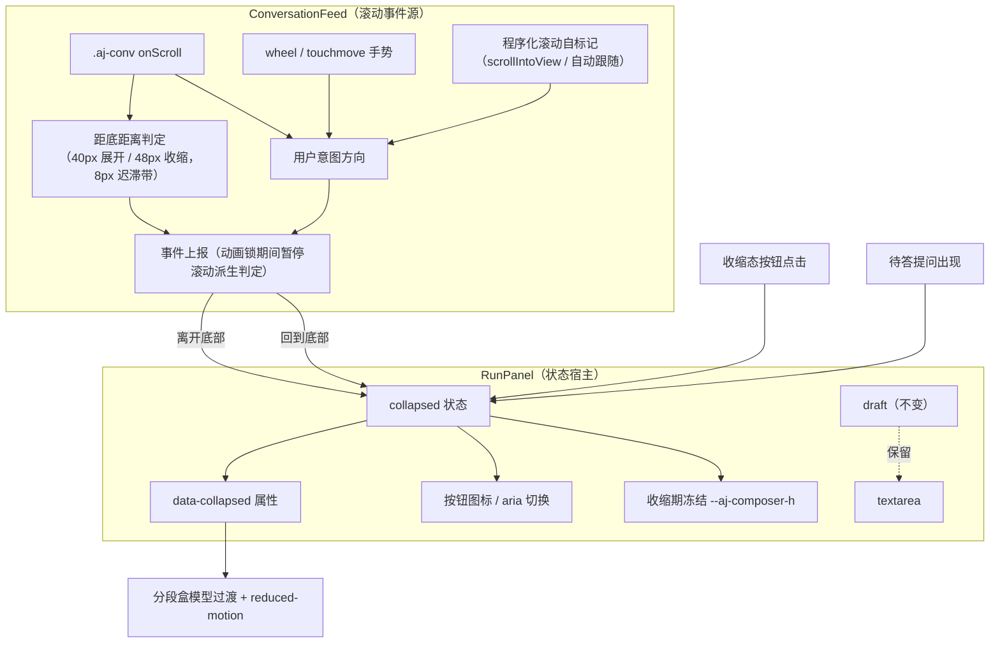
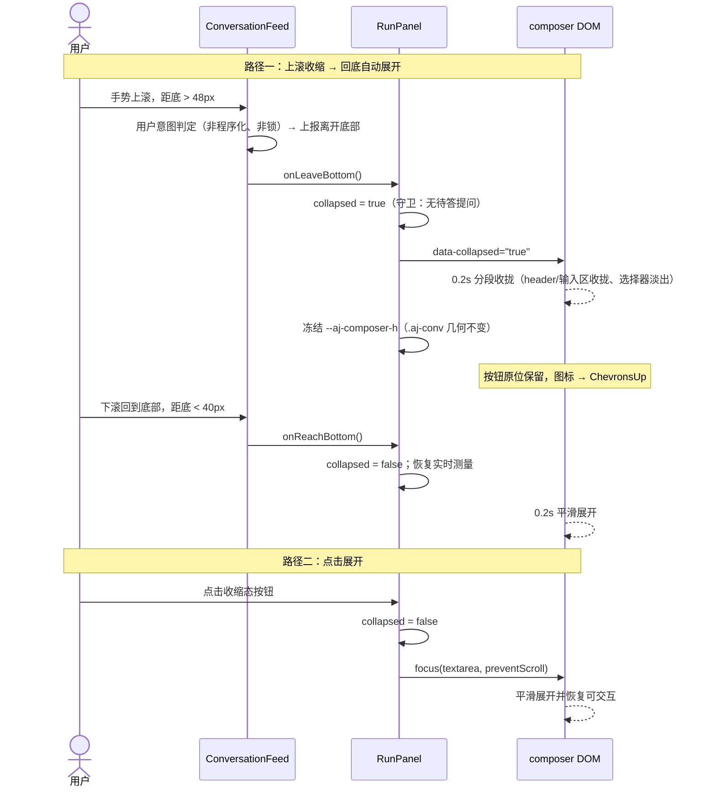

# 设计文档：中栏 Composer 滚动自动收缩

> 日期：2026-09-25
> 范围：`agentj-ui/apps/web`（Desktop 复用 web 产物自动继承；TUI 不适用）
> 版本影响：工作区 0.23.1 → **0.24.0**（feature，minor）；`PROTOCOL_VERSION` 保持 **0.15.0**（无协议/SDK/后端变更）
> 关联基线：v0.18.0 composer 75% 居中浮动 + `--aj-composer-h` 动态预留（无独立设计文档，以其实现为基线）；v0.16.5 右栏 width 过渡；v0.17.0 reduced-motion 双层机制

## 概述

中栏（会话列）底部的 composer 是 75% 宽、居中浮动、`bottom:16px` 的输入卡片（展开态包含：header 项目选择/模型 chip/token 读出、可选的 AskQuestionCard、textarea、工具栏选择器与发送按钮）。会话较长时，用户向上滚动查看历史会被该卡片持续遮挡底部。

本特性让 composer 在用户「上滚离开底部」时**自动平滑收缩**为发送按钮位置上的单枚「展开」按钮（图标与语义切换），在「下滚回到底部」或「点击展开按钮」时**平滑恢复**为完整输入框。草稿内容全程保留；有待答提问时不收缩（防止提问因不可见而超时）。目标是释放阅读空间、减少遮挡，同时不打断输入与提问流程。

## 目标与非目标

**目标：**

1. 用户上滚且离开底部（距底 > 48px）→ composer 平滑收缩为按钮形态（0.2s 过渡）。
2. 用户下滚回到底部（距底 < 40px）→ 自动平滑展开。
3. 点击收缩态按钮 → 平滑展开并聚焦 textarea。
4. 点击展开后继续上滚 → 再次收缩（上滚语义持续有效）；回到底部恢复自动跟随，未再上滚前保持展开。
5. 收缩态按钮位于发送按钮**原位（X/Y 零位移）**，图标由「发送」换为「展开」提示，`aria-label` / `aria-expanded` 同步。
6. 草稿完整保留（不清空、展开后原样恢复）；收缩不改变 `draft` 状态。
7. 有待答提问（`pendingQuestion` 非空）时不收缩；若已收缩则强制展开。
8. 动画尊重 reduced-motion（复用现有双层机制：OS 媒体查询 + `data-reduced-motion` 总开关）。
9. 测试覆盖：纯函数状态机单测 + 组件行为测试 + CSS 契约测试 + 既有契约零回归。

**非目标：**

1. 不持久化收缩态（会话内瞬态；切会话 / 刷新默认展开）。
2. 不为 TUI 实现（终端布局无此语义）；Desktop 复用 web 产物自动继承。
3. 不新增「回到底部」浮动按钮（现无此物，本次不引入）。
4. 不新增停止/取消按钮（`$/cancelRequest` 在 Web 侧保持未接线）。
5. 不改协议 / SDK / 后端；无新增第三方依赖（图标复用已有 `lucide-react`）。
6. 不改既有契约：75% 浮动、展开态 `--aj-composer-h` 实时测量、`pinned` 40px 回底判定、`RunPanel key={activeSessionId}` 重挂载、`draft`/`submit()`/`$/progress` 归约。

## 设计方案

选定：**状态机 + 盒模型过渡 + 手势/滚动双判 + 收缩期冻结预留高度**。

- 收缩状态 `collapsed: boolean` 为 RunPanel 会话内瞬态；
- ConversationFeed 负责「用户意图 + 距底距离」判定并向 RunPanel 上报；
- 卡片以分段盒模型过渡收拢（header / 输入区逐段收拢，工具栏选择器淡出且不占位；按钮行高与按钮保持）；
- 收缩期间**冻结** `--aj-composer-h`，避免滚动区几何变化引发 scrollTop 钳制（阅读位置跳动）与收缩/展开振荡。

### 备选方案

| 方案 | 描述 | 优点 | 缺点 | 结论 |
|------|------|------|------|------|
| A（选用） | 状态机 + 盒模型过渡 + 手势/滚动双判 + 收缩期冻结 `--aj-composer-h` | 空间真正释放；与右栏 width 过渡 / ResizeObserver 既有模式一致；状态迁移可无 DOM 单测 | 需处理程序化滚动排除、动画锁与结构分段收拢 | **选用** |
| B | paint-only 交叉淡出（内容淡出、卡片布局高度不变） | 无 reflow、无 CSS 变量同步问题、实现最简 | 收缩后仍占原高度，不释放阅读空间，违背主目标 | 未选 |
| C | 即时切换（无过渡，或仅按钮小动效） | 实现最简单、零误判风险 | 不满足「自动平滑收缩/展开」的明确要求 | 未选 |
| D | CSS 滚动驱动动画（scroll-driven animations） | 声明式 | 浏览器兼容差；无法表达「点击展开 / 待答提问强制展开 / 草稿保留」等状态机语义 | 未选 |

## 架构

### 状态机

唯一状态 `collapsed: boolean`（默认 `false`）；守卫 `hasPendingQuestion`（待答提问时禁止收缩并强制展开）；有效收缩形态 = `collapsed && !hasPendingQuestion`。

### 组件与数据流

- **RunPanel（状态宿主）**：持有 `collapsed`；派生 `hasPendingQuestion`；渲染 `.aj-composer-card[data-collapsed]`；发送按钮双职责；收缩期冻结 `--aj-composer-h`；点击展开时聚焦 textarea。
- **ConversationFeed（滚动事件源）**：保留现有 `pinned`（距底 < 40px）判定与自动跟随（`scrollIntoView`，仅 `pinned` 时执行，全程属于程序化滚动）；新增用户意图判定与事件上报；动画锁抑制滚动派生判定。
- **状态迁移纯函数模块**（新增，先例：`changes.ts` / `todoState` 归约）：迁移规则从 DOM 剥离，组件只做事件接线与渲染，便于无 DOM 单测。

### 主要时序

## 关键设计决策

| # | 决策 | 背景 / 选项 | 选择 | 理由 |
|---|------|-------------|------|------|
| 1 | 状态归属与持久化 | RunPanel 本地态 vs `layoutStore` 持久化 | `collapsed` 为 RunPanel 会话内瞬态，**不持久化** | 收缩是滚动派生的瞬时态而非用户偏好；切会话经 `key` 重挂载天然重置；回到底部本就应展开 |
| 2 | 收缩触发 | 任意滚动 / 仅用户上滚 | **仅用户上滚且距底 > 48px** | 程序化自动跟随不得触发；8px 迟滞带（48/40）防边界抖动 |
| 3 | 展开触发 | 回底 / 点击 / 两者 | **点击** 与 **用户下滚回到底部（< 40px）** 两者皆是 | 复用现有 `pinned` 40px 判定；点击是明确要求 |
| 4 | 点击展开后再上滚 | 仅首次离开底部收缩 / 持续响应上滚 | **持续响应上滚（再次收缩）**：任何展开路径（点击 / 回底）后，只要再次上滚离开底部即收缩 | 用户明确选择；回到底部恢复自动跟随（未再上滚前保持展开） |
| 5 | 草稿 | 有草稿不收缩 / 始终收缩 | **始终收缩，草稿完整保留** | `draft` 状态不动、不清空；展开后原样恢复（用户明确要求） |
| 6 | 待答提问 | 不收缩 / 照常收缩加提示 | **不收缩；已收缩则强制展开** | 防止提问卡不可见导致超时；提问出现即强制展开 |
| 7 | 用户意图判定 | 单一 `onScroll` 方向 / 手势 + 滚动双判 | **双判并集**：① `wheel`/`touchmove` 手势；② 非程序化 `scroll` 方向（覆盖滚动条拖拽/惯性）；程序化 `scrollIntoView` 由自标记排除 | 单一 `onScroll` 无法区分程序化跟随；纯手势又会漏掉滚动条拖拽 |
| 8 | 冻结 `--aj-composer-h` | 实时跟随（收缩期 padding 变小） / 冻结 | **收缩期冻结为展开态最后测量值**，展开时恢复实时测量 | 收缩使 `.aj-conv` 的 `scrollHeight` 变小 → scrollTop 钳制 → 阅读位置跳动，甚至产生「钳制→回底→展开→再收缩」振荡；冻结使滚动几何完全不变 |
| 9 | 收拢结构 | 整卡 `max-height` 夹取 / 分段收拢 | **分段收拢**：header、输入区逐段收拢至 0 高（可插值过渡）；工具栏选择器淡出且收拢为不占位；**按钮行高与按钮不参与收拢**；收缩完成后淡出内容不占位、不可聚焦、退出 Tab 序列 | 整卡夹取会把流末的按钮挤出可视区；分段收拢保证按钮零位移且动态高度（textarea 自增长）可平滑处理 |
| 10 | 收缩态卡片外观 | 显式像素宽收拢 / 透明保留 75% 宽 | **背景/边框淡出为透明；保留 75% 宽与 `padding: 0 16px 12px`；`pointer-events: none` + 按钮 `pointer-events: auto`** | 百分比↔像素宽度插值不可靠；透明保留使按钮 X/Y 严格零位移；`pointer-events` 防止透明层拦截内容点击 |
| 11 | 弹层处理 | 保留打开 / 关闭 | 收缩触发时**关闭** composer 内所有弹层（模型/Agent/权限/熵变/@补全） | 避免「隐藏但打开」的状态残留；恢复展开后不自动重开 |
| 12 | 图标 | `ChevronsUp` / `Maximize2` / 文字胶囊 | **`ChevronsUp`**（lucide） | 与发送箭头 `↑` 语义区分明确（双箭头 = 向上展开）；`Maximize2` 偏「全屏」；文字胶囊体积大 |
| 13 | 焦点策略 | 全部展开路径聚焦 / 仅点击聚焦 | **仅点击路径聚焦 textarea**（`preventScroll`）；自动展开与提问强制展开不抢焦点 | 自动展开时用户仍在滚动，抢焦点会打断阅读；点击是明确输入意图 |
| 14 | 按钮禁用语义 | 沿用发送按钮禁用规则 / 收缩态始终可用 | **收缩态始终可点**（不因 `isBusy` / 无会话禁用）；展开态沿用现有规则 | 收缩态按钮的职责是「展开输入框」而非发送 |
| 15 | 动画与可访问性 | 自定义动效 / 复用现有机制 | 过渡使用 `--aj-motion`（0.2s）+ `--aj-ease`；reduced-motion 复用 `@media (prefers-reduced-motion: reduce)` 分块 + `:root[data-reduced-motion="true"]` 总开关（`displayPrefs.css` 最后导入） | 与全站动效一致，零新增 token；双层机制已覆盖 composer 卡片 |
| 16 | 状态迁移实现 | 组件内 if/else / 纯函数模块 | **纯函数状态迁移模块**（新增 `composerCollapse`，含迁移守卫） | 与 `changes.ts` / `todoState` 先例一致；状态机可无 DOM 全量单测 |
| 17 | 动画锁 | 无锁 / 状态切换后短暂锁 | 状态切换后 **260ms**（0.2s 过渡 + 60ms 缓冲）内暂停滚动派生判定；**点击与待答提问事件不受锁限制** | 防过渡期间的重复/抖动事件；用户显式操作永不被丢弃 |

## 错误处理

| 场景 | 行为 |
|------|------|
| 短会话（无滚动条） | 无 `scroll` 事件 → 始终展开（自然行为，无需特判） |
| 流式自动跟随 | `scrollIntoView` 属程序化滚动（自标记排除）→ 不触发收缩；内容增长本身不产生收缩 |
| 滚动条拖拽 / 惯性滚动 | 非程序化 `scroll` 方向判定覆盖（用户意图来源并集）；迁移幂等，重复事件不产生抖动 |
| 边界抖动（40/48px 附近） | 8px 迟滞带 + 260ms 动画锁 + 迁移幂等 |
| 窗口 resize（展开态） | ResizeObserver 实时更新（行为不变） |
| 窗口 resize（收缩态） | 冻结不更新；展开时恢复实时值。若尺寸变化导致展开瞬间预留高度小幅调整，可接受（不阻断、不振荡） |
| 会话切换 / 重挂载 | `collapsed` 重置为 `false`；无持久化残留 |
| `isBusy` / 无 `activeSessionId` | 允许收缩（提交后草稿已清空）；收缩态按钮始终可点（展开） |
| 焦点在 textarea 时上滚 | 收缩导致 textarea 失焦（可接受）；草稿保留；点击展开后焦点回到 textarea |
| 弹层打开时上滚 | 收缩同时关闭弹层；恢复展开后不自动重开 |
| 移动端惯性 / 回弹 | 方向判定基于 `scrollTop` 差；距底距离取非负值；状态迁移幂等 |
| 键盘滚动 | 现阶段 `.aj-conv` 不可聚焦（无 `tabindex`），键盘滚动不可达；不新增 tabindex（避免与现有焦点模型/键位冲突）。作为扩展点记录：若未来 feed 可聚焦，按相同方向语义纳入 |
| 主题切换（亮/暗） | 收缩态透明卡片与按钮样式需 token 化，两主题下均无残留背景/边框/阴影（验收项） |
| demo 模式 | 与真实模式共用 ConversationFeed 与 composer，行为一致 |

## 测试策略

### 1. 纯函数状态机单测（新增）

- 迁移全表覆盖：上滚离开底部 → 收缩；回底 → 展开；点击 → 展开；点击后继续上滚 → 再次收缩；待答提问出现 → 强制展开；待答期间上滚 → 不收缩；会话重置 → 展开。
- 守卫优先级（待答提问 > 上滚收缩）；迁移幂等（重复同类事件不改变状态）。

### 2. 组件行为测试（RunPanel / ConversationFeed）

- 模拟 `.aj-conv` 滚动（jsdom 中设置 `scrollTop`/`scrollHeight`/`clientHeight` 并触发 `scroll`，叠加 `wheel`/`touchmove` 方向事件）→ 断言 `data-collapsed` 出现/消失。
- 程序化自动跟随（`scrollIntoView` 路径）不触发收缩。
- 点击展开按钮 → 展开 + textarea 聚焦 + 草稿保留（先输入草稿 → 上滚收缩 → 展开 → 断言 textarea 值与草稿一致）。
- 待答提问：出现时强制展开；待答期间上滚不收缩。
- 图标 / `aria` 切换（`aria-label`「发送」⇄「展开输入框」、`aria-expanded`）；收缩态按钮在 `isBusy` / 无会话时仍可点击。
- `ResizeObserver` stub（既有模式）：展开态写入 `--aj-composer-h`；收缩态**不写入**（冻结）；展开后恢复写入。
- 动画锁：状态切换后短时间内重复 `scroll` 事件不产生状态抖动；点击与提问事件不被锁丢弃。

### 3. CSS 契约测试（读 `composer.css`，复用 `ruleBody` 助手模式）

- `[data-collapsed="true"]` 规则存在，且过渡使用 `--aj-motion` / `--aj-ease`。
- 分段收拢规则存在（header / 输入区 / 选择器收拢；按钮行保持）。
- reduced-motion 覆盖仍含 composer 卡片（既有分块不回归）。
- 既有 75% 浮动 / `min-width` / 展开态 `max-height` 契约不回归（`composerFloat.test.ts` 保持通过）。

### 4. 验收标准（实施后，实机 Playwright）

- 上滚离开底部 → 200ms 内平滑收缩；发送按钮 X/Y 零位移（像素级 ±1px）。
- 收缩态按钮图标与发送图标不同；`aria-label` = 「展开输入框」。
- 下滚回到底部自动平滑展开；点击按钮平滑展开且焦点在 textarea。
- 点击展开后继续上滚 → 再次收缩；回到底部保持展开。
- 草稿保留：输入文本 → 上滚收缩 → 展开 → 文本不丢失。
- 待答提问出现 → 强制展开；待答期间上滚不收缩。
- 程序化流式跟随滚动不触发收缩。
- reduced-motion 开启 → 无过渡动画（瞬切）。
- 亮/暗主题下收缩态无视觉残留；窄视口（≤390px）无溢出。
- 门禁：`npm --prefix agentj-ui test --workspace=@agentj/web` 全绿（含新增测试）；`web build` 通过；既有 composerFloat / RunPanel 契约测试不回归。

## 依赖

- **复用（无改动）**：`pinned` 距底判定与自动跟随；`--aj-composer-h` ResizeObserver 机制；`--aj-motion` / `--aj-ease` 动效变量；reduced-motion 双层机制；`OptionPopover` 的 `focus({preventScroll})` 先例；`CodeBlockCard` 图标切换先例；测试助手 `ruleBody` / `mediaBodies` 与 ResizeObserver stub 模式。
- **新增/修改（计划阶段实施）**：
  - `agentj-ui/apps/web/src/RunPanel.tsx`：`collapsed` 状态、事件接线、按钮双职责、冻结逻辑、聚焦。
  - `agentj-ui/apps/web/src/components/composer.css`：`[data-collapsed]` 分段收拢规则与过渡、reduced-motion 补充。
  - 新增 `agentj-ui/apps/web/src/composerCollapse.ts`（纯函数状态迁移）+ 对应测试。
  - 测试扩展：`RunPanel.test.tsx` / `composerFloat.test.ts`（或新增专用测试文件）。
- **版本与文档**：工作区 0.23.1 → 0.24.0（Cargo workspace + `sdk/config.ts` VERSION + desktop 同源，`check-version.sh` 通过）；`PROTOCOL_VERSION` 0.15.0 不变；AGENTS.md / README.md / summary（fe）按惯例在实施阶段同步。
- **外部依赖 / 阻塞**：无新增第三方依赖；无协议/后端阻塞。主要实施风险 = 分段收拢结构调整触碰既有 CSS 契约测试，须保持既有断言全绿（已在测试策略中锁定）。
