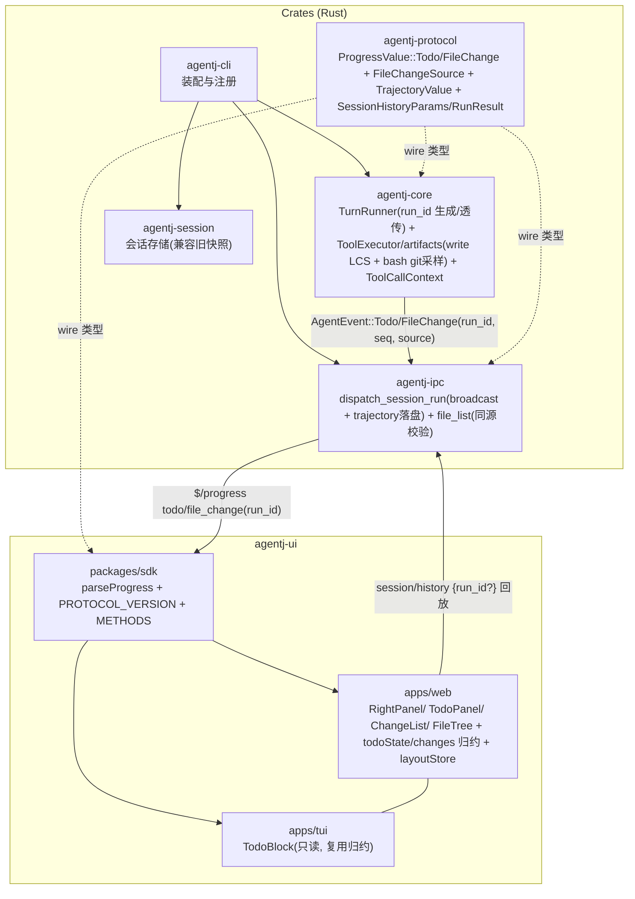
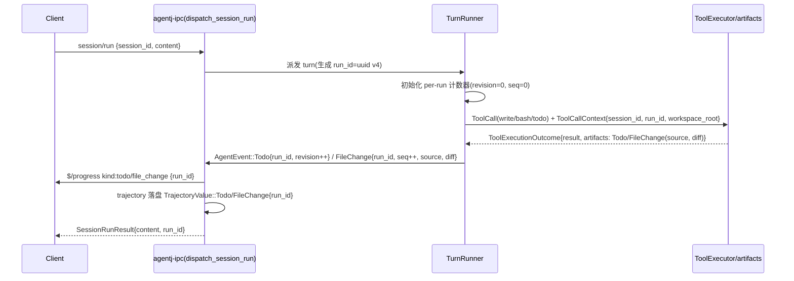
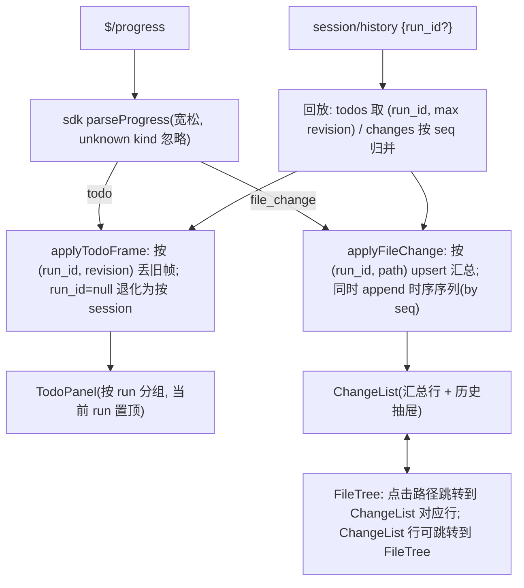
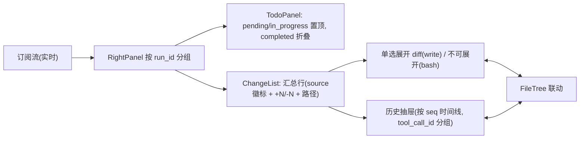

# 设计文档：右边栏运行详情 — 任务与文件变更协议设计实现

> 状态：**已实现（v0.23.0，PROTOCOL 0.15.0）** —— T0–T11 全部落地，52 schemas / cargo 648 / web 552 / tui 142 全绿 ｜ 日期：2026-09-25 ｜ 上游输入：用户需求「右边栏运行详情中，任务与文件变更协议设计实现」+ 头脑风暴四问收敛（C/A/B/A）+ Phase 1 三路调研
> 本文档定义 **WHAT / WHY**（架构、契约、决策、权衡）；任务级 TDD 拆解属下一阶段（`/jskill-feature-plan`）。

## 概述

AgentJ 三栏工作台的**右边栏-运行详情**当前由 `$/progress kind:todo`（全量快照 + `revision` 单调）与 `kind:file_change`（`write` 自研 LCS ≤64KiB + `bash` git 采样 `numstat` 双源，`path` 维度 upsert + `unified diff` 单选展开）驱动，经 `session/history` 回放重建。已能展示，但存在三类结构债：

1. **运行维度缺失**：`session_id` 级混流，同一会话多轮 `session/run` 的任务与变更无法隔离到"本次运行"；
2. **归并与来源不透明**：同路径覆盖丢历史、双源（`write`/`bash`）口径混淆、`diff` 截断无总量提示、与 `file/list` 的 `git_status` 无显式同源；
3. **只读但不可溯**：只读是正确约束，但"汇总覆盖"与"时序可追溯"未兼顾，右栏无分组/无抽屉、与 `FileTree` 无联动。

本设计以**加性协议**补齐运行维度与归并语义，并一次性对齐右栏体验（分组汇总 + 时序抽屉 + 来源徽标），保持**只读镜像**（不新增 `todo/update` / `file/diff`），`PROTOCOL_VERSION 0.14.0 → 0.15.0`。

## 目标与非目标

- **目标**：
  1. 同一会话内多次 `session/run` 的任务与文件变更按 `run_id` 隔离展示与回放；旧数据（无 `run_id`）兼容可读。
  2. 文件变更携带 `run_id + seq + source(write|bash) + tool_call_id?`，同 `run_id` 内按 `(run_id, path)` 去重覆盖为"本次运行汇总"，同时通过 `trajectory seq` 保留时序、可在抽屉中展开查看历史。
  3. `diff` 口径统一：`write` 产出为 `unified diff ≤64KiB + diff_truncated + total_bytes?`；`bash` 产出为计数型（`diff=null + source=bash` 标签），不伪造 diff；与 `file/list` 的 `git_status` 同源可校验。
  4. Todo `revision` 改为**按 run 单调**（会话内 per-run 计数），旧 `revision` 按会话单调的数据仍按"丢旧帧"兼容。
  5. 右栏按 run 分组展示：汇总行含 `source` 徽标 + `+N/-N` + diff 单选展开 + 历史抽屉；与 `FileTree` 跳转联动；空态/截断/持久化符合现有 `layoutStore` 语义。
  6. 协议纪律全绿：`schemas` 漂移门禁、`protocol/methods.json` 注册表一致、`check-version.sh`、clippy 零告警；仅加性字段，不改既有字段含义。
- **非目标**：
  - **不做右栏可编辑 Todo**（`todo/update`）：本期保持只读镜像，避免双写冲突与权限面；可编辑留待后续独立特性。
  - **不做 `file/diff` 懒加载**：超限仅显式提示截断与总量，不新增按需拉取方法；首屏仍内联 `≤64KiB`。
  - **不做 `edit` 工具、不做 EventBus 桥接、不做 file/list 分页**（延续 v0.15 非目标）。
  - **不引入第三方依赖**；不做动态 import SRI（属部署完整性专项）。
  - **TUI 本期不新增 file_change 视图**（仅保持 TODO 只读区块与现有 `TodoBlock` 语义一致）。

## 设计方案

### 选定方案总览（方案 B：混合聚合）

以**加性 `run_id` + `FileChangeSource` + `seq` + `total_bytes`** 补齐协议，内核侧在 `session/run` 边界生成 `run_id`（UUID v4）并贯穿 `TurnRunner → ToolCallContext → ToolExecutor/artifacts → dispatch_session_run → broadcast + trajectory`；`Todo` 的 `revision` 按 `run_id` 单调；`FileChange` 按 `source` 标签区分双源口径。

展示层：**汇总覆盖 + 时序可溯**——实时流按 `(run_id, path)` 去重覆盖为汇总，历史通过 `TrajectoryEvent.seq` 追加序列在抽屉中展开；右栏按 `run_id` 分组（当前运行置顶），`FileTree` 点击可跳转到对应变更行。

兼容：所有新增字段 `Option + skip_serializing_if`（旧客户端忽略、旧数据 `run_id=null` 视为"未分组"兼容展示）。

### 备选方案

| 方案 | 优点 | 缺点 | 为何未选用 |
|------|------|------|-----------|
| **A 轻量补丁**：`run_id?` 可选附加，其余不动（仍全局 path upsert、双口径混淆保留） | 改动最小、零迁移 | 多 run 串台；同文件覆盖丢历史；`write`/`bash` 混淆未解；右栏无分组/抽屉，体验债留存 | 与"按 run 聚合+抽屉+source 标签"目标矛盾 |
| **B 混合聚合（选定）** | 解 run 隔离、历史可溯、双源标签化；汇总+抽屉兼顾；只读零双写；加性兼容 | 需贯穿 `run_id` 生成/透传链路与右栏分组/抽屉改动 | — |
| **C 事件溯源重构**：`todo/file_change` 纯 append-only 事件流，汇总由客户端折叠推导；引入 version vector | 历史最完整 | 协议/存储/回放全重做；旧 `revision` 废弃需迁移；客户端聚合与首屏噪音显著上升 | 过度设计，MVP 不取 |

### 协议契约（wire 层，`@since 0.15.0`）

> 字段一律 `snake_case`；新增字段 `Option<T> + skip_serializing_if`；值枚举未知值走 `#[serde(other)] + #[schemars(skip)] Unknown`；判别联合未知 `kind` 由 `$` 前缀约定忽略。

#### 1. `run_id` 的产生与回显

- `session/run` 触发时内核生成 `run_id: String`（UUID v4，`uuid` crate 已在 `agentj-ipc` 依赖中），贯穿该次 turn 的全部 `AgentEvent`。
- `SessionRunResult` 加性字段 `run_id?: string`（新客户端可用于关联订阅与回放过滤；旧客户端忽略）。
- `SessionStatusResult` 已有 `project_root`，本期**不**新增运行态字段（避免与会话状态机耦合）；如需"当前运行"由客户端以最近 `run_id` 推导。

#### 2. `$/progress kind:todo` 变更

```rust
ProgressValue::Todo {
  session_id: SessionId,
  #[serde(default, skip_serializing_if = "Option::is_none")] run_id: Option<String>, // @since 0.15.0
  revision: u64, // 语义变更：改为 per-run 单调（旧数据 per-session 单调仍兼容：客户端按 (run_id, revision) 丢旧帧，run_id=null 时退化为按 session 丢旧帧）
  items: Vec<TodoItem>,
}
```

`TodoItem` / `TodoStatus` 不变。`TrajectoryValue::Todo` 同步加性 `run_id?: string`。

#### 3. `$/progress kind:file_change` 变更

新增值枚举与字段：

```rust
enum FileChangeSource { Write, Bash, #[serde(other)] #[schemars(skip)] Unknown } // @since 0.15.0

struct FileChange {
  path: String,            // 相对 project_root（不变）
  op: FileChangeKind,      // add/modify/delete（不变）
  additions: u64,          // 不变
  deletions: u64,          // 不变
  #[serde(default, skip_serializing_if = "Option::is_none")] tool_call_id: Option<String>,
  #[serde(default, skip_serializing_if = "Option::is_none")] diff: Option<String>,          // write: unified diff ≤64KiB；bash: null
  #[serde(default, skip_serializing_if = "Option::is_none")] diff_truncated: Option<bool>,  // 仅截断时 true
  // 新增 @since 0.15.0
  #[serde(default, skip_serializing_if = "Option::is_none")] run_id: Option<String>,
  #[serde(default, skip_serializing_if = "Option::is_none")] seq: Option<u64>,              // 单调 per-run 序号（内核分配，用于抽屉排序；与 TrajectoryEvent.seq 同源递增但独立命名空间亦可）
  #[serde(default, skip_serializing_if = "Option::is_none")] source: Option<FileChangeSource>,
  #[serde(default, skip_serializing_if = "Option::is_none")] total_bytes: Option<u64>,      // diff 原始字节数（截断时告知总量）
}
```

`ProgressValue::FileChange` 同步加性 `run_id?: string`（冗余于 `change.run_id`，便于不解析 `change` 即可路由；两者不一致时以 `change.run_id` 为准，`ProgressValue.run_id` 仅作路由提示）。

`TrajectoryValue::FileChange` 同步加性 `run_id?: string`（与 `change.run_id` 一致性同上）。

口径统一规则：

- `source=write`：`diff` 为自研 LCS 产出的 `unified diff`（`DIFF_MAX=64KiB`），`total_bytes` 为截断前字节数；`diff_truncated=true` 时 `diff` 为截断后前缀。
- `source=bash`：`diff=null`、`diff_truncated=null`、`total_bytes=null`，仅 `additions/deletions` 计数有效；UI 打 `bash` 标签且不可展开 diff。
- `source` 缺省（旧数据）按 `diff` 是否存在启发式：`diff.is_some() → write`，否则 `bash`/`unknown`，UI 降级为不打标签。

#### 4. `session/history` 加性过滤

```rust
struct SessionHistoryParams {
  session_id: SessionId,
  #[serde(default, skip_serializing_if = "Option::is_none")] cursor: Option<u64>,
  #[serde(default, skip_serializing_if = "Option::is_none")] limit: Option<u64>,
  #[serde(default, skip_serializing_if = "Option::is_none")] run_id: Option<String>, // @since 0.15.0：按 run 过滤回放
}
```

语义：`run_id` 存在时仅返回该 `run_id` 的 `Todo/FileChange` 事件（其余 `TrajectoryValue` 不受影响或按需全量；本设计**仅过滤 Todo/FileChange**，其余 kind 保持全量以不破坏时间线完整性——需在 spec 中明确）。`run_id=null` 时行为不变（全量分页）。

#### 5. 版本与注册表

| 项 | 现状 | 目标 |
|---|---|---|
| `PROTOCOL_VERSION`（`agentj-ui/packages/sdk/src/config.ts` 单一真源） | `0.14.0` | **`0.15.0`**（加性 → minor） |
| 工作区版本（Cargo + sdk `VERSION` + desktop） | `0.22.0` | **`0.23.0`**（feature → minor） |
| `protocol/methods.json` | 21 方法 `0.14.0` | 21 方法（不新增方法）`0.15.0` |
| `schemas/*.json` | 51 | **约 55**（新增 `FileChangeSource` + 3 处加性字段的 schema 更新） |

## 架构

### 组件图



### 数据流 A：`session/run` → `run_id` 贯穿



### 数据流 B：前端订阅与归约



### 数据流 C：右栏交互



## 关键设计决策

### #1 `run_id` 必填语义 vs wire 可选（兼容）

- **上下文**：运行详情天然按次隔离，但旧数据与旧客户端无 `run_id`。
- **选项**：A wire 必填（破坏兼容） / B wire 可选但语义必填（新 run 必带，旧数据 `null` 兼容）。
- **决策**：B。`SessionRunResult.run_id` 与 `ProgressValue::Todo/FileChange.run_id` 均为 `Option`，但**新内核对新 run 必发**；客户端按 `run_id` 分组，`null` 归入"未分组（历史）"桶，不丢弃。
- **理由**：加性纪律（只加不改）+ 零迁移；旧客户端忽略新字段仍可用。

### #2 `revision` 按 run 单调 vs 按 session 单调

- **上下文**：现 `revision` 按会话单调，多 run 串流时旧 run 的快照可能覆盖新 run。
- **决策**：改为 **per-run 单调**（`TurnRunner` 内 `HashMap<run_id, u64>` 计数）；客户端丢旧帧改为按 `(run_id, revision)` 比较，`run_id=null` 时退化为按 `revision` 单调（兼容旧数据）。
- **理由**：与 `run_id` 隔离一致；`session/history` 回放取 `(run_id, max revision)` 天然正确。

### #3 去重键：`(run_id, path)` vs 全局 `path`

- **上下文**：现全局 `path` 去重导致跨 run 覆盖。
- **决策**：汇总层去重键为 **`(run_id, path)`**；同一 `run_id` 内后者覆盖前者；跨 `run_id` 互不干扰。时序层（抽屉）为 **append-only** 按 `seq` 追加，不做去重。
- **理由**：兼顾"本次运行汇总"与"历史可追溯"；与用户选择的 B 方案一致。

### #4 `source` 标签与 diff 口径统一

- **上下文**：`write` 自研 diff 与 `bash` 的 `numstat` 计数双口径混淆。
- **决策**：新增 `FileChangeSource` 枚举；`write→write`（带 diff）、`bash→bash`（无 diff，仅计数）；`diff_truncated + total_bytes` 显式化截断；`bash` 行 UI 标记 `bash` 且不可展开。
- **理由**：不伪造 diff；客户端可据 `source` 决定是否展示展开控件与徽标色。

### #5 `seq` 的作用域与落盘

- **上下文**：抽屉需稳定时序；`TrajectoryEvent.seq` 已有全局 per-session 单调，但与 `file_change` 的展示序需解耦。
- **决策**：`FileChange.seq` 为 **per-run 单调**（`TurnRunner` 分配），与 `TrajectoryEvent.seq` 同步递增但独立命名空间亦可；回放时按 `seq` 排序，保证抽屉时序与落盘一致。
- **影响**：`TrajectoryValue::FileChange` 需同步 `run_id` 以便按 run 过滤。

### #6 右栏只读与联动边界

- **决策**：本期**不**新增 `todo/update` / `file/diff`；右栏为只读镜像；与 `FileTree` 联动为**单向跳转**（点击路径互跳），不做双向选中同步的复杂状态机。
- **理由**：与用户选择的 A（只读 MVP）一致；避免双写冲突与额外往返；联动以最小可用闭环交付。

## 错误处理

| 场景 | 行为 |
|---|---|
| `run_id` 缺失（旧数据/旧内核） | 归入"未分组"桶；Todo 按 `revision` 单调兼容；FileChange 按 `path` 全局 upsert 兼容；回放不过滤 |
| `run_id` 非法（非 UUID/超长） | 视为 `null`（不抛错），归入未分组；`session/history {run_id}` 校验：非法 `run_id` → `-32602 InvalidParams + data{reason:"invalid_run_id"}` |
| `revision` 乱序/回退 | 客户端丢弃旧帧（`(run_id, revision)` 比较）；`trajectory` 仍落盘，不影响回放（回放取 max revision） |
| `diff` 超限（>64KiB） | `diff` 截断到 `64KiB` 前缀 + `diff_truncated=true` + `total_bytes=原始字节数`；UI 显式提示"已截断（原始 N KiB）" |
| `source=bash` 且请求展开 | 控件禁用；tooltip "bash 变更无 diff，仅计数" |
| 非 git 仓库 / 根外路径 / `.git` 排除 | 延续 v0.15 语义：`git_status=null` 降级；根外符号链接条目跳过；`file/list` 越界仍 `-32807` |
| `session/history {run_id}` 无匹配 | 返回空 `events:[]`（不报错） |
| 未知 `source` / `op` / `kind` | `Unknown` 容忍；UI 按 `pending` / `modify` / 忽略未知 kind 降级 |

## 测试策略

| 层级 | 关键场景 | 验收标准 |
|---|---|---|
| **协议/单测**（`agentj-protocol`） | `ProgressValue::Todo/FileChange` 序列化（`run_id`/`source`/`seq`/`total_bytes` 加性）、`FileChangeSource::Unknown`、`SessionHistoryParams` 过滤、`SessionRunResult.run_id` | `cargo test -p agentj-protocol -- drift` 2 passed；新增 schema 约 55 个无漂移 |
| **内核/单测**（`agentj-core`） | `TurnRunner` per-run `revision`/`seq` 分配、`write` LCS 截断与 `total_bytes`、`bash` 计数型产出 `source=bash` | 单测覆盖双源口径与截断边界；`cargo clippy -D warnings` 零告警 |
| **IPC/e2e**（`agentj-ipc` + `e2e_*`） | 同会话多 `session/run` 的 `run_id` 隔离（订阅仅收本 run 或按 `run_id` 过滤）、`session/history {run_id}` 分页、`run_id=null` 兼容回放 | `cargo test --workspace` 全绿；`e2e_ws` 覆盖 `run_id` 隔离 |
| **SDK**（`@agentj/sdk`） | `parseProgress` 宽松解析（缺 `run_id`/`source` 不抛错）、`PROTOCOL_VERSION 0.15.0` | `npm --prefix agentj-ui test --workspace=@agentj/sdk` 全绿 |
| **Web**（`@agentj/web`） | `todoState.applyTodoFrame` 按 `(run_id, revision)` 丢旧帧、`changes.applyFileChange` 按 `(run_id, path)` upsert + 时序 append、`RightPanel` 按 run 分组、`ChangeList` 汇总+抽屉+`source` 徽标+截断提示、`FileTree` 跳转 | `vitest` 新增单测覆盖归约与分组；`vite build` 通过 |
| **TUI**（`@agentj/tui`） | `TodoBlock` 按 run 分组或保持现有单会话展示（本期 TUI 不新增 file_change 视图，仅兼容 `run_id`） | `bun --cwd agentj-ui/apps/tui test` 全绿 |
| **门禁** | `cargo fmt` / `clippy` / `drift` / `check-version 0.23.0 / 0.15.0` / `web build` / `tui` / `desktop-ui` | 全绿 |

## 依赖

- **前置**：`uuid` 已在 `agentj-ipc` 可用（`WsConnection::with_init_token` 路径已引入）；`DIFF_MAX=64KiB` 常量与 LCS 实现已在 `agentj-core/artifacts.rs`；`TrajectoryStore` NDJSON 落盘与 `session/history` 分页已具备。
- **外部依赖**：无新增第三方依赖（`FileChangeSource` 为纯枚举，`run_id` 生成用既有 `uuid`）。
- **阻塞项**：无；本设计为加性变更，可独立于 `指标导出扩展 / 抽检扩展 / Web 搜索` 等待实施项并行落地。
- **版本门禁**：`docs/specs/ipc-protocol.md` 需同步新增 §（`FileChangeSource`、run 维度、`session/history` 过滤、`diff` 口径）；`protocol/methods.json` 同步 `protocol_version 0.15.0`；`schemas/*.json` 重新生成并纳入 drift 门禁。

---

> 已实现：已运行 `/jskill-feature-plan docs/superpowers/specs/2026-09-25-agentj-right-panel-run-details-design.md` 产出 TDD 任务拆解与实施计划。
