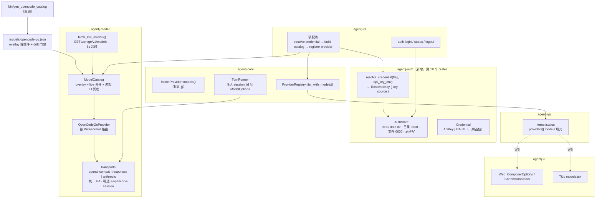
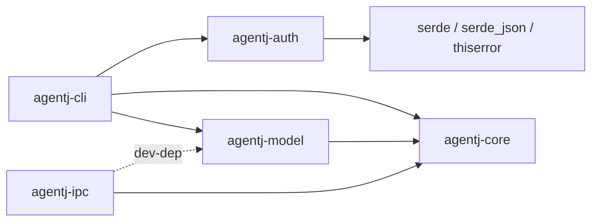
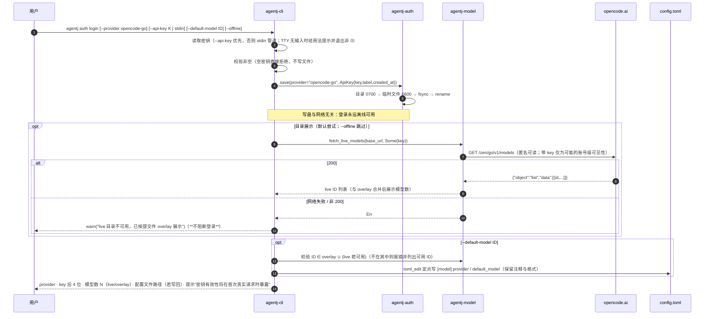
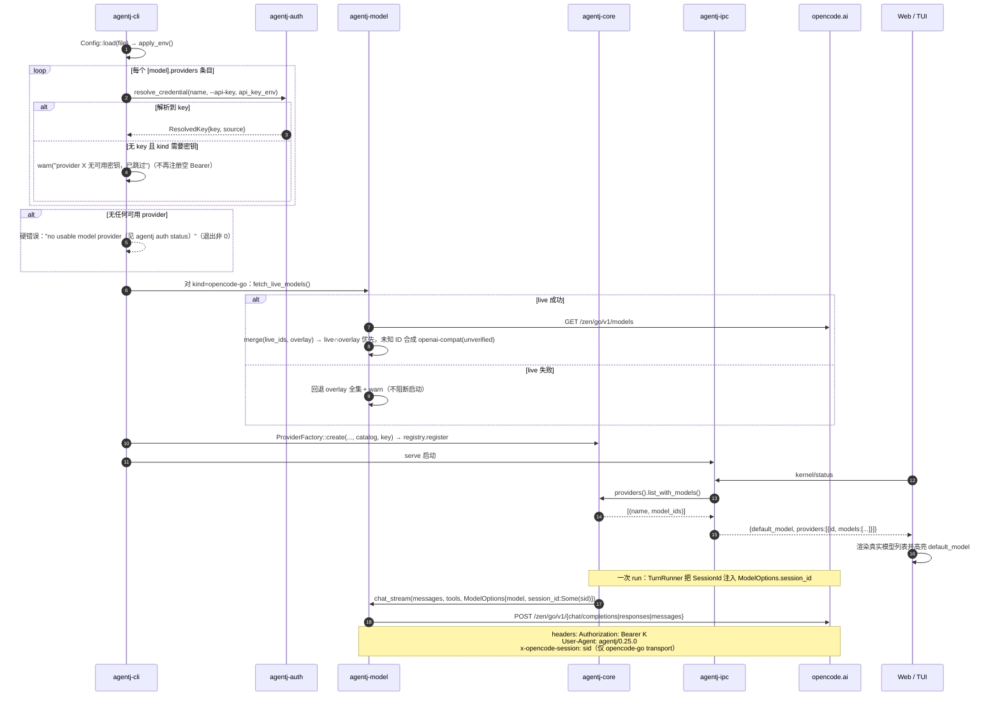

# 设计文档：agentj 接入 opencode-go 订阅（0.25.0）

> 状态：待审阅 · 工作区版本 0.24.2 → **0.25.0** · `PROTOCOL_VERSION` **0.15.0 冻结不变**（52 schemas / 21 方法）
> 分期：**一期＝可用（本文档交付范围）**；二期＝好用（用量面板 / device-code OAuth / 运行期切模型），本文档仅定义接口预留。

## 概述

agentj 当前已有一个 `opencode-go` provider facade：静态提交件 `models/opencode-go.json`（19 个模型 × 3 种 wire format）、单一 `base_url`（`https://opencode.ai/zen/go`）、密钥仅来自 `api_key_env` 环境变量。它能发请求，但**不是一个"订阅集成"**：没有登录与凭据落盘、目录靠人工维护、账号里到底有哪些模型在 UI 上看不见、缺少上游明确要求的客户端标识头，且密钥缺失时会静默发送未认证请求。

本设计把 opencode-go **订阅**（OpenCode Go，$10 / Go Plus $40 月订阅）作为一等 provider 接入：

1. `agentj auth login | status | logout` —— workspace API key 落盘 `0600`，四段优先级解析，启动打印来源（不打印密钥）。
2. **目录 = live 发现 + 提交件 overlay** —— `GET https://opencode.ai/zen/go/v1/models` 提供可用 ID（匿名可读），提交件提供不可 live 发现的 `id → wire format` 映射，未知新 ID 兜底并在日志显式标注"路由未验证"。
3. **厂商合规头** —— 全部 provider 统一 `User-Agent: agentj/<version>`；opencode-go 流量每会话携带稳定的 `x-opencode-session`。
4. **可见性** —— 填充已有字段 `kernel/status.providers[].models`（零协议变更），Web/TUI 显示真实模型列表并高亮默认模型。
5. 一期结束时用户能走完：登录 → 看到订阅里有哪些模型 → 选一个写进 `config.toml` → 重启内核 → 跑通一轮（含工具调用）→ 出错时有可行动的提示。

## 目标与非目标

### 目标（一期）

- **G1 凭据生命周期**：`auth login/status/logout`；`auth.json`（目录 `0700` / 文件 `0600` / 原子写）；优先级 `--api-key` > `api_key_env` > `auth.json`；**权限不符或 JSON 损坏时拒绝使用并报错**，不静默降级。
- **G2 消除静默空密钥**：无法解析密钥的 provider 不再注册为空 Bearer；若最终无任何可用 provider，启动即报可行动错误。
- **G3 动态目录**：live `/models` ∩ overlay 合并；live 不可用（离线/超时）自动回退 overlay 全集；live 中的未知 ID 合成为 `openai-compat` 条目并标记 `unverified`（启动 `warn` 列出）。
- **G4 合规标识**：所有 provider 请求 `User-Agent: agentj/<CARGO_PKG_VERSION>`；opencode-go 请求在 `session_id` 存在时携带 `x-opencode-session`（值为内核 `SessionId`，天然"每对话稳定"）；**不做任何 UA/客户端身份伪装**。
- **G5 模型可见性**：`kernel/status.providers[].models` 返回真实列表；Web 与 TUI 展示该列表并高亮 `default_model`；`auth login --default-model <id>` 定点写回 `config.toml` 的 `[model] provider` / `default_model`（保留注释与格式）。
- **G6 错误可行动**：解析网关错误包封 `{"type":"error","error":{"type","message"}}`，把 `error.type` 带入错误文案；三个 transport 的 429 行为统一（含 `Retry-After` 解析）。

### 非目标（一期明确不做）

- ❌ device-code OAuth 登录（`console.opencode.ai` 端点未公开文档，二期独立交付，届时先做只读探针）。
- ❌ **一期不做密钥在线校验**：`/zen/go/v1/models` 匿名可读，**无法据此判定 key 有效性**（坏 key 很可能同样返回 200），拿它当校验只会给出假信心。错误 key 在首次真实请求时以 `AuthError` 明确暴露；真正的校验（`GET /zen/go/v1/usage`）属二期。**因此 `auth login` 永远离线可用，不因网络失败而拒绝写盘。**
- ❌ OS keyring（上游自己都没做，issue #4318 仍 open）。
- ❌ 用量/配额面板（`GET /zen/go/v1/usage` 属二期；一期只做结构化错误 + 退避）。
- ❌ 运行期切模型（需改 `session/run` wire 或新增协议方法，二期）。
- ❌ 账号级收敛目录（Console `GET /api/config`，可反映 workspace 禁用模型；一期只用匿名公共列表）。
- ❌ 不接按量付费 Zen（`/zen/v1`）；同一套机制可复用，但不在本期。
- ❌ 不新增任何协议方法、不改 `PROTOCOL_VERSION`、不改 `schemas/*.json` 与 `protocol/methods.json`。
- ❌ 不做"客户端身份伪装"（伪造 `opencode/<ver>` UA 与官方头——调研显示免费层已因此关闭，且踩法律/ToS 风险）。

## 设计方案（选定：方案 A —— 新增 `agentj-auth` + `agentj-model` 扩展 + 全部 transport 补合规头）

把"订阅账户"（凭据、二期 OAuth/用量）与"wire-format 适配"（目录、路由、头部）分成两处职责，凭据仅在 CLI 装配点注入。

### 备选方案

| 方案 | 优点 | 缺点 | 为何未选用 |
|------|------|------|-----------|
| **A 新增 `agentj-auth` + `agentj-model` 扩展（选用）** | 职责干净：密钥/账户归 auth，wire-format/目录归 model；二期 OAuth 与用量查询零重构落点；可独立单测（临时目录 + 权限断言）；与项目既有风格一致（`agentj-license`/`agentj-stats`/`agentj-skills` 都是单一职责小 crate） | 架构基线 17 → 18 crate（`AGENTS.md` 需同步）；多一个 crate 的记账成本 | **选中** |
| B 全部就地放进 `agentj-model` | 改动面最小、crate 数不变、reqwest/serde 现成 | 模型 crate 越界承担"密钥存储 + XDG 路径 + 文件权限"；二期 device flow 状态机 + 用量查询塞入后变双职责，大概率二次拆分（返工） | 一期可行、二期返工 |
| C 全部放进 `agentj-config` | 不新增 crate；`config.get_str` 已是配置真源 | `ConfigProvider` 是**同步** trait 且该 crate 无 HTTP 依赖，异步 live 目录塞不进去；引入文件权限 I/O 让纯解析 crate 长出副作用 | 架构不匹配 |

### 分期与接口预留

| 分期 | 内容 | 预留点 |
|---|---|---|
| **一期（本文档）** | 凭据文件 + 优先级 + 合规头 + live/overlay 目录 + `providers[].models` 可见性 + `auth` 子命令 | `Credential` 含 `OAuth` 变体（读取即报"需二期"），文件格式一次定死 |
| 二期 | `GET /zen/go/v1/usage` 用量窗口（rolling/weekly/monthly）+ 配额事前预警 + device-code OAuth（`console.opencode.ai`，`refresh_token` 轮换）+ 新协议方法（`model/list`、`auth/status`）+ 运行期切模型 + SettingsDialog 订阅 tab | `agentj-auth` 内新增 `oauth.rs` / `usage.rs`，调用方与文件格式不动 |

## 架构

### 总览

### 依赖方向（保持无环）

关键取舍：`agentj-model` **不依赖** `agentj-auth`（凭据只在 CLI 装配点注入）；`agentj-ipc` **不依赖** `agentj-model`（模型列表通过 `agentj-core` 的 `ModelProvider::models()` 默认方法与 `ProviderRegistry::list_with_models()` 抵达 `kernel/status`）。

### 接口清单（语义级）

| 接口 | 位置 | 语义 | 兼容性 |
|---|---|---|---|
| `AuthStore::load / save / path()` | `agentj-auth` | 读写 `auth.json`（目录 `0700` / 文件 `0600` / 临时文件 + fsync + rename 原子写）；文件不存在 = 空 store；**权限非 0600、JSON 损坏、未知 `type` 一律报错而非降级接受** | 新 |
| `resolve_credential(provider, flag, api_key_env)` | `agentj-auth` | 返回 `ResolvedKey { key, source: Flag\|Env\|File }` 或 `None`（**绝不返回空串**）；调用方据此决定注册或跳过 | 新 |
| `Credential` | `agentj-auth` | `#[serde(tag = "type")]`：`ApiKey { key, label, created_at }` / `OAuth { … }`（一期读到 `OAuth` 返回"需 agentj ≥ 二期"错误）——**文件格式一期定死** | 新 |
| `ModelCatalog::from_sources(overlay, live_ids)` | `agentj-model` | 合并：**live 成功** → `live ∩ overlay` + live 中未知 ID 合成 `OpenAiCompat` 且 `verified = false`；**live 失败** → overlay 全集；overlay 独有条目在 live 成功时不可见（可能已下架） | overlay 由 19 → 全量 Go 列表 |
| `fetch_live_models(base_url, key: Option<&str>)` | `agentj-model` | 5s 超时 GET `/models`；失败返回 `Err` 由调用方降级（**不阻断登录/启动**）；`key` 仅用于可能的账号级可见性，**不代表校验** | 新 |
| `ModelProvider::models()` | `agentj-core` | 默认实现 `vec![]`；`OpenCodeGoProvider` 返回目录 ID 排序列表 | 加性默认方法，零破坏 |
| `ModelOptions.session_id` | `agentj-core` | 内部字段（**不进 wire**）；`None` 时 transport 不签发该头 | 加性字段 |
| `ProviderRegistry::list_with_models()` | `agentj-core` | `Vec<(name, Vec<model_id>)>`，供 `kernel/status` | 加性方法 |
| `agentj auth login` | `agentj-cli` | `--provider`（默认 opencode-go）、`--api-key` 或 stdin 管道、`--default-model <id>`、`--offline`（跳过 live 目录展示） | 新子命令 |

### 数据流 1：`agentj auth login`

### 数据流 2：启动发现 + 一次 run 的头部注入

## 关键设计决策

### D1 凭据存 `auth.json`，环境变量仍可覆盖（问题 5）

- **上下文**：需要"登录一次、以后不用管"的持久凭据，同时不能破坏 CI/临时覆盖用法；项目已有 `api_key_env` 语义与 `resolve_session_dir` 的 XDG 逻辑可复用。
- **选项**：① XDG data dir 下 `auth.json`（0600）② 写进 `config.toml` 的 `[model] api_key` ③ OS keyring。
- **选择**：①。**优先级 `--api-key` > `api_key_env`（设且非空）> `auth.json`**；`serve` 启动打印来源与 key 后 4 位，**永不打印全量**。
- **理由**：与上游 `auth.json` 同构（排障心智一致）；②会把密钥写进常被提交/共享的仓库内 `config.toml`；③上游自己都未实现且引入平台依赖。目录解析复用现有 XDG 逻辑，不新增 `dirs` 依赖。

### D2 一期只做 API key，格式预留 OAuth（问题 2）

- **上下文**：上游认证有两条路——官方文档主路径是粘贴 workspace API key；device-code OAuth 走 `console.opencode.ai` 的未公开端点（`client_id=opencode-cli`，`refresh_token` 轮换）。
- **选项**：① 只做 key，类型预留 OAuth ② 一期以 OAuth 为主 ③ 两条都做完整。
- **选择**：①。`Credential` 用 `#[serde(tag = "type")]` 定义 `ApiKey` 与 `OAuth` 两个变体，**文件格式一期定死**；读到 `OAuth` 时返回明确错误（"OAuth 凭据需 agentj ≥ 二期"）。
- **理由**：把三个未文档化端点引入一期，等于把"登录能否工作"押在厂商内部接口上；key 路径官方支持、headless 友好。二期补 device flow 时**不改存储格式、不改调用方**。

### D3 目录 = live 发现 + 提交件 overlay（问题 3）

- **上下文**：`/zen/go/v1/models` 匿名可读但**只返回 `id/object/created/owned_by`**，没有 wire format；而路由必须知道 format，且调研证明"同一 ID 在 Zen 与 Go 上路由可能不同"，按模型族猜是错的。
- **选项**：① live ID + `id→format` overlay（catwalk 模式）② 纯提交件 + 手动/CI 刷新 ③ 纯 live + 内置启发式。
- **选择**：①。overlay 由离线 `bin/gen_opencode_catalog` 生成（live ID 列表 + models.dev 元数据），纳入 drift 门禁；条目带 `verified: bool`。live 中的未知 ID 合成 `openai-compat` 条目并置 `verified=false`，启动 `warn` 列出。live 失败 → 回退 overlay 全集。
- **理由**：新模型无需发版即可出现；路由仍由受控可审计的映射决定；离线可用。③ 把路由正确性押在无官方保证的命名启发式上，调研已证伪。

### D4 合规头走 `ModelOptions.session_id` + 统一 UA（问题 6）

- **上下文**：Go 文档对第三方客户端硬要求"自报 UA（非通用 SDK 名）+ 每对话稳定 `x-opencode-session`"；crush 曾因缺后者被厂商邮件点名。当前 `ModelOptions` 无 session 概念，`ModelProvider` trait 签名是 `(messages, tools, options)`；三个 transport 自行 `Client::new()` 并用 `reqwest` 默认 UA。
- **选项**：① `ModelOptions` 加内部 `session_id: Option<String>` + transport 可选签发头 ② trait 加 `RequestContext` 参数 ③ 进程级 UUID 当代替。
- **选择**：①。`TurnRunner::run_turn(session_id, …)` 已有 `SessionId`（`turn_runner.rs:163`），直接注入；transport 构造时**显式**声明 `session_header: Option<String>`，仅 `OpenCodeGoProvider` 传 `Some("x-opencode-session")`，其他 provider 传 `None`（零行为变化）。UA 用 `Client::builder().user_agent("agentj/<CARGO_PKG_VERSION>")` 全局设置。
- **理由**：不动协议、不改 trait 签名、改动集中在请求构造处；③ 违反"per conversation"会让厂商 prompt caching/路由串味；② 改动面明显更大（6 个 provider + mock + 全部调用点），与"一期先可用"冲突。

### D5 模型列表挂在 `ModelProvider::models()`，`kernel/status` 填充已有字段（零协议变更）

- **上下文**：`KernelStatusResult.ProviderInfo { id, models: Vec<String> }` 字段**已存在**，只是恒为空（`ipc/src/lib.rs:1908-1926`）。协议规则要求任何 wire 变更同步 `PROTOCOL_VERSION`，但"填充已有字段"不是 wire 变更。
- **选项**：① `ModelProvider` 加默认方法 `models()` + `ProviderRegistry::list_with_models()` ② 让 `agentj-ipc` 依赖 `agentj-model` 直读 catalog ③ `ServiceRegistry` 新服务。
- **选择**：①。默认实现 `vec![]`，全部现有实现零改动；`OpenCodeGoProvider` 返回目录 ID 排序列表。
- **理由**："这个 provider 服务哪些模型"本就是 provider 自身的事实；②破坏 ipc 与 model 的边界（ipc 现在只在 dev-deps 里出现 model）；③为一件小事引入服务注册间接层。**`PROTOCOL_VERSION` 保持 0.15.0，52 schemas / 21 方法不变。**

### D6 一期不做运行期切模型，`auth login --default-model` 定点写回配置（问题 4）

- **上下文**：`SessionRunParams` 只有 `session_id/content/attachments/progress_token`，无 `model`；内核每轮从 `config.get_str("model.default_model")` 取模型（`turn_runner.rs:191-197`）。运行期切换必须改协议。
- **选项**：① 一期只做可见性 + 写回默认模型 ② 一期就做运行期切换 ③ 连默认模型也不动。
- **选择**：①。用 `toml_edit` **定点**写 `[model] provider` / `default_model` 两个键，保留用户注释与格式（避免用 `toml` 0.8 全文档重序列化把注释洗掉）。
- **理由**：一期不碰协议与内核路由，回归面最小；③ 会把一期的价值砍半（用户看不到订阅里有什么模型）。

### D7 缺失密钥不再静默发空 Bearer

- **上下文**：现状 `pcfg.api_key_env.and_then(env::var).unwrap_or_default()`，取不到就是空串，请求带着 `Authorization: Bearer ` 出网。
- **选择**：**需要密钥的 kind 白名单 = `openai-compat` / `responses` / `anthropic` / `opencode-go`**（即 `ProviderFactory` 中仅有的四个真实传输）；解析不到密钥 → **不注册** + 可行动 warn。**免密钥 kind = `mock` / `mock-workbench` / `mock-ask`**（既有 e2e 夹具用 `api_key_env = ""` + `kind = "mock"`，不受影响）；未知 kind 仍走既有 `unknown provider kind` 错误。若最终 registry 为空则硬错误。
- **注意**：`ollama.rs` 存在但**未接入 `ProviderFactory`**（`factory.rs:204-267` 无该分支），本期不改变这一事实，也不把 ollama 纳入密钥白名单。
- **理由**：静默失败是最贵的失败模式；空密钥请求在上游必然 401，但用户看到的是"模型报错"而非"你没配密钥"。

### D8 网关错误包封解析，三个 transport 行为对齐

- **上下文**：上游错误统一为 `{"type":"error","error":{"type","message"}}`，配额类（如 `GoUsageLimitError`）→ 429（可能带 `retry-after` 与 `metadata.limitName`），认证/额度类 → 401。
- **选择**：新增共享 `parse_gateway_error()`，把 `error.type` 拼进 `ModelError::Api{status, message}` 文案（**不新增错误变体**，避免协议/UI 连锁）；`openai-compat` 补上 `Retry-After` 解析（当前 429 恒为 `retry_after: None`，与另两个 transport 不一致）；429 保留既有 3 次指数退避。
- **理由**：一期无用量面板，用户至少要知道"是额度墙还是网络错"；统一行为避免"换个模型格式就换一套重试语义"。

## 错误处理

| 场景 | 行为 | 用户可见文案（示例） |
|---|---|---|
| `auth.json` 权限非 `0600` | 拒绝使用，不覆盖 | `凭据文件权限不安全（0644）：请 chmod 600 ~/.local/share/agentj/auth.json` |
| `auth.json` JSON 损坏 | 拒绝使用，报路径 | `凭据文件解析失败：<path>（第 N 行）` |
| 凭据 `type` 未知 / `OAuth` | 明确报版本要求 | `不支持的凭据类型 oauth：需 agentj ≥ 二期版本` |
| `auth login` 传入空密钥 | 拒绝写入 | `密钥为空：请通过 --api-key 或 stdin 管道提供` |
| `auth login` 无法连网（live 目录展示） | **照常写入凭据**，仅 warn | `无法连接 opencode.ai（网络错误）：已按提交件目录展示（N 个模型）；凭据已保存` |
| 首次真实请求遇 401/403（key 错误 / 订阅未激活 / 免费层） | `Api{status, "AuthError: …"}` + 日志提示重新登录 | `API error (401): AuthError: missing API key；请运行 agentj auth login 重新获取（opencode.ai/auth）` |
| `--default-model` 不在目录中 | 报错并列出可用 ID（前 N 个） | `未知模型 opencode-go/foo；可用：opencode-go/kimi-k3, …` |
| 启动时某 provider 无密钥 | warn + 跳过该 provider | `provider deepseek 无可用密钥（api_key_env=DEEPSEEK_API_KEY），已跳过` |
| 启动时无任何可用 provider | 硬错误，退出非 0 | `no usable model provider：未解析到任何密钥，见 agentj auth status` |
| live `/models` 失败 | warn + 回退 overlay（不阻断启动） | `opencode-go：live 目录不可用（超时），回退提交件（N 个模型）` |
| live 出现未知 ID | 合成为 `openai-compat` + `unverified`，启动 warn | `opencode-go：2 个模型路由未验证（将按 chat/completions 尝试）：…` |
| 429 且带 `Retry-After` | `ModelError::RateLimited{retry_after: Some}` + 3 次指数退避 | `rate limited, retry after 3600s` |
| 429 `GoUsageLimitError` | 退避耗尽后 `Api{429, "GoUsageLimitError: …"}` | 提示查看订阅用量（二期提供面板入口） |
| 401 / 403 | `Api{status, "AuthError: …"}` + 日志提示重新登录 | `API error (401): AuthError: missing API key` |
| 内核 turn 层 | 既有 `route(e.to_string())` 不变，事件流不变 | 无新增协议事件 |

## 测试策略

### 单元（新增）

- **`agentj-auth`**：临时目录 + `XDG_DATA_HOME` 覆盖下的路径解析；写入后 `metadata().permissions()` == `0o600`（Unix）、目录 `0o700`；原子写（写中途失败不留下半文件）；优先级 `flag > env > file` 三组合；文件不存在 → `None`；`0644` → 权限错误；JSON 损坏 → 解析错误；`OAuth` 变体 → 版本提示错误；`resolve` 在无来源时返回 `None`（**不返回空串**）。
- **`agentj-model`**：`from_sources` 合并矩阵（live ∩ overlay、live 独有 → unverified、overlay 独有 → 不可见、live 为空 → overlay 全集）；`fetch_live_models` 用 `wiremock`（dev-dep 已有）覆盖 200 / 401 / 500 / 超时；请求头断言 —— opencode-go transport 发 `User-Agent: agentj/<ver>` 与 `x-opencode-session`，非 opencode provider **不发**该头；`Retry-After` 解析（openai-compat 新增）；网关错误包封 → 文案含 `error.type`。
- **`agentj-core`**：`ModelProvider::models()` 默认返回空（用一个最小 fake provider 断言）；`ProviderRegistry::list_with_models()` 顺序与内容；`ModelOptions` 新字段默认 `None` 不改变既有 provider 测试行为；`TurnRunner` 注入 `session_id`（用 recording provider 断言收到 `Some(sid)`）。
- **`agentj-ipc`**：`kernel/status` 在 provider 报告模型时填充 `providers[].models`；provider 未报告时为 `[]`；`KernelStatusResult` schema 无变化（drift 门禁 `52 schemas` 保持）。
- **`agentj-cli`**：`auth login --offline` **不发起任何网络请求**即写出 0600 文件（wiremock 断言零请求）；live 目录不可用时仍写出凭据且 warn（不阻断）；空密钥被拒绝且不写文件；`auth status` 输出**只含后 4 位**；`auth logout` 移除条目并在空文件时删除文件；无密钥启动 → `no usable model provider`（并断言 wiremock 上**没有**出现空 `Bearer ` 请求）；`--default-model` 写回后 `config.toml` **注释仍在**（toml_edit 定点写断言）。

### 前端

- **Web**：`App.test.tsx` 的 `kernel/status` fixture 增加 `providers:[{id, models:[…]}]` → 断言列表渲染与默认高亮；`ComposerOptions` 由硬编码 `MODEL_LIST` 改为消费服务端列表后，原有选中断言更新（保留无服务端数据时的单条回退）。
- **TUI**：`models.test.tsx` 断言服务端 `models` 渲染；`providers` 为空时保留既有回退。
- **门禁不变式**：`packages/sdk` 的 `METHODS` 仍 21 项、`protocol/methods.json` 版本仍 0.15.0、`schemas/*.json` 仍 52 个（本设计不改协议，**不触发任何生成/重生成**）。

### 端到端（人工，记入验收清单，不进 CI）

用真实 Go 订阅 key 跑一次：`auth login` → `auth status` → `serve` → `kernel/status` 模型列表 → Web 选模型（写回配置后重启）→ 一轮含工具调用的对话 → 抓包/日志确认 `agentj/<ver>` UA 与 `x-opencode-session`。

### 门禁清单（沿用项目命令）

`cargo fmt --check` · `cargo clippy --workspace --all-targets -- -D warnings` · `cargo test --workspace` · `cargo test -p agentj-protocol -- drift`（52 schemas）· `./scripts/check-version.sh`（0.25.0 / PROTOCOL_VERSION 0.15.0）· `npm --prefix agentj-ui test --workspace=@agentj/web` · `npm --prefix agentj-ui test --workspace=@agentj/sdk` · `bun --cwd agentj-ui/apps/tui test`。

## 依赖

### 新增依赖

| crate | 依赖 | 用途 | 备注 |
|---|---|---|---|
| `agentj-auth`（新） | `serde` / `serde_json` / `thiserror` | 凭据文件类型与错误 | **不引入 reqwest**（HTTP 只在 `agentj-model`） |
| `agentj-config` | `toml_edit 0.22` | 定点写回 `[model]`，保留注释/格式 | 已有 `toml 0.8` 仍用于读取 |

### 不新增

- `dirs`：复用 `agentj-cli/src/main.rs:89-107` 的 `XDG_DATA_HOME` / `HOME` 解析逻辑（下沉到 `agentj-auth`）。
- `rpassword`：一期 `--api-key` 或 stdin 管道读取；隐藏输入提示留二期。
- `keyring` / `oauth2` / `reqwest-oauth`：二期评估。

### 新增/修改文件

**新增**：`crates/agentj-auth/{Cargo.toml, src/lib.rs, src/credential.rs, src/store.rs}`（workspace member 由 `crates/*` 通配自动覆盖，`Cargo.toml` 的 `members` 无需改）；`crates/agentj-model/src/{catalog_source.rs, gateway_error.rs}`（或合并进现有模块）；`crates/agentj-model/src/bin/gen_opencode_catalog.rs`（对齐 `agentj-protocol` 的 `gen_schemas` 先例）；`crates/agentj-cli/src/auth.rs`；`docs/guide/subscription.md`；`docs/changelog/v0.25.md`（+ 索引）。

**修改**：`crates/agentj-model/src/{catalog.rs, opencode_go.rs, openai_compat.rs, anthropic.rs, responses.rs, factory.rs}`；`crates/agentj-core/src/{module.rs, types.rs, turn_runner.rs}`；`crates/agentj-config/{Cargo.toml, src/lib.rs}`；`crates/agentj-cli/{Cargo.toml, src/main.rs}`；`crates/agentj-ipc/src/lib.rs`；`models/opencode-go.json`（19 → 全量 Go 列表 + `verified` 字段）；`agentj-ui/apps/web/src/{App.tsx, components/ComposerOptions.tsx}` + 测试；`agentj-ui/apps/tui/src/models.tsx` + 测试；`AGENTS.md`（crate 17 → 18、`auth` 子命令、架构条目）；`README.md`（仅在命令/基线变化时同步）。

## 验收标准（一期）

1. `agentj auth login --api-key <k> --default-model opencode-go/<id>` 后：`auth.json` 存在且 `stat` 权限为 `600`；`config.toml` 的 `[model] provider` / `default_model` 更新且**原有注释保留**；**`--offline` 时全程零网络请求也成立**（登录不依赖联网）。
2. `agentj auth status` 输出 provider、key 来源、**后 4 位**、模型数，且输出中不含完整 key（可用 `grep` 断言）。
3. `agentj auth logout` 后条目消失；文件为空时被删除。
4. 无任何可用密钥时启动退出非 0 且文案含 `no usable model provider`；不再出现空 `Bearer` 请求（wiremock 断言）。
5. `serve` 启动后 `kernel/status` 的 `providers[].models` 与 live 列表一致；断网时等于 overlay 全集且启动有 warn。
6. Web 与 TUI 显示真实模型列表并高亮 `default_model`；`providers` 缺失时保留原单条回退。
7. 一次真实 run 的请求头含 `User-Agent: agentj/0.25.0` 与 `x-opencode-session=<session_id>`；非 opencode provider 不含该头。
8. 429 带 `Retry-After` → `ModelError::RateLimited { retry_after: Some(..) }`（三个 transport 一致）。
9. 门禁全绿：`cargo fmt --check`、`clippy -D warnings`、`cargo test --workspace`、drift（52 schemas）、`check-version.sh`（0.25.0 / 0.15.0）、web / sdk / tui 测试。
10. `PROTOCOL_VERSION` 保持 `0.15.0`，`protocol/methods.json` 仍 21 方法，`schemas/` 无漂移。

## 风险与缓解

| 风险 | 影响 | 缓解 |
|---|---|---|
| 厂商 "Validated Clients" 白名单 | 未来可能拒绝非白名单客户端（我们无法自行加入） | 一期按文档做满自报 UA + `x-opencode-session`；**不做身份伪装**；把"联系厂商加入白名单"列为持续项 |
| `/zen/go/v1/models` 无路由元数据 | 新模型可能被兜底为错误格式，首轮请求 4xx | `unverified` 标记 + 启动 warn；overlay 由在线脚本持续跟随；错误立即暴露而非静默重试 |
| overlay 落后上游 | 新模型短暂只能按 `openai-compat` 试 | `gen_opencode_catalog` 纳入每日 CI 刷新（catwalk 模式）；live 列表始终保证"看得见" |
| 写回 `config.toml` | 用户自定义配置被破坏 | `toml_edit` 定点只改两个键；单测断言注释保留 |
| 空闲/静默降级 | 用户以为"模型坏了" | D7 消除空密钥；live 失败必 warn；错误文案包含 `error.type` |
| 免费层已对第三方关闭 | 用 `*-free` 的 key 会 403，用户误判为配置错误 | 登录校验即失败并给出明确文案（"key 无效或订阅未激活"）；文档写明需付费订阅 |
| 无余额 API、网关剥离 `x-ratelimit-*` | 一期无法显示余额/限额 | 文档写明；二期用 `GET /zen/go/v1/usage` 的百分比替代余额 |
| Go / Zen 同 ID 不同路由 | 用户从 Zen 文档抄模型名导致 404 | overlay 只收录 Go 侧条目；`UnknownModel` 错误文案提示"该模型可能属于 Zen 而非 Go" |

## 调研依据（一手来源）

- 产品与端点：<https://opencode.ai/docs/zen/>、<https://opencode.ai/docs/go/>（端点表、订阅价格与 per-model 限额、"Where can I use it?" 第三方客户端要求与 Validated Clients 名单）。
- 目录发现：live `GET https://opencode.ai/zen/v1/models` 与 `/zen/go/v1/models`（匿名可读，仅 `id/object/created/owned_by`，实测 Go 44 个 ID）；models.dev provider 页面。
- 认证：`packages/core/src/plugin/provider/opencode.ts`（device-code OAuth 全流程、refresh 轮换、Console `/api/config` 目录、`public` 匿名语义）；`packages/opencode/src/auth/index.ts`（`~/.local/share/opencode/auth.json`、`0o600`、三种凭据形状）；
- 网关行为：`packages/console/app/src/routes/zen/util/handler.ts`（错误类映射 401/429/500、`retry-after`、响应头剥离白名单 `content-type`/`cache-control`）。
- 客户端头：`packages/opencode/src/session/llm/request.ts`（`x-opencode-session/client/project/request`、`User-Agent`）。
- 用量端点与社区验证：<https://github.com/anomalyco/opencode/issues/44189>、`dsh-opencode-usage` README（自标 Unverified）、PR #16513。
- 生态集成先例：`charmbracelet/catwalk` PR #246（生成配置 + 每日 CI 刷新 + models.dev 元数据）、`charmbracelet/crush` commit `e048e71` 与 issue #3706（厂商要求 `x-opencode-session` 的邮件）、`earendil-works/pi` issue #2824（身份伪装被拒的反例）、`NousResearch/hermes-agent` issue #106495（免费层 403 的独立验证）。
- 边界事实：issue #4318（无 keyring）、ToS <https://opencode.ai/legal/terms-of-service>。
